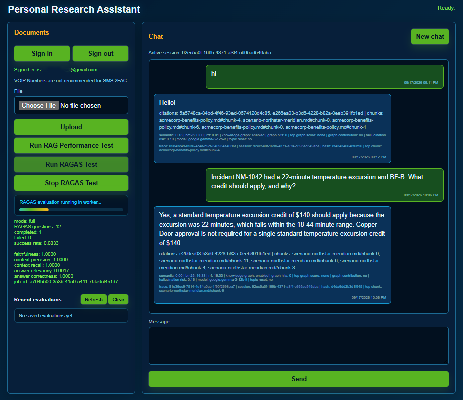
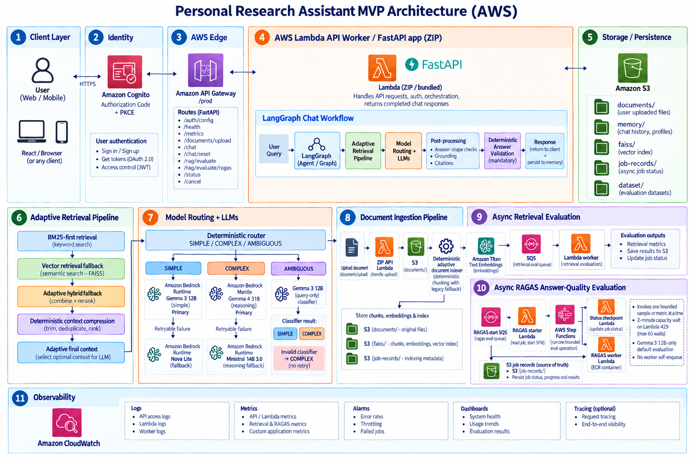
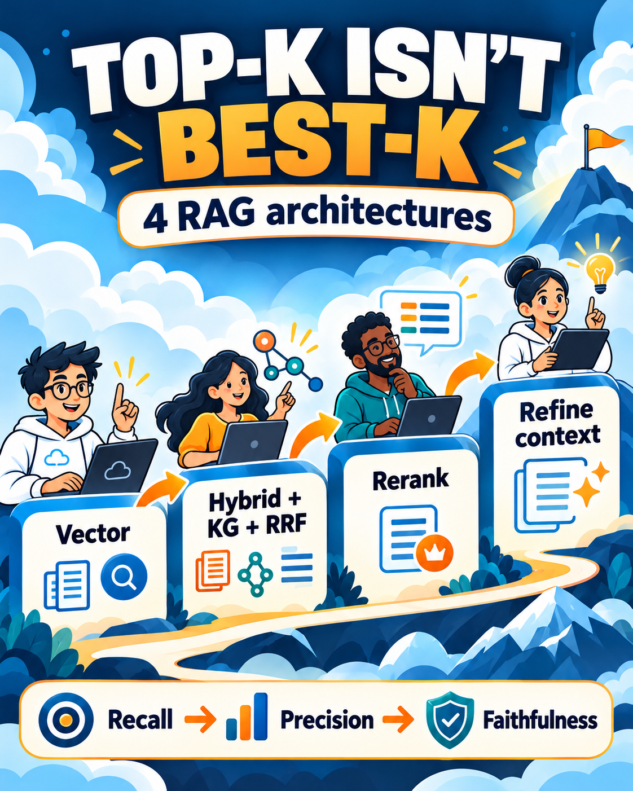
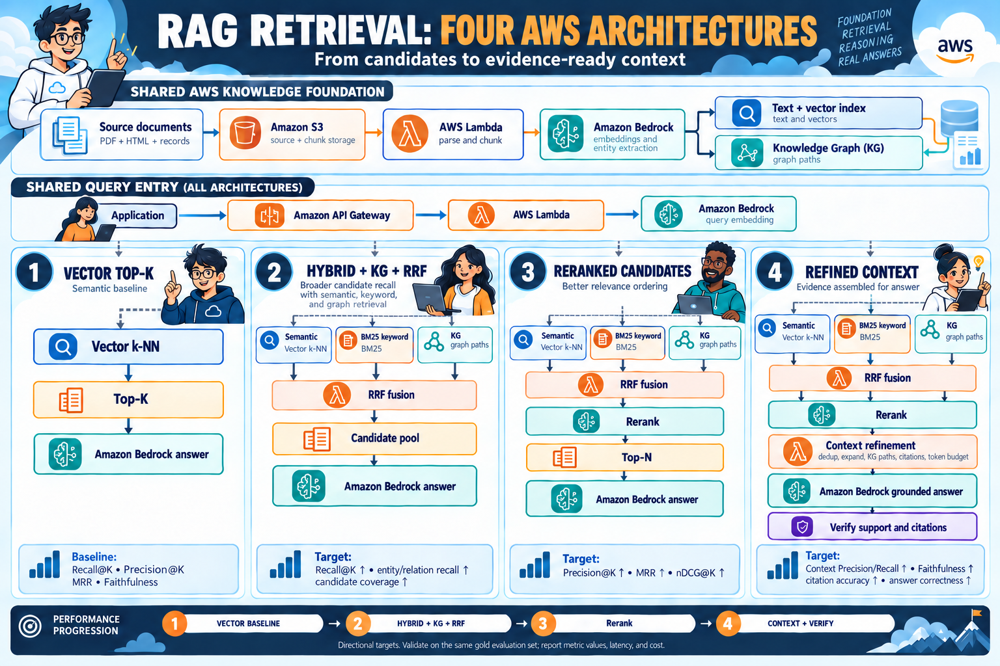
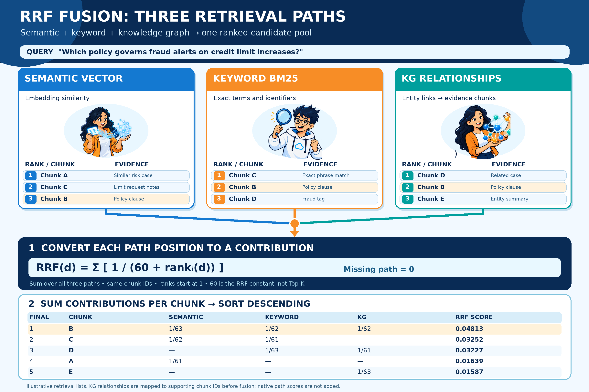

# Personal Research Assistant

> A local-first research assistant for uploading notes, indexing them locally, and chatting over the retrieved context through a FastAPI service and a simple browser UI.

This repository contains an intentionally lightweight local experience and an AWS deployment path built around API Gateway, Lambda, S3, Bedrock, and Cognito.

## Start Here

| Audience | Recommended path |
| --- | --- |
| Product reviewers and nontechnical readers | Start with [Project Overview](#project-overview), [Current State](#current-state), [MVP Architecture](#mvp-architecture), and [What Is Not Implemented Yet](#what-is-not-implemented-yet). |
| Developers | Continue to [Repository Layout](#repository-layout), [Local Setup](#local-setup), [Local Usage](#local-usage), and [Tests](#tests). |
| AI/RAG engineers | Review [Model Routing and Fallbacks](#model-routing-and-fallbacks), [How Retrieval Works Today](#how-retrieval-works-today), and the [Project Docs](#project-docs). |
| Cloud and platform engineers | See [AWS Deployment](#aws-deployment), [Firebase-Hosted Research Assistant Integration](#firebase-hosted-research-assistant-integration), and [Environment Variables](#environment-variables). |

## Contents

- [Project Overview](#project-overview)
- [Adaptive RAG](#adaptive-rag)
- [Model Routing and Fallbacks](#model-routing-and-fallbacks)
- [Current State](#current-state)
- [What Is Not Implemented Yet](#what-is-not-implemented-yet)
- [MVP Architecture](#mvp-architecture)
- [Repository Layout](#repository-layout)
- [Project Docs](#project-docs)
- [Main Interfaces](#main-interfaces)
- [Local Setup](#local-setup)
- [Local Usage](#local-usage)
- [How Retrieval Works Today](#how-retrieval-works-today)
- [Tests](#tests)
- [Docker](#docker)
- [AWS Deployment](#aws-deployment)
- [Firebase-Hosted Research Assistant Integration](#firebase-hosted-research-assistant-integration)
- [Environment Variables](#environment-variables)
- [Development Notes](#development-notes)

## Project Overview

The project has been built incrementally through the foundation, LangGraph workflow, AWS CDK deployment scaffold, observability, local retrieval pipeline, platform abstraction, persistence, Bedrock LLM provider, Cognito auth, Bedrock embedding, model-routing, deterministic chunking, MVP rate limiting, and conversational response refinement phases. It is still intentionally lightweight locally, while the `infra/` folder provides the current deployment path to API Gateway, Lambda, S3, Bedrock, and Cognito.

| Area | Current implementation |
| --- | --- |
| User experience | Browser-based document upload, authenticated chat, and evaluation controls. |
| Application | FastAPI with a LangGraph chat workflow. |
| Retrieval | BM25-first adaptive retrieval with vector fallback, weighted RRF, and configurable reranking. |
| Models | Deterministic routing across Bedrock-hosted simple and reasoning models with request-scoped fallbacks. |
| Storage | S3-backed documents, memory, evaluation records, and a persisted FAISS index in AWS. |
| Security | Cognito Hosted UI, authorization code with PKCE, JWT-protected API routes, and rate limiting. |
| Evaluation | Separate asynchronous retrieval-performance and RAGAS answer-quality workflows. |
| Observability | Structured logging, CloudWatch, metrics, trace IDs, and optional LangSmith tracing. |

## Adaptive RAG

The MVP includes feature-flagged adaptive chunking and retrieval. Application config
defaults remain legacy-compatible, while the deployed CDK stack enables
`PRA_ADAPTIVE_CHUNKING_ENABLED=true`, `PRA_ADAPTIVE_RETRIEVAL_ENABLED=true`, and
`PRA_TABLE_PROCESSING_ENABLED=true`. Disabled flags retain the original chunker and
`HybridRetriever` behavior. Artifacts are stored under the existing persistence prefix
at `adaptive/<document-id>/v1/`. See `docs/adaptive-rag-architecture.md` and
`docs/adaptive-rag-configuration.md`.

## Model Routing and Fallbacks

The deployed chat path uses deterministic routing plus request-scoped fallbacks so transient Bedrock issues are less likely to interrupt the chat experience.

```text
Primary simple-answer model:
  google.gemma-3-12b-it

Fallback simple-answer model:
  amazon.nova-lite-v1:0

Primary reasoning model:
  google.gemma-4-31b

Fallback reasoning model:
  mistral.ministral-3-14b-instruct
```

How it works:

- Gemma 3 12B handles simple chat, greetings, and strong high-RRF retrieval. Retryable timeout, throttling, or temporary service failures can fall back to Nova Lite for that request.
- Gemma 4 31B through Bedrock Mantle is the primary model for higher-value reasoning and weaker retrieval cases.
- Deterministic routing remains first: clear simple and complex queries make zero extra routing-model calls. Only an ambiguous query may use one small, query-only Gemma 3 fallback classifier; invalid classifier output routes upward to the complex path without retrying the classifier.
- If Gemma 4 fails with a retryable Mantle error after retry handling, the same request is retried against Ministral 14B 3.0.
- Both fallbacks are request-scoped. The next request always tries its configured primary model first again.
- Nonretryable access, validation, model-configuration, and credential errors fail fast instead of switching models.

## Current State

The application currently includes:

- FastAPI API with health, document upload, chat, metrics, and OpenAPI docs.
- API-served browser front end retained for local development and fallback access.
- Firebase-hosted Tractlytics Research Assistant page in `data/research-assistant/` for the current website integration path.
- LangGraph chat workflow.
- Local upload pipeline: parse, store, chunk, embed, and index.
- Deterministic Phase 13 chunking decision chain: whole-document, section-aware, paragraph-aware, sentence-aware, semantic, then fixed sliding-window fallback.
- Local vector retrieval during chat.
- Mock LLM provider for deterministic local behavior.
- Bedrock LLM provider with Gemma 3 12B for simple chat/retrieval, Nova Lite as its retryable fallback, Gemma 4 31B through Bedrock Mantle as the primary reasoner, and Ministral 14B 3.0 as the retryable reasoning fallback.
- Friction-reduction behavior for transient Bedrock issues: reasoning fallback happens inside the backend provider, and the browser silently retries one retryable chat failure before showing a visible error.
- Bedrock embedding provider using Amazon Titan embeddings in deployment.
- FAISS-backed vector storage in deployed AWS, with the index persisted in S3. OpenSearch Serverless is no longer deployed to avoid ongoing vector collection charges.
- Duplicate-upload protection using a stored SHA-256 `content_hash`, so repeat uploads reuse the existing document record and do not bloat the deployed FAISS index.
- pgvector vector-store backend as an alternate production target.
- Bedrock transient retry handling for throttling, timeout, and temporary service errors.
- MVP rate limiting for chat, uploads, and public auth configuration.
- More natural unsupported-topic and no-context responses, with less robotic repetition of the user’s wording.
- Configurable persistence for documents, chat memory, and local vector indexes.
- Cognito authentication with branded Hosted UI sign-in, authorization code + PKCE, refresh-token renewal, and JWT-protected API calls.
- Structured JSON logging, trace IDs, metrics, and centralized error handling.
- Retrieval similarity and hallucination-risk metadata returned by chat and shown in assistant bubbles.
- Retrieval-only RAG evaluation through an authenticated API route and browser button with async job polling.
- Separate async RAGAS answer-quality evaluation through a second browser button, using the uploaded-document corpus and Bedrock-configured evaluator models.
- Optional AWS-hosted LangSmith tracing, with the API key fetched by Lambda from an existing AWS Secrets Manager secret.
- Guardrail abstraction with local prompt checks.
- Tool registry, evaluation framework, graph store abstraction, AgentCore abstractions, and Neptune placeholder.
- AWS CDK project for API Gateway, Lambda, S3-backed document/memory persistence, FAISS index persistence, Bedrock invocation, IAM roles, and environment wiring.

## What Is Not Implemented Yet

These capabilities are deliberately not production implementations yet:

- Production AgentCore.
- Production Neptune.
- Production-grade relational metadata storage.

The deployed stack stores document and chat-memory JSON snapshots in S3 under the `pra-prod/` prefix, and stores the FAISS index plus vector metadata in S3. OpenSearch Serverless was removed from the deployed stack to stop its baseline collection charges. Local development can still use local hash embeddings and JSON vector persistence for deterministic tests.

## MVP Architecture

The maintained architecture source is `docs/mvp-architecture.mmd`. The PNG below is an AI-generated visual summary informed by that source, not a direct Mermaid render. The application uses the Firebase-hosted Tractlytics page, retained Cognito pool, Lambda/API Gateway, BM25-first adaptive retrieval, Bedrock model routing, FAISS + S3 persistence, and separate asynchronous retrieval-performance and RAGAS evaluation paths. The API-served FastAPI UI also supports local development.

The architecture now explicitly shows the API process plus two separate asynchronous evaluation paths:

- the API Worker Lambda, which serves upload, chat, auth config, and polling requests
- the Async Retrieval Evaluation Lambda, which runs retrieval-only evaluation jobs from SQS
- the RAGAS start queue and starter Lambda, which begin a Step Functions execution
- the Step Functions state machine, which invokes one bounded ECR-backed RAGAS worker step at a time and checkpoints progress to S3
- the lightweight RAGAS status-checkpoint Lambda, which records orchestration and capacity-wait state without making model calls

The chat workflow Lambda currently sends LangSmith state and step metadata. Both evaluation workers use no-op tracing for their evaluation paths; RAGAS does not report to LangSmith.

The image below shows the Cognito-authenticated browser chat window, including the sign-in controls, document workspace, chat area, and evaluation controls.





The image uses service icons and numbered sections. Its model routes are Gemma 3 12B with Nova Lite fallback for simple answers, and Gemma 4 31B through Bedrock Mantle with Ministral 14B fallback for reasoning. Ambiguous questions can use a query-only Gemma 3 classifier. Fallbacks follow exhausted retryable provider failures.

The PNG is a compact visual summary. The Mermaid source remains the detailed source of truth for route names, feature flags, fallback behavior, and evaluation-state transitions.

### RAG Retrieval Visuals

These supporting visuals are stored in `docs/` and are presented in the requested order. They explain why retrieval quality depends on candidate selection, fusion, reranking, context refinement, and evidence verification rather than on a single top-K result.



The first visual compares four retrieval architectures, progressing from a vector baseline through hybrid and knowledge-graph retrieval, reranking, and refined context selection.



The second visual maps the shared AWS knowledge foundation and query path to four architecture stages, including the target metrics for recall, precision, reranking, context quality, faithfulness, and citation accuracy.



The third visual explains how semantic, BM25 keyword, and knowledge-graph paths contribute ranked candidates that are combined into one reciprocal-rank-fusion result.

## Repository Layout

<details>
<summary><strong>Expand the repository tree</strong></summary>


```text
personal-research-assistant/
  apps/
    api/
      src/pra_api/
        routes/              FastAPI route modules
        static/              Browser UI CSS and JavaScript
        templates/           Browser UI HTML
        error_handlers.py    API error response handling
        lambda_handler.py    Mangum handler for API Gateway/Lambda
        main.py              FastAPI app assembly
        middleware.py        Trace and request middleware
        rag_worker.py        SQS worker entry point for async RAG evaluation jobs
  platform/
    core/
      src/pra_core/
        agent/               LangGraph workflow
        agentcore/           AgentCore-compatible abstractions
        auth/                Authentication interfaces and Cognito JWT auth
        documents/           Parsing, chunking, repositories, services
        embeddings/          Local and Bedrock embedding providers
        evaluation/          Evaluation abstractions
        graphstores/         GraphStore and Neptune placeholder
        guardrails/          Guardrail interfaces and local checks
        grounding/           Hallucination-risk scoring
        llm/                 Mock and Bedrock LLM providers
        memory/              Local memory service
        persistence/         JSON object-store persistence backends
        retrieval/           Retrieval abstraction
        routing/             Model routing abstraction
        tools/               ToolRegistry
        tracing/             Trace abstractions
        vectorstores/        Local, FAISS, JSON, OpenSearch, and pgvector stores
        config.py            Settings and environment variables
        logging.py           Structured logging setup
        metrics.py           Runtime metrics
  infra/
    app.py                   CDK app entry point
    pra_infra/stack.py       CDK stack
    requirements.txt         CDK Python dependencies
  data/
    research-assistant/
      index.html            Firebase-hosted Tractlytics page shell for the MVP
      app.js                Firebase-hosted Tractlytics page logic for auth, chat, upload, and RAG evaluation
  docs/
    architecture-overview.md Phase architecture notes and diagrams
    guardrails.md            Current guardrail behavior notes
    github-oidc.md           GitHub OIDC deployment notes
  tests/                     Pytest suite
```

</details>

## Project Docs

| Document | Purpose |
| --- | --- |
| [Architecture Overview](docs/architecture-overview.md) | Phase architecture notes and diagrams. |
| [MVP Architecture Diagram](docs/mvp-architecture.png) | Current AWS implementation overview, including adaptive indexing, model routing, deterministic answer validation, and Step Functions-orchestrated RAGAS evaluation. |
| [MVP Architecture Source](docs/mvp-architecture.mmd) | Mermaid source for the current MVP architecture diagram. |
| [RAGAS AWS Execution Diagram](docs/ragas-aws-execution.png) | Focused view of the ZIP-based API and starter Lambdas, start queue, Step Functions, status checkpoint Lambda, ECR-backed worker, Bedrock, S3, and CloudWatch. |
| [Chunking Strategy](docs/chunking%20strategy.md) | Plain-language guide to the implemented chunking chain and best-fit document types. |
| [Chunking Decision Chain](docs/chunking-decision-chain.mmd) | Mermaid flow chart for the deterministic chunking strategy. |
| [Model Routing Flow](docs/model-routing-flow.mmd) | Mermaid flow chart for the Phase 12 deterministic model router. |
| [Grounding Scorer Flow](docs/grounding-scorer-flow.mmd) | Mermaid flow chart for the Phase 12 hallucination-risk scorer. |
| [RAG Master Guide](docs/rag-master.md) | Combined guide for the RAG pipeline, retrieval-only evaluation, diagnostics, and the current tuned retrieval defaults. |
| [RAGAS Step Functions Recovery Design](docs/ragas-step-functions-recovery.md) | Historical recursive-loop failure and the implemented Step Functions orchestration with one bounded worker step at a time. |
| [Env Notes](docs/env-notes.md) | Clarifies that `.env.example` is a local template and AWS runtime configuration comes from CDK and managed services. |
| [Chat History](docs/chat-history.md) | Current MVP chat persistence behavior and recommended evolution path. |
| [Cost Dashboard](docs/cost-dashboard.md) | CloudWatch dashboard and alarm guidance for cost and operations visibility. |
| [LangSmith Dashboard](docs/langsmith-dashboard.md) | LangSmith usage, AWS implementation, benefits, and operational observability guidance for the MVP. |
| [LangSmith In AWS](docs/langsmith-aws.md) | Existing-secret and CDK setup for sending MVP workflow metadata to LangSmith from Lambda. |
| [UI Front-end Handoff](docs/UI%20Front-end%20Handoff.md) | Safe front-end-only files and styling guidance for recreating the MVP as a webpage in another site. |
| [Rate Limiting](docs/rate-limiting.md) | Detailed explanation of the current MVP rate-limiting design and limitations. |
| [Web Access Guardrails](docs/web-access-guardrails.md) | Design guidance for adding web retrieval without losing product focus, while limiting confusion, latency, and token costs. |
| [Cost Considerations](docs/cost%20considerations.md) | Cost, latency, usage, quota, scaling, and risk analysis for the current MVP. |
| [Model Cost and Usage](docs/model-cost-and-usage.md) | Active model routes, request-scoped fallbacks, RAGAS isolation, pricing caveats, and candidate comparisons. |
| [Retrieval Weight Evaluation](docs/retrieval-weight-evaluation-guide.md) | Controlled process and recorded results for evaluating BM25/vector fusion weights. |
| [Enterprise Considerations](docs/enterprise%20considerations.md) | Roadmap from the current MVP to a production enterprise architecture. |
| [Guardrails](docs/guardrails.md) | Current guardrail behavior and limitations. |
| [GitHub OIDC](docs/github-oidc.md) | GitHub Actions deployment identity and AWS OIDC setup. |
| [CDK Recursive Cleanup Chat](docs/cdk-recursive-cleanup-chat.md) | Windows cleanup guidance and guardrails for recursive generated `cdk.out` directories. |
| [Vector Stores](docs/vector%20stores.md) | Current vector-store choice and comparison with FAISS, OpenSearch Serverless, and pgvector. |
| [Northstar Meridian Scenario](docs/test-corpus/scenario-northstar-meridian.md) | Fictional private source document for upload and retrieval testing. |
| [Retrieval Stress Test Q/A](docs/test-corpus/retrieval-stress-test-qa.md) | Evaluation questions designed to expose smart-retrieval limitations. |

## Main Interfaces

| Interface | Purpose |
| --- | --- |
| `GET /` | Browser chat and upload UI. |
| `GET /auth/config` | Public browser auth configuration for Cognito Hosted UI. |
| `GET /health` | Runtime health check. |
| `GET /docs` | FastAPI Swagger UI. |
| `POST /documents/upload` | Upload a local text or markdown document. |
| `POST /chat` | Send a chat message and receive a mock-LLM response using retrieved context. |
| `POST /chat/reset` | Clear stored conversation memory for a session when starting a true new chat. |
| `POST /rag/evaluate` | Enqueue a retrieval-only RAG performance test job against the configured evaluation dataset. |
| `GET /rag/evaluate/{job_id}` | Poll the status and results for an async RAG evaluation job. |
| `POST /rag/evaluate/ragas` | Enqueue a separate RAGAS answer-quality evaluation job. |
| `GET /rag/evaluate/ragas/{job_id}` | Poll the status and results for an async RAGAS evaluation job. |
| `GET /metrics` | Current local runtime metrics. |
| `GET /static/app.css` | Front-end stylesheet served by FastAPI. |
| `GET /static/app.js` | Front-end script served by FastAPI. |

## Local Setup

Install Python dependencies from the repository root:

```cmd
python -m pip install --upgrade pip
python -m pip install ".[dev]"
```

Set the source roots for the current Command Prompt session:

```cmd
set PYTHONPATH=apps/api/src;platform/core/src
```

Start the API:

```cmd
uvicorn pra_api.main:app --reload
```

Open the local UI:

```text
http://localhost:8000/
```

Open the local API docs:

```text
http://localhost:8000/docs
```

## Local Usage

Upload and chat endpoints require a Cognito bearer token. For deployed browser use, sign in through the web page first. For command-line testing, pass a Cognito JWT:

For SMS MFA, avoid VoIP numbers when possible. The browser UI displays the same guidance because VoIP numbers are less reliable for receiving authentication codes.

The browser sign-in flow uses Cognito Hosted UI authorization code with PKCE. ID and access tokens are configured for 1 hour, and refresh tokens are configured for 30 days. Before upload or chat, the browser refreshes an expiring ID token when possible. Long-running RAGAS polling revalidates the session before every status request, so a valid refresh token can renew the ID token while the worker runs. If the session cannot be refreshed or the API rejects the token, the UI clears local tokens and shows `Please Sign in Again. MM/DD/YYYY HH:MM AM/PM`.

```cmd
curl -X POST http://localhost:8000/documents/upload -H "Authorization: Bearer <cognito-jwt>" -F "file=@notes.md;type=text/markdown"
```

Ask a question:

```cmd
curl -X POST http://localhost:8000/chat -H "Content-Type: application/json" -H "Authorization: Bearer <cognito-jwt>" -d "{\"message\":\"What do my notes say?\",\"session_id\":\"local-demo\"}"
```

Check health:

```cmd
curl http://localhost:8000/health
```

Check metrics:

```cmd
curl http://localhost:8000/metrics
```

Run retrieval-only RAG evaluation:

```cmd
curl -X POST http://localhost:8000/rag/evaluate -H "Content-Type: application/json" -H "Authorization: Bearer <cognito-jwt>" -d "{\"dataset\":\"default\",\"top_k\":25,\"eval_k\":[5,10,25]}"
```

The `POST /rag/evaluate` call now returns a job record immediately. Poll `GET /rag/evaluate/{job_id}` with the same Cognito token until `status` becomes `completed` or `failed`.

## How Retrieval Works Today

This section begins with the two core request pipelines. The expandable reference sections that follow preserve the implementation details for engineering, operations, and evaluation work.

### Pipeline Summary

Document upload currently follows this pipeline:

```text
Upload -> Parse -> Store -> Chunk -> Embed -> Index
```

Chat currently follows this pipeline:

```text
Request -> Cognito JWT auth -> Guardrails -> Retrieve chunks -> LangGraph workflow -> Model routing -> LLM provider -> Grounding score -> Response
```

### Retrieval and Model-Routing Strategy

Retrieval in the MVP is adaptive and BM25-first. The user query starts with BM25 lexical search; embedding-based vector search and weighted Reciprocal Rank Fusion remain available as a low-confidence fallback. BM25 retrieves 50 candidates, vector search retrieves 50 candidates when needed, and a BM25-preservation rule keeps strong lexical hits from being pushed down by weaker fusion. Deterministic reranking remains available, but the tuned default keeps `PRA_ENABLE_RERANKING=false` because it did not improve this evaluation set. `PRA_ENABLE_RECIPROCAL_RANK_FUSION` is active only when both `PRA_ENABLE_BM25_LEXICAL=true` and `PRA_ENABLE_VECTOR_SEARCH=true`. Final context adapts to the query: 5 chunks for simple lookups, 8 for policy/rule questions, and up to 15 for complex or low-confidence questions. The browser and API default to `top_k=25`, so each chat request can cap returned retrieval candidates unless the caller overrides the value.

Model routing now uses a hybrid heuristic. The primary gate is the top fused RRF score. If the best retrieved chunk has an RRF score of at least `0.03`, the router treats retrieval support as strong enough for the lower-cost simple model unless the prompt itself looks like high-value reasoning. If the top RRF score is only borderline, at least `0.02`, the router runs a secondary semantic check and then a support-count tie-breaker. Strong semantic support can keep the request on the simple model, and so can multiple retrieved documents above the minimum supporting RRF threshold. The router also treats conditional and exception-style questions containing phrases such as `always`, `except`, `unless`, `only if`, or `does this still apply` as reasoning-model candidates. Before generation, the workflow now also applies a topic-shift check. If the current prompt clearly introduces a different entity than the recent conversation, the app drops prior history for that turn so retrieval and prompt assembly stay focused on the current question.

The retrieval pipeline is configured with these settings:

```text
PRA_BM25_TOP_K        -> how many lexical BM25 candidates to retrieve before fusion
PRA_VECTOR_TOP_K      -> how many semantic vector candidates to retrieve before fusion
PRA_RRF_K             -> the Reciprocal Rank Fusion smoothing constant
PRA_ENABLE_BM25_LEXICAL -> true/false switch for BM25 lexical retrieval
PRA_ENABLE_VECTOR_SEARCH -> true/false switch for semantic vector retrieval
PRA_ENABLE_RECIPROCAL_RANK_FUSION -> true only when BM25 and vector retrieval are both enabled
PRA_ENABLE_RERANKING  -> true/false switch for deterministic post-fusion reranking
PRA_RERANK_TOP_K      -> how many merged candidates to keep after reranking
PRA_LLM_CONTEXT_TOP_K -> how many final reranked chunks are passed into the LLM prompt
```

These retrieval defaults are the live config defaults in `platform/core/src/pra_core/config.py` and are shared by both local development and deployed AWS runs unless overridden by environment variables or CDK. The embedding size setting is different: `embedding_dimensions = 64` is the local hash-embedding default for deterministic testing, while AWS Bedrock embedding runs use `bedrock_embedding_dimensions = 1024`.

### Evaluation Behavior

<details>
<summary><strong>Expand retrieval evaluation and RAGAS details</strong></summary>


RAG evaluation ground truth now uses normalized `source_files` plus `expected_sections`. The checked-in `v2` dataset contains 22 questions over `acmecorp-benefits-policy.md` and `scenario-northstar-meridian.md`, and every item includes materialized `relevant_chunk_ids` for regression checks. Duplicate upload suffixes such as `(1)` or `(3)` are stripped before parsing, indexing, retrieval diagnostics, and section resolution so `guardrails(1).md` and `guardrails.md` resolve to the same stable filename. Chunk IDs are derived from the isolated evaluation corpus at evaluation time and should not be treated as durable labels.

The checked-in evaluation dataset is a stand-alone file, but it is not stand-alone in meaning. It can live locally or in S3 as its own artifact, yet its labels still resolve against the evaluation source corpus in `docs/`. In practice that means user uploads do not affect the evaluation set, but doc merges, renames, or deletions inside `docs/` can require the dataset to be rebuilt.

The MVP also includes a retrieval-only RAG evaluation path. The browser UI exposes it through `Run RAG Performance Test`, and the backend exposes it through `POST /rag/evaluate`. That request now enqueues an async job and returns immediately; the browser polls `GET /rag/evaluate/{job_id}` until the run completes. The job still calls the retriever directly for each evaluation question and computes retrieval metrics without invoking LangGraph generation or any Bedrock chat model. In deployed AWS, the temporary isolated evaluation corpus now uses the deterministic local hash embedder rather than live Bedrock embeddings so the test job does not fail on Bedrock embedding throttling. This evaluation path is intended as an admin diagnostic tool and should normally be used only after major changes to the RAG pipeline, not during ordinary end-user chat usage.

The separate **Run RAGAS Test** button defaults to full metric mode with 12 questions and `top_k=15`. Full mode evaluates faithfulness, context precision, context recall, answer relevancy, and answer correctness, plus citation correctness when citation data is available. It retrieves and generates an answer once per question, persists that sample, then uses one sequential metric per Step Functions worker invocation. A successful 12-question full run therefore uses 12 retrievals, 12 answer generations, and 60 native metric evaluations before bounded metric-only recovery attempts. API clients can explicitly request as many as 50 questions and `top_k=25`; `mode: "standard"` remains the lower-cost three-native-metric profile.

Each RAGAS metric evaluation has a 120-second timeout (`PRA_RAGAS_METRIC_TIMEOUT_SECONDS`). A slow judge call is recorded as a failed question instead of allowing the Lambda invocation to remain silent until the worker timeout. The coordinator also writes a heartbeat before each question begins, so job status reflects active work.

</details>

### Upload, Indexing, and Chunking

<details>
<summary><strong>Expand upload, deduplication, indexing, and chunking details</strong></summary>


Uploaded documents are not read from a folder automatically. They enter the system through `POST /documents/upload` or the browser upload control. The API stores the parsed document first and then attempts chunking, embedding, and vector indexing. If Bedrock embeddings or vector indexing are temporarily unavailable, the upload response returns `indexed: false` instead of failing the stored document with a generic server error.

Uploads also have a hard application-level size cap. Files that exceed `PRA_MAX_UPLOAD_BYTES` are rejected with a clean `413 Payload Too Large` before parsing or indexing begins, so the app does not rely only on infrastructure limits.

Before a new parsed document is stored, the upload route computes a SHA-256 `content_hash` from the parsed text and checks for an existing stored document with the same hash. Exact duplicate uploads reuse the original `document_id` so the FAISS index does not grow with repeated copies of the same content. If the original document was stored but never successfully indexed, a repeat upload now retries indexing instead of staying permanently deduplicated-but-unindexed.

Chunking is now deterministic and non-LLM-based. The decision chain is:

```text
1. Whole document for very small files
2. Section-aware chunks when headings fit the chunk budget
3. Paragraph-aware fallback
4. Sentence-aware fallback
5. Deterministic semantic grouping with fixed local-hash embeddings and a fixed similarity threshold
6. Fixed-size sliding window with overlap as the final fallback
```

Each chunk now carries metadata such as the chosen strategy, word count, and strategy-specific fields like `heading`, `paragraph_index`, `sentence_count`, or sliding-window offsets before embedding and indexing.

The deployed stack enables adaptive chunking, but the selection remains deterministic and does not call an LLM. It analyzes document structure, tables, sections, sentences, references, and domain signals; chooses `table_aware`, `hierarchical_structure`, `semantic_boundary`, or `fixed_size`; persists versioned parent, child, table, and relationship artifacts; and indexes the child chunks. If adaptive analysis or artifact persistence fails, the upload path falls back to the legacy deterministic `TextChunker`.

</details>

### Persistence, Vector Storage, and Providers

<details>
<summary><strong>Expand persistence, vector-store, embedding, and model-provider details</strong></summary>


Document and memory persistence are controlled by `PRA_PERSISTENCE_BACKEND`:

```text
memory -> process-local storage for tests and quick experiments
file   -> JSON files under PRA_PERSISTENCE_DATA_DIR for local durable runs
s3     -> JSON objects under PRA_PERSISTENCE_S3_PREFIX in PRA_DOCUMENT_BUCKET_NAME
```

Vector storage is controlled by `PRA_VECTOR_STORE_BACKEND`:

```text
local      -> process-local in-memory vectors for tests and quick experiments
persistent -> JSON vector snapshots through the selected object store
faiss      -> FAISS-style in-memory vectors persisted through the selected object store
opensearch -> OpenSearch Serverless vector index adapter, not currently deployed by CDK
pgvector   -> Postgres pgvector table for production deployments that choose Postgres
```

For OpenSearch Serverless, the service generates internal vector document IDs and does not support forcing `refresh=true` during writes. The app stores its stable `chunk_id` inside each indexed document and uses that field when search results are returned. This adapter remains in code, but the current CDK stack does not deploy OpenSearch.

Embedding selection is controlled by `PRA_EMBEDDING_PROVIDER`:

```text
local   -> deterministic local hash embeddings for local tests and development
bedrock -> Bedrock Runtime embeddings using PRA_BEDROCK_EMBEDDING_MODEL_ID
```

The deployed Lambda uses S3 for documents and memory, plus a FAISS index persisted in S3 for vectors. Local development can use the file backend plus `PRA_VECTOR_STORE_BACKEND=persistent` by copying `.env.example` to `.env`.

Vector indexes are provider-specific. During upload indexing, the app now runs a provider-compatibility check first. When the configured embedding provider changes, the app clears the incompatible vector index and re-indexes stored documents with the new provider.

LLM selection is controlled by `PRA_LLM_PROVIDER`:

```text
mock    -> deterministic local/test responses
bedrock -> Amazon Bedrock providers using the explicit simple/reasoning model settings
```

The deployed Lambda uses deterministic model routing first. Simple chat, greetings, strong high-RRF retrieval, borderline-RRF retrieval with strong semantic support, and borderline-RRF retrieval with multiple supporting documents use `google.gemma-3-12b-it`, with `amazon.nova-lite-v1:0` as a request-scoped fallback after exhausted retryable failures. High-value reasoning, conditional or exception-style questions, weaker hybrid retrieval support, multi-chunk reconciliation cases, and no-retrieval research questions try `google.gemma-4-31b` through Bedrock Mantle first, then fall back to `mistral.ministral-3-14b-instruct` only if the primary returns a retryable error after retry handling. Only ambiguous deterministic decisions invoke one small, query-only Gemma 3 fallback classifier; malformed classifier output routes to the complex path without another classifier call. The next request always tries the selected route's primary model again. Local development stays on `mock` unless explicitly configured otherwise.

The Bedrock system prompt defaults to short answers, usually 1-3 sentences, and avoids introductions, question restatements, and unnecessary bullets. This reduces output tokens, lowers model cost, and helps improve chat latency.

The response style is also tuned to sound more natural when the retrieved material is not helpful. The assistant should avoid stiff phrases that simply restate the user's topic back to them, over-explain what unrelated material was retrieved, or sound overly specific about corpus mismatches. When support is weak, it should respond in a more general and graceful way.

</details>

### Observability, Reliability, and Runtime Diagnostics

<details>
<summary><strong>Expand tracing, retries, rate limits, grounding, and diagnostics details</strong></summary>


In deployed AWS, optional LangSmith tracing uses `LANGSMITH_PROJECT` as the Lambda environment variable. The project name is assigned by this repo and currently defaults to `personal-research-assistant`. The `LANGSMITH_API_KEY` and `LANGSMITH_ENDPOINT` values live inside the existing AWS Secrets Manager secret named `LANGSMITH_API_KEY`. Lambda reads that secret at runtime, and the tracer sends metadata-first workflow spans to LangSmith when the secret lookup succeeds.

The model-cost snapshot used by the workflow is stored in `platform/core/src/pra_core/data/bedrock_pricing.json`. It is versioned in the repo so each deploy can ship a fresh pricing table alongside the code that uses it. When the snapshot is refreshed before deploy, the workflow can emit estimated `Input Tokens`, `Output Tokens`, `Cost per call`, and `Total Cost` values into LangSmith without doing a live pricing lookup on every request.

For observability planning, LangSmith is the right place for workflow latency, `LLM Count` over time via deterministic `llm_count` / `llm_call_count`, estimated token usage, estimated model cost trends, and process-level runtime telemetry emitted by the active Lambda container. The app also exposes a warm-container `llm_call_count` through `GET /metrics` so you can compare the current Lambda process against the per-request trace count. CloudWatch remains the source of truth for fleet-wide uptime, throttles, memory pressure, and other infrastructure metrics across the deployed service.

The Bedrock provider retries transient runtime failures such as throttling, timeouts, internal server errors, and temporary service unavailability with short exponential backoff and jitter. It does not retry access denied, validation, missing model, or credential errors because those require configuration changes.

For the simple path, exhausted retryable failures on `google.gemma-3-12b-it` can trigger a request-scoped Bedrock Runtime fallback to `amazon.nova-lite-v1:0`. For the reasoning path, exhausted retryable failures on `google.gemma-4-31b` can trigger a request-scoped Bedrock Runtime fallback to `mistral.ministral-3-14b-instruct`. The Mantle provider requests a short-lived bearer token using the Lambda IAM role and does not persist or log it. A successful fallback answer is returned as a normal chat response, and neither fallback permanently changes its configured primary model.

The browser UI treats `429`, `500`, `502`, `503`, and `504` chat responses as retryable transient failures. It silently retries one retryable chat request before showing anything to the user. If the retry still fails, the UI shows `The model is temporarily unavailable. Please try again.` and keeps a `Try again` button available for the same prompt.

If chat returns `LLM provider is unavailable. Check Bedrock model access and configuration.`, confirm that the AWS account and region have access enabled for the configured Bedrock inference profile ID and that the Lambda role can invoke Bedrock inference profiles.

The current MVP applies fixed-window rate limits in app code:

```text
/chat               -> per authenticated Cognito subject
/documents/upload   -> per authenticated Cognito subject
/auth/config        -> per client IP or X-Forwarded-For
```

When a limit is exceeded, the API returns `429 Too Many Requests` with a `Retry-After` header. The current limiter is process-local by design; see the dedicated rate-limiting document for the detailed behavior and the future distributed design path.

Assistant chat bubbles show retrieval and grounding metadata above the timestamp:

```text
semantic: 0.91 · bm25: 2.14 · rrf: 0.03 · hallucination risk: 0.16 · model: google.gemma-3-12b-it
```

Similarity scores are provider-specific retrieval signals. In the current hybrid retriever, the `semantic` value shown in the chat bubble is the best cosine similarity score for the supporting retrieved chunk for that document, so it should stay within `-1.0` to `1.0`. BM25 is an unbounded lexical ranking score, and the merged RRF score is the fused ranking signal used by both the model router and the grounding scorer. The hallucination score is a grounding-risk signal, not a guarantee of truth.

The browser UI now includes a true `New chat` action. It rotates to a brand-new `session_id`, clears the visible conversation, calls `POST /chat/reset` to clear stored memory for the prior session when signed in, and shows the active session ID in the interface for debugging. Assistant metadata also surfaces retrieved chunk labels so you can quickly confirm which source chunks were used.

To reduce wrong-topic answers after refreshes or sharp conversation pivots, the workflow now applies a topic-shift check before retrieval and generation. If the current prompt clearly introduces a different named entity than the recent conversation, the app drops prior history for that turn, marks the run with `topic_reset_applied`, and retrieves against the current question instead of letting prior topical momentum dominate. The chat route also logs `trace_id`, `session_id`, and a privacy-safe `message_hash` so request and response correlation can be debugged without storing full prompt text in logs.

For retrieval debugging, the chat response now also returns `retrieved_chunk_labels` and `top_chunk_label`, and the browser renders those along with `trace_id`, `session_id`, and `message_hash` inside assistant-bubble debug metadata. The front end also blocks duplicate in-flight submissions for the same session and message text, and keeps one stable `trace_id` across retry attempts for the same chat turn.

The browser diagnostics footer is controlled by `PRA_RETRIEVAL_DIAGNOSTICS_ENABLED`,
which defaults to `true`. When disabled, the UI hides citations/chunks,
retrieval scores, model, trace, session, and related diagnostic metadata. This
flag controls presentation only: the authenticated chat API keeps its existing
response schema and may still return those fields, and server-side diagnostic
logging remains active. It is therefore not a payload-redaction or security
boundary.

The workflow takes threshold-based action on high grounding risk. Moderate risk can expose low-confidence metadata or escalate from Gemma to the configured reasoning model; very high risk returns a safe fallback instead of a confident unsupported answer.

</details>

## Tests

Run the full test suite from the repository root:

```cmd
python -m pytest
```

## Docker

Build the local image:

```cmd
docker build -t personal-research-assistant:latest .
```

Run the container:

```cmd
docker run --rm -p 8000:8000 --env-file .env.example personal-research-assistant:latest
```

Then open:

```text
http://localhost:8000/
```

Docker is used in two ways:

1. **Local development and CI**
   - [`Dockerfile`](Dockerfile) builds a Python 3.12 image containing the FastAPI application.
   - It runs the API locally on port `8000`.
   - GitHub Actions builds this image to verify it packages correctly.

2. **RAGAS evaluation worker**
   - [`Dockerfile.ragas-worker`](Dockerfile.ragas-worker) builds a Lambda-compatible container.
   - It includes the heavier RAGAS and evaluation dependencies.
   - CDK publishes this image to ECR and runs it as the asynchronous RAGAS Lambda worker.
   - The worker is configured for a 14-minute timeout, 1,024 MB memory, and reserved concurrency of 1.

The normal API Lambda uses a ZIP deployment, with Docker used during CDK's Python dependency bundling. The separate RAGAS Lambda runs the image built from `Dockerfile.ragas-worker` and published to ECR. Inside that container, shared RAG workflow code runs directly; it does not call the API Lambda to generate evaluation answers. SQS dispatches only the initial job to the starter Lambda. Step Functions owns all later bounded worker invocations, while S3 stores job progress for the browser to poll through the API.

The local container serves the browser page, upload, chat, auth configuration, health, metrics, and evaluation routes at `http://localhost:8000/`. In `-p 8000:8000`, the first port belongs to the host and the second to the container. Provider and persistence settings determine whether it uses mock/local resources or AWS services; running locally does not by itself make model calls free.

## AWS Deployment

The CDK app lives in `infra/` and currently deploys API Gateway, Lambda, Cognito, Cognito Hosted UI branding, IAM roles, Bedrock invocation permissions, environment variables, and an S3 bucket for document, memory, and vector persistence. It does not deploy OpenSearch Serverless.

Install CDK dependencies:

```cmd
cd infra
python -m pip install -r requirements.txt
```

For the first CDK project in an AWS account and region, bootstrap once:

```cmd
cdk.cmd bootstrap --profile admin-programatic
```

Synthesize:

```cmd
cdk.cmd synth --profile admin-programatic
```

Deploy:

```cmd
cdk.cmd deploy --profile admin-programatic --force
```

The current deployed API base URL is:

```text
https://svr1n7ghpk.execute-api.us-east-1.amazonaws.com/prod/
```

The Lambda deployment sets `PRA_API_ROOT_PATH=/prod` so FastAPI and API Gateway agree on the stage prefix. The API also normalizes static asset requests for both common API Gateway shapes: stage-prefixed paths such as `/prod/static/app.css`, and Lambda events where the stage has already been stripped to `/static/app.css` while `root_path` remains `/prod`. After front-end changes, run `cdk deploy` again so the updated static files are bundled into the Lambda asset.

Cognito Hosted UI styling and OAuth flow configuration are managed in CDK. Changes to the login page colors, button styling, callback URLs, token lifetimes, or PKCE authorization-code flow require another `cdk deploy`.

## Firebase-Hosted Research Assistant Integration

The repo also includes a Tractlytics-hosted front-end copy of the assistant in:

- [data/research-assistant/index.html](data/research-assistant/index.html)
- [data/research-assistant/app.js](data/research-assistant/app.js)

Those files are now the main production website integration path for the assistant. They are meant for a Firebase-hosted or other external site integration that calls the deployed AWS API directly instead of being served by FastAPI. The Firebase page now depends on the API allowing these exact browser origins:

- `http://localhost:5000`
- `http://127.0.0.1:5000`
- `https://<your-domain.com>`
- `https://www.<your-domain.com>`
- `https://tractlyticswebsite.web.app`
- `https://tractlyticswebsite.firebaseapp.com`

Because the external page signs in through Cognito Hosted UI and returns to its own page URL, the Cognito app client must also allow these callback and logout URLs:

- `http://localhost:5000/research-assistant/`
- `http://127.0.0.1:5000/research-assistant/`
- `https://<your-domain.com>/research-assistant/`
- `https://www.<your-domain.com>/research-assistant/`
- `https://tractlyticswebsite.web.app/research-assistant/`
- `https://tractlyticswebsite.firebaseapp.com/research-assistant/`

The existing API-served assistant URLs still remain valid too:

- `http://localhost:8000/`
- `https://svr1n7ghpk.execute-api.us-east-1.amazonaws.com/prod/`

In practice, the hosted split is now:

```text
Firebase Hosting:
  serves the Tractlytics research assistant page
  runs the browser-side Cognito PKCE flow
  calls the AWS API over CORS

AWS:
  validates Cognito tokens
  handles upload, chat, retrieval, Bedrock, persistence, and async RAG evaluation
```

The deployed RAG evaluation path expects the rebuilt `v2` dataset in the S3 testing prefix. After a deploy that changes `PRA_RAG_EVAL_DATASET_PATH`, upload the checked-in dataset before using the `Run RAG Performance Test` button:

```cmd
scripts\upload_rag_eval_dataset.cmd data\rag_eval_dataset_v2.json <document-bucket-name>
```

For the current stack, the target object is:

```text
s3://<document-bucket-name>/pra-prod/testing/rag-eval/rag_eval_dataset_v2.json
```

The `v2` dataset keeps `source_files` and `expected_sections` as the durable labels. The evaluator resolves current chunk IDs such as `architecture-overview.md#chunk-72` from the isolated evaluation corpus at runtime, so reindexing or changing chunk settings does not require manually relabeling hardcoded chunk numbers. If a source file or expected section cannot be found, the RAG evaluation result reports a ground-truth warning.

GitHub Actions can also deploy the CDK stack through OIDC without storing AWS access keys. For public-repository safety, production deployment is manual only: it must be started from `main` with explicit confirmation and approved through the protected `production` GitHub environment. Pull requests, forks, and ordinary pushes do not receive production deployment credentials. See `docs/github-oidc.md` for the AWS role setup and non-secret deployment identifiers.

## Environment Variables

Copy `.env.example` to `.env` for local overrides.

<details>
<summary><strong>Expand the complete environment-variable reference</strong></summary>

The tables below separate application, authentication, storage, observability, model, retrieval, guardrail, and rate-limit settings.

### Core App

| Variable | Default | Purpose |
| --- | --- | --- |
| `PRA_SERVICE_NAME` | `personal-research-assistant` | Service name exposed by API metadata. |
| `PRA_SERVICE_VERSION` | `0.1.0` | Service version exposed by API metadata. |
| `PRA_ENVIRONMENT` | `local` | Runtime environment label. |
| `PRA_DEBUG` | `false` | FastAPI debug flag. |
| `PRA_RETRIEVAL_DIAGNOSTICS_ENABLED` | `true` | Controls whether the browser shows the admin/developer RAG retrieval diagnostics footer, including citations, chunks, scores, model, trace, and session metadata. |
| `PRA_LOG_LEVEL` | `INFO` | Root log level. |
| `PRA_LOG_FORMAT` | `json` | `json` or `console`. |
| `PRA_API_ROOT_PATH` | empty | API Gateway stage prefix, such as `/prod`. |
| `PRA_ALLOWED_CORS_ORIGINS` | `http://localhost:5000,http://127.0.0.1:5000,https://<your-domain.com>,https://www.<your-domain.com>` | Exact browser origins allowed to call the API from the Firebase-hosted page and local front-end testing. |
| `PRA_AUTH_PROVIDER` | `cognito` | Active auth provider. Cognito is the Phase 9 provider. |
| `PRA_AWS_REGION` | `us-east-1` | AWS region for deployed runtime configuration. |

### Cognito

| Variable | Default | Purpose |
| --- | --- | --- |
| `PRA_COGNITO_USER_POOL_ID` | empty | Cognito user pool ID injected by CDK. |
| `PRA_COGNITO_CLIENT_ID` | empty | Cognito app client ID injected by CDK. |
| `PRA_COGNITO_ISSUER` | empty | Cognito JWT issuer URL injected by CDK. |
| `PRA_COGNITO_HOSTED_UI_BASE_URL` | empty | Cognito Hosted UI base URL injected by CDK. |

These four Cognito values come from the AWS Cognito user pool, app client, issuer, and Hosted UI domain that back the sign-in flow. They are required for local sign-in testing and for the deployed app to build the correct Hosted UI login and logout URLs.

### Persistence And Storage

| Variable | Default | Purpose |
| --- | --- | --- |
| `PRA_DOCUMENT_BUCKET_NAME` | empty | S3 bucket name injected by CDK. |
| `PRA_PERSISTENCE_BACKEND` | `memory` | `memory`, `file`, or `s3` persistence backend. CDK sets this to `s3`. |
| `PRA_PERSISTENCE_DATA_DIR` | `.pra_data` | Local directory for file-backed JSON persistence. |
| `PRA_PERSISTENCE_S3_PREFIX` | `pra-prod` | S3 prefix for deployed JSON persistence objects. |
| `PRA_VECTOR_STORE_BACKEND` | `local` | `local`, `persistent`, `faiss`, `opensearch`, or `pgvector`. CDK sets this to `faiss` for deployed AWS Lambda execution. |
| `PRA_OPENSEARCH_ENDPOINT` | empty | Optional OpenSearch Serverless endpoint when the adapter is enabled manually. |
| `PRA_OPENSEARCH_INDEX_NAME` | `pra-chunks` | Optional OpenSearch index for document chunk vectors. |
| `PRA_PGVECTOR_DSN` | empty | Postgres connection string for pgvector deployments. |
| `PRA_PGVECTOR_TABLE_NAME` | `pra_chunks` | pgvector table for document chunk vectors. |
| `PRA_RAG_EVALUATION_QUEUE_URL` | empty | SQS queue URL used by the deployed async RAG evaluation job submit path. Local development falls back to an in-process worker when this is unset. |
| `PRA_RAG_EVALUATION_ENABLED` | `true` | Enables the retrieval-only performance-test route and **Run RAG Performance Test**. Set to `false` to disable it. |
| `PRA_RAG_EVAL_DATASET_PATH` | `data/rag_eval_dataset_v2.json` | Local file path or `s3://bucket/key` URI for the retrieval evaluation dataset JSON file. The deployed stack points this to an isolated S3 testing prefix. |
| `PRA_RAGAS_ENABLED` | `true` | Enables the separate RAGAS answer-quality route and **Run RAGAS Test**. Set to `false` to disable it and avoid evaluation model spend. |
| `PRA_RAGAS_EVALUATION_QUEUE_URL` | empty | Initial RAGAS start-queue URL used by the API submit path. The Step Functions-owned worker does not self-enqueue continuations. |
| `PRA_RAGAS_EVAL_DATASET_PATH` | `data/rag_eval_dataset_v2.json` | Dataset path used for generated-answer evaluation. |
| `PRA_RAGAS_EVALUATOR_MODEL_ID` | empty | Explicit RAGAS judge model identifier; required to avoid implicit external-provider fallback. |
| `PRA_RAGAS_EMBEDDING_MODEL_ID` | empty | Explicit RAGAS embedding model identifier. |
| `PRA_RAGAS_MAX_QUESTIONS` | `50` | Maximum question count the API accepts for an explicitly enlarged full-mode run. The browser currently requests 12. |
| `PRA_RAGAS_STANDARD_MAX_QUESTIONS` | `12` | Maximum representative question count for standard mode. |
| `PRA_RAGAS_STANDARD_TOP_K` | `15` | Retrieval cap for standard mode. The browser also currently requests `top_k=15` for its 12-question full-mode run; explicit full API requests can use up to 25. |
| `PRA_RAGAS_EVALUATOR_MAX_TOKENS` | `768` | Maximum structured judge output tokens per RAGAS model call. |
| `PRA_RATE_LIMIT_RAGAS_REQUESTS` | `2` | RAGAS job submissions allowed per authenticated user in each rate-limit window. |
| `PRA_RATE_LIMIT_RAGAS_WINDOW_SECONDS` | `3600` | RAGAS submission rate-limit window. |

The two evaluation flags are feature gates, not role-based access controls. Both
routes require Cognito authentication, but the current implementation does not
limit them to Admin or Developer groups. Add an explicit Cognito group check to
the routes if these tools must be restricted to those roles.

### Observability

| Variable | Default | Purpose |
| --- | --- | --- |
| `PRA_CLOUDWATCH_LOG_GROUP` | empty | Optional log group value included in JSON logs. |
| `PRA_CLOUDWATCH_LOG_STREAM` | empty | Optional log stream value included in JSON logs. |
| `LANGSMITH_PROJECT` | `personal-research-assistant` | Project name used for LangSmith workflow and step traces. |

AWS deployment reads these LangSmith values from the existing AWS Secrets Manager secret named `LANGSMITH_API_KEY`:

| Secret JSON field | Required | Purpose |
| --- | --- | --- |
| `LANGSMITH_API_KEY` | Yes | LangSmith API key. Access should be limited to the AWS owner/admin and the Lambda execution role only. |
| `LANGSMITH_ENDPOINT` | Yes | LangSmith API endpoint, for example `https://api.smith.langchain.com`. |

### Bedrock

| Variable | Default | Purpose |
| --- | --- | --- |
| `PRA_LLM_PROVIDER` | `mock` | `mock` or `bedrock` LLM provider. CDK sets this to `bedrock`. |
| `PRA_BEDROCK_MODEL_ID` | `us.anthropic.claude-opus-4-1-20250805-v1:0` | Legacy Bedrock model setting retained for compatibility; normal routing uses the explicit simple and reasoning settings. |
| `PRA_BEDROCK_SIMPLE_MODEL_ID` | `google.gemma-3-12b-it` | Low-cost Bedrock model used for greetings, simple chat, and simple high-confidence retrieval. |
| `PRA_BEDROCK_SIMPLE_FALLBACK_MODEL_ID` | `amazon.nova-lite-v1:0` | Request-scoped fallback after retryable timeout or throttling failure from the simple-answer model. |
| `PRA_BEDROCK_REASONING_MODEL_ID` | `google.gemma-4-31b` | Bedrock Mantle target for high-value reasoning and weak/moderate RRF retrieval support. |
| `PRA_BEDROCK_REASONING_FALLBACK_MODEL_ID` | `mistral.ministral-3-14b-instruct` | Request-scoped Bedrock Runtime fallback used only when the primary reasoning model fails with retryable errors. |
| `PRA_BEDROCK_MANTLE_BASE_URL` | `https://bedrock-mantle.us-east-1.api.aws/openai/v1` | Optional Mantle OpenAI-compatible endpoint override; otherwise derived from `PRA_AWS_REGION`. |
| `PRA_BEDROCK_MAX_TOKENS` | `700` | Maximum output tokens for Bedrock responses. |
| `PRA_BEDROCK_TEMPERATURE` | `0.2` | Bedrock generation temperature. |
| `PRA_EMBEDDING_PROVIDER` | `local` | `local` or `bedrock`; CDK sets this to `bedrock`. |
| `PRA_BEDROCK_EMBEDDING_MODEL_ID` | `amazon.titan-embed-text-v2:0` | Bedrock embedding model used by deployed retrieval. |
| `PRA_BEDROCK_EMBEDDING_DIMENSIONS` | `1024` | Bedrock embedding vector dimensions. |

### Chunking And Guardrails

| Variable | Default | Purpose |
| --- | --- | --- |
| `PRA_BM25_TOP_K` | `50` | Number of BM25 lexical candidates retrieved before hybrid fusion. |
| `PRA_VECTOR_TOP_K` | `50` | Number of semantic vector candidates retrieved before hybrid fusion. |
| `PRA_RRF_K` | `30` | Reciprocal Rank Fusion constant used when merging BM25 and vector ranks. |
| `PRA_FUSION_STRATEGY` | `weighted_rrf` | Fusion mode for hybrid retrieval. The tuned default keeps RRF-family scoring because routing and grounding thresholds use that score scale. |
| `PRA_BM25_FUSION_WEIGHT` | `0.8` | Relative weight applied to BM25 ranks inside weighted hybrid fusion. |
| `PRA_VECTOR_FUSION_WEIGHT` | `0.2` | Relative weight applied to vector ranks inside weighted hybrid fusion. |
| `PRA_PRESERVE_BM25_CANDIDATES` | `true` | Preserves strong lexical candidates when hybrid fusion would otherwise rank them lower. |
| `PRA_ENABLE_BM25_LEXICAL` | `true` | Enables or disables BM25 lexical retrieval. |
| `PRA_ENABLE_VECTOR_SEARCH` | `true` | Enables or disables semantic vector retrieval. |
| `PRA_ENABLE_RECIPROCAL_RANK_FUSION` | `true` | Enables RRF only when BM25 and vector retrieval are both enabled. The app coerces this to `false` if either retrieval leg is disabled. |
| `PRA_ENABLE_RERANKING` | `false` | Enables or disables deterministic post-fusion reranking. The tuned default keeps it off because it added latency without improving this evaluation set. |
| `PRA_RERANK_TOP_K` | `50` | Number of fused candidates kept after deterministic reranking. |
| `PRA_LLM_CONTEXT_TOP_K` | `15` | Outer cap for final retrieval chunks; adaptive planning normally selects 5, 8, or 15. |
| `PRA_CHUNK_SIZE` | `600` | Maximum word budget used by deterministic sentence, semantic, and sliding-window chunking. |
| `PRA_CHUNK_OVERLAP` | `100` | Overlap used by the final sliding-window fallback. |
| `PRA_EMBEDDING_DIMENSIONS` | `64` | Local hash embedding dimensions. |
| `PRA_GUARDRAIL_BLOCKED_TERMS` | `production-agentcore` | Comma-separated local guardrail blocked terms. |

### Rate Limits

| Variable | Default | Purpose |
| --- | --- | --- |
| `PRA_RATE_LIMIT_CHAT_REQUESTS` | `30` | Maximum chat requests per user inside the fixed window. |
| `PRA_RATE_LIMIT_CHAT_WINDOW_SECONDS` | `60` | Fixed-window duration for per-user chat limiting. |
| `PRA_RATE_LIMIT_UPLOAD_REQUESTS` | `5` | Maximum upload requests per user inside the fixed window. |
| `PRA_RATE_LIMIT_UPLOAD_WINDOW_SECONDS` | `3600` | Fixed-window duration for per-user upload limiting. |
| `PRA_MAX_UPLOAD_BYTES` | `9500000` | Hard upload cap enforced by the API before parsing and indexing. |
| `PRA_DOCUMENT_UPLOAD_ENABLED` | `true` | Controls document uploads; `true` enables them. When `false`, the File and Upload controls are hidden and direct upload requests are rejected with `403`. |
| `PRA_RATE_LIMIT_PUBLIC_REQUESTS` | `60` | Maximum public requests per client inside the fixed window. |
| `PRA_RATE_LIMIT_PUBLIC_WINDOW_SECONDS` | `60` | Fixed-window duration for public IP-based limiting. |

</details>

## Development Notes

- Keep local execution functional before changing deployment code.
- The browser UI is intentionally simple and lives under `apps/api/src/pra_api/templates` and `apps/api/src/pra_api/static`.
- The mock LLM exists so the app can be tested without Bedrock or other paid services.
- The deployed provider routes between Gemma 3 12B and Gemma 4 31B. Nova Lite is the retryable simple-answer fallback, and Ministral 14B 3.0 is the retryable reasoning fallback. Mantle model access and the Lambda role's `bedrock-mantle:CreateInference` and `bedrock-mantle:CallWithBearerToken` permissions must be available.
- Bedrock calls include a short retry/backoff buffer for transient provider failures, but permanent access or model configuration errors fail fast.
- Local hash embeddings are retained for deterministic local tests; deployed AWS uses Bedrock embeddings.
- S3 remains the deployed document and memory store.
- FAISS is the deployed vector index strategy, with the index persisted in S3.
- OpenSearch Serverless and pgvector remain available as alternate vector-store adapters, but CDK does not deploy them by default.
- LangSmith tracing in AWS is secret-backed through an existing Secrets Manager secret rather than GitHub Actions secrets or plain Lambda environment variables.
- AWS CDK deployment packages the application into Lambda; deployed static assets only change after a new deploy.
- Next step is the other Phases.
