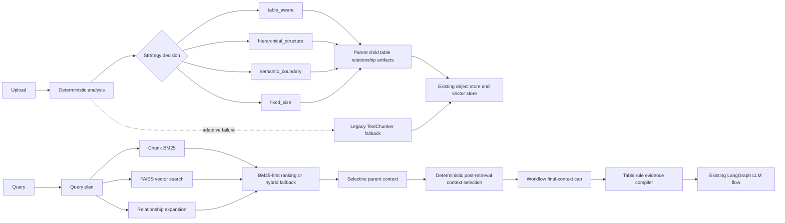

# Adaptive RAG Architecture

The MVP remains the authoritative baseline: FastAPI handles upload/chat, LangGraph
coordinates chat, the existing vector-store interface supplies FAISS-compatible
search, and S3/file JSON persistence stores durable state. Cognito, API contracts,
and CDK constructs are unchanged.

`AdaptiveDocumentIndexer` wraps the existing indexer. It runs deterministic domain,
type, structure, table, and reference analysis, persists portable artifacts, and
indexes child chunks. Any analysis or persistence error falls back to the existing
indexer. `AdaptiveRetriever` wraps `HybridRetriever`; disabled flags, missing
artifacts, or adaptive failures use legacy retrieval. Query planning is BM25-first by
default, with hybrid retrieval retained as a low-confidence fallback. Before LLM
generation, multi-record table/rule questions can receive a compiled evidence packet
that places primary rows, relevant rules, and lookup tables ahead of raw chunks. The
workflow response contract is unchanged; retrieval traces still expose candidate and
latency fields.

Artifacts use deterministic identifiers and reject unsafe document IDs before keys are
formed. No source text or query text is added to application logs. Relationship
traversal is bounded by configuration; it does not require a graph database.

## Post-Retrieval Context Selection

The workflow applies `compress_context` after the retriever returns. It uses generic
entity, rule-family, domain/source-affinity, and lexical signals to select the final
evidence. Retrieval candidates, their scores, and their original ordering are not
mutated by this stage. Optional document metadata is inferred locally during
repository ingestion and stored with document records; missing retrieved metadata
is inferred again from filename and text where possible.

Question types select targets from 5 to 15 chunks, followed by the existing workflow
cap. With no usable relevance signals, candidates are retained in retrieval order.
These heuristics do not guarantee full evidence coverage. See the
[RAG Master Guide](rag-master.md#metadata-and-selection-limits) for metadata fields,
fallback behavior, diagnostics, and current verification limits.
