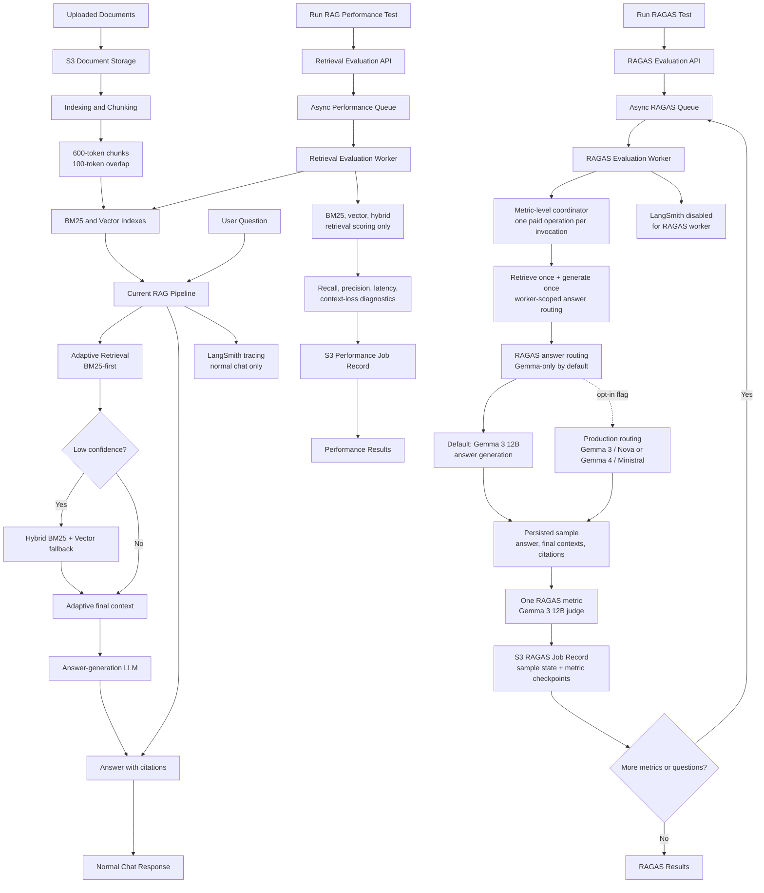
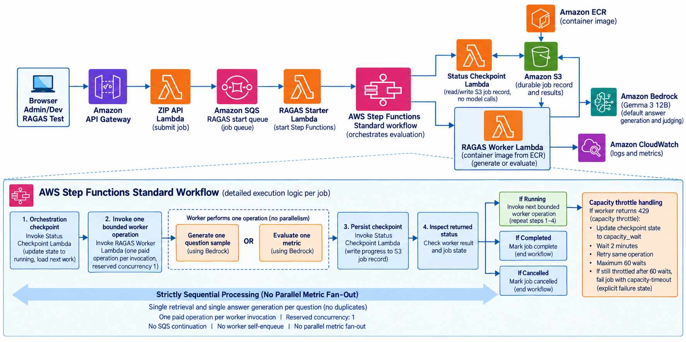
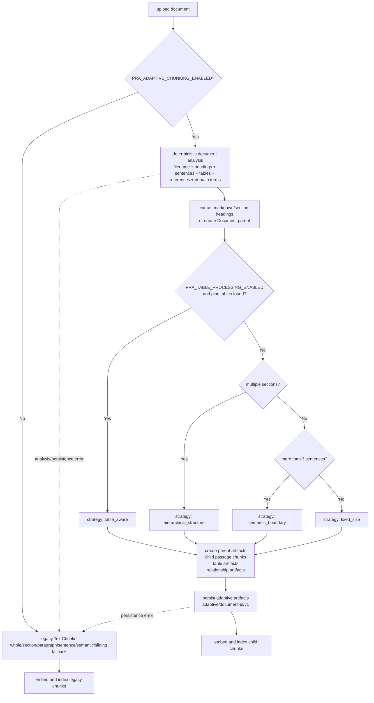
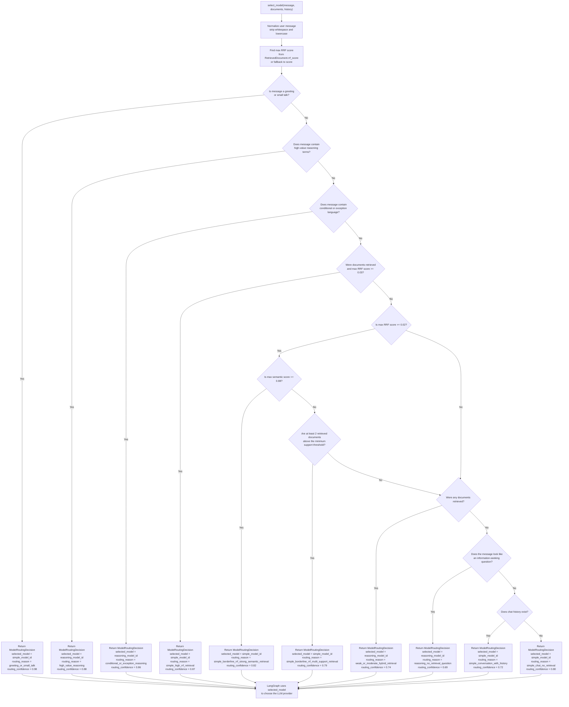

# Phase 16 Architecture Overview

## Current Architecture Slice

Phase 16 keeps the deterministic chunking strategy, reasoning fallback, and MVP rate limiting, and adds conversational response refinement. The deployed stack still uses Bedrock embeddings with a FAISS-backed vector index persisted in S3, while both mock and Bedrock responses are now tuned to sound more natural when the retrieved documents do not support the user's request well. The main website integration path is now the Firebase-hosted Tractlytics page in `data/research-assistant/`, which calls the AWS API directly over the configured CORS allowlist. CDK imports the retained Cognito pool `us-east-1_IxEu5C7oJ` by default and creates the current app client and Hosted UI domain against it.

The deployed runtime should now be thought of as two product/evaluation paths plus RAGAS orchestration helpers:

1. The API Worker Lambda, which serves end-user upload, chat, auth config, reset, and RAG job polling requests.
2. The Async Retrieval Evaluation Lambda, which is triggered from its SQS queue and runs retrieval-only diagnostics separately from live chat traffic.
3. The RAGAS start queue and starter Lambda, which start an idempotent Step Functions execution.
4. The ECR-backed RAGAS worker Lambda, which Step Functions invokes for one bounded sample or metric operation at a time.
5. The lightweight RAGAS status-checkpoint Lambda, which records orchestration and capacity-wait state in S3 without retrieval or model calls.

The key split is:

```text
Local/test:
  LocalHashEmbeddingProvider
  LocalVectorStore or PersistentVectorStore
  Mock LLM by default

Deployed AWS:
  BedrockEmbeddingProvider
  FaissVectorStore with S3 persistence
  BedrockLLMProvider for Gemma simple responses
  Bedrock Mantle provider for Gemma 4 31B reasoning responses
  Request-scoped fallback to Ministral 14B 3.0 on retryable reasoning failures
  One silent browser retry for retryable chat failures before the UI shows an error
  Fixed-window rate limiting in app code
  Softer unsupported-topic response style
  Optional LangSmith tracing with the API key loaded from an existing AWS Secrets Manager secret
```

## Runtime Flow

```mermaid
flowchart LR
    Browser["End user browser"] --> Firebase["Firebase-hosted Tractlytics page"]
    Browser -. local/fallback .-> Legacy["FastAPI-served UI"]
    Firebase --> Cognito["Cognito Hosted UI code + PKCE"]
    Legacy --> Cognito
    Cognito --> Firebase
    Cognito --> Legacy
    Firebase --> Upload["POST /documents/upload"]
    Firebase --> Chat["POST /chat"]
    Firebase --> AuthConfig["GET /auth/config"]
    Legacy --> Upload
    Legacy --> Chat
    Legacy --> AuthConfig

    Upload --> UploadLimit["Per-user Upload Limit"]
    Chat --> Auth["Cognito JWT Auth"]
    Auth --> ChatLimit["Per-user Chat Limit"]
    AuthConfig --> PublicLimit["Public IP Limit"]

    UploadLimit --> Parser["Document Parser"]
    Parser --> Chunker["TextChunker decision chain"]
    Chunker --> Embedder{"Embedding Provider"}
    Embedder --> LocalEmbed["Local Hash Embeddings"]
    Embedder --> BedrockEmbed["Bedrock Titan Embeddings"]
    BedrockEmbed --> BedrockRuntime["Amazon Bedrock Runtime"]
    Embedder --> VectorStore{"Vector Store"}
    VectorStore --> LocalVector["Local / JSON Vector Store"]
    VectorStore --> FaissVector["FAISS index persisted in S3"]
    VectorStore --> PgVector["pgvector optional backend"]

    ChatLimit --> Guardrails["Guardrails"]
    Guardrails --> Retriever["HybridRetriever"]
    Retriever --> Embedder
    Retriever --> VectorStore
    Retriever --> Workflow["LangGraph Workflow"]
    Workflow --> Router["ModelRouter"]
    Router --> Classify["Deterministic router<br/>SIMPLE / COMPLEX / AMBIGUOUS"]
    Classify -->|clear SIMPLE| Gemma["Gemma 3 12B simple primary"]
    Classify -->|clear COMPLEX| Gemma4["Gemma 4 31B Mantle reasoning primary"]
    Classify -->|AMBIGUOUS only| FallbackRouter["Gemma 3 12B fallback classifier<br/>query only"]
    FallbackRouter -->|SIMPLE| Gemma
    FallbackRouter -->|COMPLEX or invalid| Gemma4
    Gemma -. exhausted retryable failure .-> Nova["Nova Lite simple fallback"]
    Gemma4 -. exhausted retryable failure .-> Ministral["Ministral 14B 3.0 reasoning fallback"]
    Workflow --> Scores["Similarity + Hallucination Risk Metadata"]
```



The Firebase-hosted page and the FastAPI-served fallback UI both talk to the same backend routes and use the same Cognito Hosted UI PKCE flow. The Firebase page depends on the configured CORS allowlist plus Cognito callback/logout URLs that point back to `/research-assistant/` on the Tractlytics domains and local port-5000 paths. During long-running RAGAS polling, both pages revalidate the session before each status request and silently refresh an expiring ID token when a valid Cognito refresh token is available. This avoids unnecessary re-login prompts while preserving a clear sign-in prompt for invalid sessions.

RAGAS worker dispatch is deliberately small and observable. The API writes a
job record and publishes its `job_id` to `RagasEvaluationQueue`; the queue
invokes the starter Lambda, which begins the Step Functions execution. The
state machine invokes the Docker Lambda handler `pra_api.ragas_worker.handler`
one bounded step at a time. The worker uses `updated_at` for milestone
heartbeats and a 60-second deadline reserve. The queue visibility timeout is
30 minutes, with a dead-letter queue after five receives. Worker concurrency is
intentionally capped at one to control evaluation cost. When that worker is
busy, Step Functions first writes a lightweight S3 job-record checkpoint, waits
two minutes, and then retries the bounded worker step. The checkpoint Lambda does
not retrieve, embed, generate an answer, or run a metric. It records the capacity
wait state and retry count so browser polling reports a queued capacity wait rather
than a stale-worker error. After 60 capacity waits it stores an explicit capacity
timeout failure. During long answer-generation or metric work, a lightweight
45-second heartbeat updates job liveness without making model calls.

## Admin-Dev Check

This diagram provides a concise operational view of the current RAG pipeline,
the retrieval-only `Run RAG Performance Test`, and the answer-quality `Run
RAGAS Test`. It shows how both asynchronous evaluation paths relate to the
shared RAG workflow, indexes, metrics, job records, and LangSmith behavior.



Those workers are separate processes even though they are built from the same repository. They use different handlers, entry queues or orchestration paths, and operational responsibilities. The rendered high-level view is maintained in `docs/mvp-architecture.mmd` and `docs/mvp-architecture.png`; the detailed Admin-Dev view above explains the evaluation relationship.

After retrieval, the live RAG path applies deterministic context selection using entities, rule families, lexical overlap, metadata affinity, and same-document text deduplication. Question-type targets and the outer workflow cap limit final context. When no relevance signal is available, the selector retains candidates in retrieval order. It has no explicit adjacency/citation-dependency resolver, so evidence preservation still needs evaluation. This stage adds no LLM call. See the [RAG Master Guide](rag-master.md#metadata-and-selection-limits) for implementation limits and validation status.

The standalone MVP PNG is an AI-generated overview rather than a direct Mermaid render. Its ingestion queue/worker and streaming-response labels are illustrative inaccuracies: current upload indexing runs through the API and chat returns a completed answer. The Mermaid source and implementation define the exact runtime flow.

The root browser UI does not initialize or validate the vector index. Provider-compatibility checks and re-indexing are lazy and run during indexing work. Upload stores the parsed document before attempting chunking, embedding, and vector indexing; if Bedrock embeddings or vector indexing are temporarily unavailable, the API returns `indexed: false` so the UI can explain the partial success. Chat retrieval also degrades to an empty document result if the vector backend is temporarily unavailable, which allows small talk and non-document answers to continue instead of returning a generic 500.

Retrieval-only RAG evaluation is now async. The browser submits `POST /rag/evaluate`, the API records a job and enqueues it, and a separate worker Lambda or local background thread finishes the retrieval-only scoring. The browser then polls `GET /rag/evaluate/{job_id}` so the original request stays well below the Lambda timeout. The retrieval worker queries the evaluation BM25 and vector indexes and receives ranked candidates; it does not write to those indexes.

RAGAS answer-quality evaluation is a separate async path. The browser submits `POST /rag/evaluate/ragas`, the API records a separate job and enqueues its initial message on the RAGAS queue, and a starter Lambda begins a Step Functions execution. Step Functions invokes the RAGAS worker for one paid operation at a time. It first runs the current RAG workflow once for a question and persists the generated answer, final compressed contexts, citations, and routing metadata. Later worker steps run exactly one sequential metric - faithfulness, context precision, context recall, answer relevancy, then answer correctness - and checkpoint it in the same S3 job record. The state machine, rather than the worker, invokes the next bounded step, eliminating the Lambda recursive-loop risk. The recovery design is documented in [`ragas-step-functions-recovery.md`](ragas-step-functions-recovery.md).

The focused AWS execution diagram distinguishes the ZIP-packaged API Lambda from the ECR-backed RAGAS Lambda container. The RAGAS container runs shared RAG workflow code directly and does not invoke the API Lambda ZIP over the network.



The production worker receives `PRA_RAGAS_EVALUATION_QUEUE_URL`, so it cannot
use inline continuation and accidentally process another paid batch in the same
Lambda. Missing queue configuration is treated as a retryable scheduling
failure after progress is preserved.

The RAGAS worker uses the current retrieval, chunking, context assembly, and grounding behavior. By default, `PRA_RAGAS_USE_NORMAL_MODEL_ROUTING=false` isolates answer generation on `PRA_RAGAS_MODEL_ONLY_ID` (`google.gemma-3-12b-it` by default), with no Gemma 4, Nova Lite, or Ministral answer path constructed. The RAGAS evaluator remains separately configured as `PRA_RAGAS_EVALUATOR_MODEL_ID` and defaults to Gemma 3, so the judge does not change. When explicitly enabled, `PRA_RAGAS_USE_NORMAL_MODEL_ROUTING=true` reuses normal deterministic routing for answer generation: Gemma 3 with Nova Lite fallback for simple requests, and Gemma 4 Mantle with Ministral fallback for reasoning requests. This opt-in changes answer generation only; normal chat, retrieval, metrics, limits, and LangSmith behavior remain unchanged.

Phase 12 also adds exact duplicate-upload protection. The upload route computes a SHA-256 `content_hash` from parsed text, checks the document repository before storing a new record, and reuses the original document when the same content has already been uploaded. That keeps duplicate user uploads from inflating the S3-persisted FAISS index. If the original upload stored the document but indexing failed, a repeat upload now retries indexing for that existing stored document instead of skipping forever.

The upload route also enforces a hard application-level file-size cap before parsing. Oversized files fail fast with `413 Payload Too Large`, which keeps the API from depending only on upstream infrastructure limits.

Document uploads are controlled by `PRA_DOCUMENT_UPLOAD_ENABLED`, which defaults to
`true`. The auth configuration response exposes this flag to the browser. When it is
`false`, both browser UIs hide the file chooser and Upload button, while the API also
rejects direct `POST /documents/upload` requests with `403`; authentication and the
existing upload validation rules remain unchanged. CDK deployments can override it
with `-c document_upload_enabled=false`.

Upload indexing now calls the provider-compatibility check before writing vectors. That allows the deployed app to clear and rebuild an incompatible persistent vector index when the configured embedding provider changes, instead of failing later with stale vector metadata.

## Chunking Decision Architecture

The current chunking path is adaptive but deterministic. When `PRA_ADAPTIVE_CHUNKING_ENABLED=true`, upload indexing runs deterministic document analysis, chooses an adaptive strategy, persists portable artifacts, and indexes child chunks. If adaptive chunking is disabled or analysis/persistence fails, the system falls back to the legacy `TextChunker`.

```text
adaptive analysis -> table_aware | hierarchical_structure | semantic_boundary | fixed_size -> parent/child/table/relationship artifacts -> child chunk index
```

The chunking decision flow is also available as a standalone Mermaid source file at `docs/chunking-decision-chain.mmd`.



Adaptive child chunks carry stable document, parent, section path, ordinal, token count, domain, document type, strategy, and artifact-version metadata before embedding and indexing. Table artifacts preserve raw table text plus structured rows for recognizable markdown pipe tables. Relationship artifacts preserve simple portable cross-references such as section links. The legacy deterministic chain remains the compatibility fallback, not the primary adaptive path.

## Ontology-Driven Knowledge Graph Enhancement

The ontology and knowledge-graph path is additive and disabled by default. When
enabled, upload still performs the existing parsing, chunking, embedding, and
vector indexing first. A deterministic benefit assessor then scores document
structure, tables, entity density, relationship language, and cross-references.
Documents below `PRA_KG_BENEFIT_THRESHOLD` remain on the standard RAG path.

For eligible documents, the graph service creates provenance-linked document,
chunk, ontology, and entity nodes. Relations are extracted deterministically
from explicit relationship language and stored with source document IDs or
source chunk IDs. The ontology registry uses composite lexical matching:
high-confidence matches reuse an ontology, medium-confidence matches create a
versioned extension, and otherwise a new ontology is created. Optional LLM
proposals are only a proposal step; deterministic validation, allowed relation
types, deduplication, versioning, and persistence remain authoritative.

Graph retrieval is also opt-in. It performs a bounded traversal controlled by
`PRA_GRAPH_MAX_HOPS` and `PRA_GRAPH_MAX_RESULTS`, returns ordinary retrieved
chunks, and merges them with the existing keyword/vector/context path. This
means existing citations, context assembly, reranking hooks, and response
schemas remain unchanged. Graph extraction errors are logged and isolated from
successful document uploads.

The supplied detailed reference diagram is preserved unchanged here:


The high-level MVP diagram in `docs/mvp-architecture.mmd` is intentionally not
modified by this enhancement.

Feature controls:

```text
PRA_KNOWLEDGE_GRAPH_ENABLED=true
PRA_GRAPH_RETRIEVAL_ENABLED=true
PRA_KG_BENEFIT_THRESHOLD=60
PRA_ONTOLOGY_REUSE_THRESHOLD=0.90
PRA_ONTOLOGY_EXTENSION_THRESHOLD=0.70
PRA_GRAPH_MAX_HOPS=2
PRA_GRAPH_MAX_RESULTS=20
PRA_GRAPH_EXTRACTION_LLM_ENABLED=true
```

All three feature switches default to `true` in the application and deployed
CDK environment. Set an individual flag to `false` when a lower-cost local or
test run must bypass graph persistence, graph retrieval, or extraction-model
calls.

Graph and ontology state uses the existing JSON object-store abstraction under
`knowledge-graph/state.json`, so local file persistence and deployed S3
persistence use the same portable format. No new AWS service or deployment
resource is required for this feature.

## LangGraph In The MVP

LangGraph currently provides the chat orchestration skeleton. It is not yet doing autonomous planning, dynamic tool selection, branching agent behavior, or multi-agent coordination. In this MVP, it gives the chat flow a clear state machine with ordered steps:

```text
load_memory -> retrieve -> route_model -> generate -> score_grounding -> apply_grounding_policy -> save_memory -> END
```

The workflow starts by loading prior messages for the `session_id`, applies a topic-shift check, retrieves relevant document chunks, summarizes retrieval scores, chooses a model, asks the selected LLM provider to answer with context, scores answer grounding risk, applies threshold actions, then saves the user message and assistant answer back to memory.

The topic-shift check is meant to reduce session-history contamination. If the current prompt clearly introduces a different named entity than the recent conversation, the workflow clears prior in-memory history for that turn, marks `topic_reset_applied = true`, and lets retrieval focus on the active prompt instead of carrying forward the earlier topic.

The LangGraph state is `AssistantState` in `platform/core/src/pra_core/agent/workflow.py`. It stores only the data needed to move one chat request through the graph:

| State Field | Purpose |
| --- | --- |
| `message` | Current user prompt. |
| `session_id` | Conversation identifier used to load and save memory. |
| `top_k` | Number of retrieved candidates requested from the retriever. Defaults to `25` in the UI and workflow unless overridden. |
| `llm_top_k` | Outer cap on retrieved chunks sent into the LLM context. Defaults to `15`; adaptive planning normally selects 5, 8, or 15. |
| `history` | Prior chat messages loaded from the memory store. |
| `topic_reset_applied` | Whether the workflow detected a topic shift and temporarily dropped prior history for the current turn. |
| `documents` | Retrieved document chunks returned by the retrieval abstraction. |
| `citations` | Document IDs for the retrieved chunks used as citations. |
| `retrieval_scores` | Final retrieved ranking scores, which in the hybrid path are the fused RRF scores for the LLM-context chunks. |
| `min_retrieval_score` | Lowest retrieved similarity score, or `None` when no documents matched. |
| `max_retrieval_score` | Highest retrieved similarity score, or `None` when no documents matched. |
| `avg_retrieval_score` | Average retrieved similarity score, or `None` when no documents matched. |
| `selected_model` | Model ID selected by the routing node. |
| `routing_reason` | Human-readable reason for the selected model. |
| `routing_confidence` | Heuristic confidence in the routing decision. |
| `answer` | LLM-generated response. |
| `hallucination_score` | Grounding-risk score from `0.0` low risk to `1.0` high risk. |
| `hallucination_reason` | Human-readable reason for the grounding-risk score. |
| `hallucination_action` | Action taken by the grounding policy, such as `none`, `low_confidence_metadata`, `escalated_from_<model>`, or `safe_fallback`. |

The state exists only while a graph invocation is running. Durable conversation memory is stored through the configured `MemoryStore`; in deployed AWS that currently means S3-backed JSON persistence under the `pra-prod/` prefix, while local/test runs can use in-memory or file-backed persistence.

## Model Routing

Phase 12 uses a deterministic `ModelRouter` abstraction. LangGraph owns the `route_model` node, but the routing rules live outside the graph so they can be tested and replaced later. The workflow now also has a post-retrieval `refine_model_route` step before generation so strong retrieval alone does not force the simple model when the question looks like exception handling or multi-chunk reconciliation.

The routing decision flow is also available as a standalone Mermaid source file at `docs/model-routing-flow.mmd`.



Current routing behavior:

| Request Type | Selected Model |
| --- | --- |
| Greeting or small talk | `google.gemma-3-12b-it` |
| Simple high-RRF retrieval | `google.gemma-3-12b-it` |
| Borderline RRF with strong semantic support | `google.gemma-3-12b-it` |
| Borderline RRF with multiple supporting retrieved documents | `google.gemma-3-12b-it` |
| Simple chat without retrieval | `google.gemma-3-12b-it` |
| High-value reasoning terms such as compare, recommend, evaluate, risk, legal, financial, compliance, or strategy | Gemma 4 31B via Bedrock Mantle |
| Conditional or exception-style questions such as `always`, `except`, `unless`, `only if`, or `does this still apply` | Gemma 4 31B via Bedrock Mantle |
| Weak or moderate hybrid retrieval support | Gemma 4 31B via Bedrock Mantle |
| Post-retrieval multi-chunk reconciliation case | Gemma 4 31B via Bedrock Mantle |
| No-retrieval research question | Gemma 4 31B via Bedrock Mantle |

Routing decisions are logged as `model_route_selected` with `selected_model`, `routing_reason`, `routing_confidence`, `session_id`, retrieved document count, and max retrieval score. In the hybrid path that max retrieval score is the top fused RRF score, using `RetrievedDocument.rrf_score` when available and falling back to `score` for compatibility. The router also inspects the top semantic score and the count of retrieved documents above the minimum supporting RRF threshold when the primary RRF gate is only borderline. After that, the workflow can still replace a simple-model route with `post_retrieval_conditional_reconciliation` if the top retrieved chunks suggest the answer depends on reconciling multiple conditions or exceptions.

For debugging and operational correlation, the chat route logs `trace_id`, `session_id`, and a privacy-safe `message_hash` on both request receipt and response send. The browser UI also shows the active `session_id`, and the `New chat` action rotates to a fresh conversation identity while calling `POST /chat/reset` to clear stored memory for the prior session.

Gemma 3 remains the primary simple-answer model. The deterministic router now explicitly distinguishes simple, complex, and ambiguous queries. Clear decisions make no routing-model call; only ambiguous queries can invoke one query-only Gemma 3 fallback classifier call using a tiny output budget. Invalid or failed classifier output routes upward to the complex chain without repeated classifier calls. After its existing retry handling, retryable timeout or throttling failures can use `amazon.nova-lite-v1:0` through Bedrock Runtime for that request only; nonretryable errors do not invoke the fallback. Gemma 4 reasoning is selected after deterministic routing or a valid ambiguous-query classification. The API invokes `google.gemma-4-31b` through the Bedrock Mantle OpenAI-compatible endpoint using a short-lived IAM-issued bearer token. If the reasoning request still fails after retry handling with a retryable error, a generic fallback wrapper invokes `mistral.ministral-3-14b-instruct` through Bedrock Runtime. RAGAS remains isolated on Gemma 3 12B.

If the provider still returns a retryable chat failure after that backend fallback path, the browser UI performs one silent retry before surfacing a visible error. This keeps brief Bedrock blips from turning into a jarring chat failure when a second attempt would likely recover.

## LangSmith In AWS

The MVP can optionally send metadata-first workflow traces from the deployed Lambda to LangSmith.

The AWS path is:

```text
CDK -> existing Secrets Manager secret -> Lambda IAM read access -> tracer setup -> LangSmith
```

The API Worker Lambda receives `LANGSMITH_PROJECT` as a normal environment variable, then reads the real API key and endpoint from Secrets Manager during startup. The secret must already exist before `cdk deploy`, using the name `LANGSMITH_API_KEY` and a JSON payload that includes the `LANGSMITH_API_KEY` and `LANGSMITH_ENDPOINT` fields. If the secret is missing or unreadable, the Lambda falls back to the no-op tracer and does not attempt to send LangSmith metadata.

The evaluation workers are built from the same app assembly, but their evaluation paths use no-op tracing. The RAGAS worker intentionally does not report to LangSmith, while the normal chat workflow continues to emit its configured LangSmith traces.

Current practical split:

- API Worker Lambda: currently sends chat workflow state and step traces to LangSmith.
- Async RAG Evaluation Lambda: can be extended to report there later, but does not currently emit the retrieval-evaluation trace stream.

## MVP Rate Limiting

Phase 15 adds a process-local fixed-window limiter:

| Route | Key | Default Limit |
| --- | --- | --- |
| `/chat` | Cognito `sub` | 30 requests / 60 seconds |
| `/documents/upload` | Cognito `sub` | 5 requests / 3600 seconds |
| `/auth/config` | Client IP or `X-Forwarded-For` | 60 requests / 60 seconds |

When a request exceeds its window, the API returns `429` plus a `Retry-After` header. The limiter logs `rate_limit_exceeded` with the policy name, route, subject key, and retry window.

This MVP limiter is intentionally process-local. It protects local development, test runs, and low-scale single-process execution well, but it is not yet a distributed quota system for all Lambda instances. A future production step should move the counters to a shared backend such as DynamoDB or another distributed store.

## Similarity And Hallucination Metadata

The chat API returns retrieval similarity scores and hallucination-risk metadata. The browser UI shows assistant response metadata above the timestamp:

```text
semantic: 0.91 · bm25: 2.14 · rrf: 0.03 · hallucination risk: 0.16 · model: google.gemma-3-12b-it
```

Similarity scores come from the active vector backend and should be treated as provider-specific signals, not universal truth scores. In the hybrid path, the chat bubble `semantic` value is the best cosine similarity score for the supporting retrieved chunk, while the fused RRF score is the retrieval-strength signal used by both model routing and grounding scoring. The hallucination score is a grounding-risk signal: low means the response appears well supported by retrieved context; high means the response may be weakly grounded or unsupported.

Grounding policy actions:

| Hallucination Risk | Current Action |
| ---: | --- |
| `< 0.31` | Allow answer normally. |
| `0.31 - 0.55` | Return answer and expose low-confidence metadata. |
| `0.56 - 0.75` | If the simple model answered and a reasoning model is available, regenerate with the configured reasoning model. |
| `>= 0.76` | Replace the answer with a safe fallback stating that reliable context is insufficient. |

Threshold actions are logged as `hallucination_threshold_action`.

## Provider Compatibility

Vectors are not portable across embedding providers. A vector created by local hash embeddings is incompatible with a vector created by Bedrock embeddings.

The app records the active embedding provider ID in persistent metadata:

```text
vector_index_metadata.json
```

When the provider ID changes, the app clears the existing vector index and re-indexes the stored documents with the new provider.

Examples:

```text
local-hash:64
bedrock:amazon.titan-embed-text-v2:0:1024
```

## Component Responsibilities

- `EmbeddingProvider`: Stable interface for converting text into vectors.
- `LocalHashEmbeddingProvider`: Deterministic local/test embedding provider.
- `BedrockEmbeddingProvider`: Calls Bedrock Runtime `InvokeModel` for Titan embeddings.
- `VectorStore`: Stable interface for adding and searching document chunk vectors.
- `LocalVectorStore`: In-memory vector store for tests and quick local runs.
- `PersistentVectorStore`: JSON-backed vector store for local durable development.
- `FaissVectorStore`: Deployed AWS vector store using a FAISS-compatible in-memory index persisted to S3.
- `OpenSearchServerlessVectorStore`: Optional adapter retained in code, but not currently deployed by CDK.
- `PgVectorStore`: Alternate production backend for Postgres/pgvector deployments.
- `TextChunker`: Applies the deterministic decision chain and attaches chunk metadata before embedding/indexing.
- `DocumentIndexer`: Chunks documents, embeds chunks, and writes vectors.
- `ResearchAssistantWorkflow`: LangGraph state machine for loading memory, retrieving context, routing model choice, generating an answer, scoring grounding risk, applying grounding policy, and saving memory.
- `HostedLangSmithTracer`: Optional tracer that emits metadata-first workflow and step runs when Lambda can read a real API key from an existing Secrets Manager secret.
- `DeterministicModelRouter`: Chooses Gemma or the configured reasoning model using simple routing rules.
- `GroundingScorer`: Produces a lightweight hallucination-risk score and reason.
- `RagEvaluationJobCoordinator`: Submits and executes async retrieval-only RAG evaluation jobs, then stores the job record for polling.
- CDK stack: Creates S3 persistence, Bedrock permissions, and runtime environment variables. It no longer creates an OpenSearch Serverless collection.

OpenSearch Serverless generated internal document IDs for vector records and did not support forcing `refresh=true` during writes. The optional adapter keeps stable `chunk_id` values in the indexed document body. This matters only if OpenSearch is re-enabled later.

## Deployed Runtime Configuration

```text
PRA_PERSISTENCE_BACKEND=s3
PRA_VECTOR_STORE_BACKEND=faiss
PRA_EMBEDDING_PROVIDER=bedrock
PRA_BEDROCK_EMBEDDING_MODEL_ID=amazon.titan-embed-text-v2:0
PRA_BEDROCK_EMBEDDING_DIMENSIONS=1024
PRA_LLM_PROVIDER=bedrock
PRA_BEDROCK_MODEL_ID=us.anthropic.claude-opus-4-1-20250805-v1:0
PRA_BEDROCK_SIMPLE_MODEL_ID=google.gemma-3-12b-it
PRA_BEDROCK_SIMPLE_FALLBACK_MODEL_ID=amazon.nova-lite-v1:0
PRA_BEDROCK_REASONING_MODEL_ID=google.gemma-4-31b
PRA_BEDROCK_REASONING_FALLBACK_MODEL_ID=mistral.ministral-3-14b-instruct
PRA_BEDROCK_MANTLE_BASE_URL=https://bedrock-mantle.us-east-1.api.aws/openai/v1
LANGSMITH_PROJECT=personal-research-assistant
PRA_RATE_LIMIT_CHAT_REQUESTS=30
PRA_RATE_LIMIT_CHAT_WINDOW_SECONDS=60
PRA_RATE_LIMIT_UPLOAD_REQUESTS=5
PRA_RATE_LIMIT_UPLOAD_WINDOW_SECONDS=3600
PRA_RATE_LIMIT_PUBLIC_REQUESTS=60
PRA_RATE_LIMIT_PUBLIC_WINDOW_SECONDS=60
```

## Repository Touchpoints

```text
apps/api/src/pra_api/main.py
apps/api/src/pra_api/rag_worker.py
platform/core/src/pra_core/embeddings/
platform/core/src/pra_core/vectorstores/
platform/core/src/pra_core/indexing.py
platform/core/src/pra_core/evaluation/jobs.py
platform/core/src/pra_core/routing/
platform/core/src/pra_core/grounding/
platform/core/src/pra_core/config.py
infra/pra_infra/stack.py
tests/test_phase10_embeddings.py
tests/test_phase11_model_routing.py
```

## Deferred Functionality

- Streaming Bedrock responses.
- Additional provider chains beyond the current Gemma 3-to-Nova Lite simple fallback and Gemma 4-to-Ministral reasoning fallback.
- Async document ingestion workers.
- Adaptive chunking driven by deterministic retrieval-aware heuristics or other non-LLM signals.
- Distributed shared rate-limit counters for multi-instance production enforcement.
- Enterprise tenant-aware vector isolation.
- Production prompt evaluation and cost controls.
