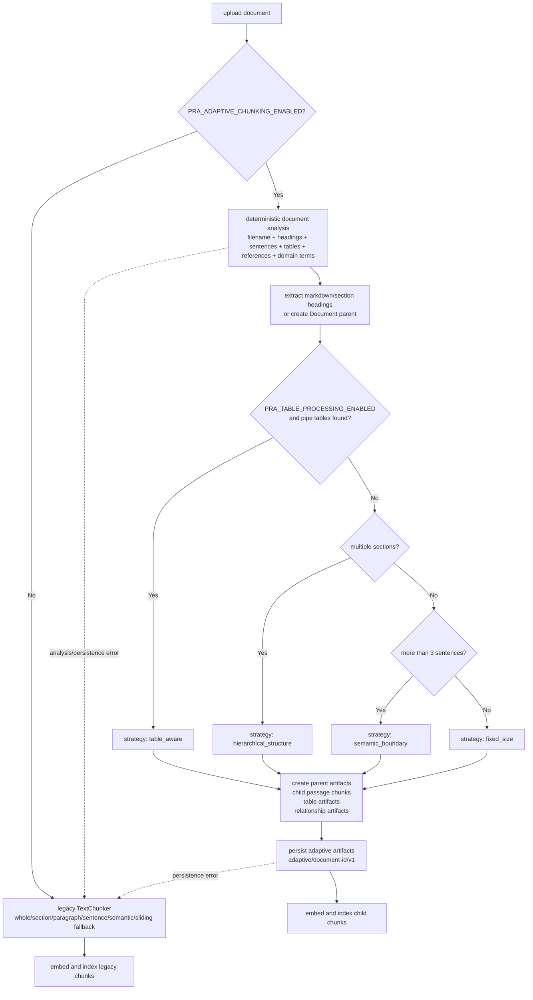

# Chunking Strategy

This document explains the chunking strategies used by the MVP, the kinds of documents each strategy handles best, and how the adaptive chunking wrapper works in practice.

The current implementation is adaptive but deterministic. It chooses a chunking strategy from document structure and configuration signals, and it does not call an LLM during chunking.

## Why Chunking Matters

Chunking shapes almost everything that happens after upload:

1. Retrieval quality depends on chunk boundaries.
2. Embedding cost depends on how many chunks are produced.
3. Index size depends on how aggressively documents are split.
4. Chat quality depends on whether retrieved chunks preserve enough local context.

The current architecture balances those concerns by preserving document structure when it exists, extracting portable adaptive artifacts, and falling back to the legacy deterministic chunker if adaptive analysis is disabled or fails.

## Implemented Chunking Architecture

The deployed and tested adaptive path is:

1. Check `PRA_ADAPTIVE_CHUNKING_ENABLED`.
2. If adaptive chunking is disabled, use the legacy `TextChunker`.
3. If adaptive chunking is enabled, run deterministic analysis over filename, headings, sentences, table-like pipe rows, reference language, and domain terms.
4. Choose `table_aware` when table processing is enabled and pipe tables are detected.
5. Choose `hierarchical_structure` when multiple sections are detected.
6. Choose `semantic_boundary` for longer sentence-based prose without section hierarchy.
7. Choose `fixed_size` for short or flat content.
8. Create parent, child, table, and relationship artifacts.
9. Persist artifacts under `adaptive/<document-id>/v1/`.
10. Embed and index child chunks.
11. If analysis or artifact persistence fails, fall back to the legacy `TextChunker`.

The same architecture is documented in [chunking-decision-chain.mmd](chunking-decision-chain.mmd).

## Rendered Decision Chain

## Strategy Details

### 1. Legacy TextChunker Fallback

The legacy `TextChunker` remains available when adaptive chunking is disabled or when adaptive analysis/persistence fails.

Best for:

- local debugging
- compatibility with older behavior
- graceful failure handling when adaptive artifacts cannot be created

Why it works well:

- It is deterministic.
- It prevents upload/indexing failure from blocking all indexing.
- It preserves the older whole/section/paragraph/sentence/semantic/sliding fallback chain.

### 2. Table-Aware Adaptive Chunking

Table-aware adaptive chunking is selected when table processing is enabled and markdown pipe tables are detected.

Best for:

- policy tables
- incident or claim records
- code/meaning lookup tables
- structured markdown files

How it works:

- The analyzer preserves raw section text.
- Recognizable pipe tables are also stored as table artifacts with structured rows.
- Parent and child artifacts keep stable IDs and section paths.

Why it works well:

- It supports exact table lookups like `BF-C`.
- It supports table-plus-rule evidence assembly for multi-record questions.
- It keeps table context available even when retrieval rankings shift.

### 3. Hierarchical Structure Chunking

Hierarchical structure chunking is selected when the document has multiple detected sections.

Best for:

- markdown documents
- policies
- manuals
- scenario documents with named sections

How it works:

- Each section becomes a parent artifact.
- Sentence-bounded child passages are created within that parent.
- Section paths and ordinals are carried into chunk metadata.

Why it works well:

- It preserves author structure.
- It gives retrieval a stable parent/child expansion path.
- It makes final-context coverage easier to reason about.

### 4. Semantic-Boundary Chunking

Semantic-boundary chunking is selected for longer prose when there is not enough section hierarchy.

Best for:

- long text without useful headings
- documents with weak formatting
- narrative or mixed-topic prose

How it works:

- Sentence boundaries are respected.
- Chunks are built up to `PRA_CHUNK_TARGET_TOKENS`.
- Neighboring chunks overlap by `PRA_CHUNK_OVERLAP_TOKENS`.

Why it works well:

- It avoids hard mid-sentence cuts.
- It remains deterministic and cheap.
- It is a better fallback than arbitrary word slicing for prose.

### 5. Fixed-Size Adaptive Chunking

Fixed-size adaptive chunking is selected for short or flat content where richer structure is unavailable.

Best for:

- short notes
- flat text
- sparse snippets
- low-structure uploads

How it works:

- The analyzer creates a single document parent if no sections exist.
- Sentence-bounded child chunks are produced using the configured target and overlap.

Why it works well:

- It guarantees progress.
- It keeps the pipeline deterministic.
- It avoids over-engineering tiny documents.

## What Documents Fit Each Strategy

| Strategy | Best documents | Why |
| --- | --- | --- |
| Table-aware | Markdown tables, incident records, policy matrices, code lookup tables | Preserves both raw text and structured rows |
| Hierarchical structure | Docs with headings, manuals, policies, structured markdown | Honors author structure through parent/child artifacts |
| Semantic boundary | Long prose with weak headings | Respects sentence boundaries while keeping chunk sizes controlled |
| Fixed size | Short or flat text | Keeps indexing deterministic when richer signals are absent |
| Legacy TextChunker | Disabled adaptive mode or adaptive failure | Preserves compatibility and graceful fallback |

## Chunk Metadata

Every chunk is annotated before embedding and indexing.

Common adaptive fields include:

- `parent_id`
- `chunk_type`
- `section_path`
- `token_count`
- `domain`
- `document_type`
- `strategy`
- `artifact_version`

Related artifact fields include:

- manifest decision, reasons, confidence, and fallback strategy
- parent section text and ordinal
- table raw text and structured rows
- relationship source, target, type, rationale, and confidence

This metadata helps with debugging, retrieval inspection, and later quality analysis.

## Why The Chain Is Deterministic

The chain is fixed on purpose.

That gives us:

- Reproducible tests
- Stable index behavior across local and deployed runs
- Easier cost analysis
- Easier debugging when retrieval quality changes

## What Adaptive Does Not Mean Here

Adaptive chunking does not mean LLM-based chunking or nondeterministic runtime behavior.

In this MVP, adaptive means the system chooses among deterministic strategies based on source-document signals. The same input and configuration should produce the same artifacts, which keeps tests reproducible and keeps deployed indexing behavior debuggable.

## Related Docs

- [Architecture Overview](architecture-overview.md)
- [README](../README.md)
- [Chunking Decision Chain](chunking-decision-chain.mmd)
