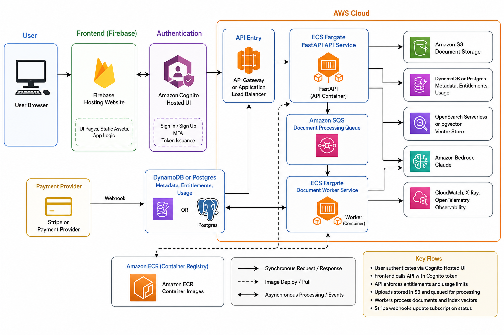

# Enterprise Considerations

This document captures production considerations for evolving the current MVP into a robust enterprise-grade research assistant. It compares the deployed Lambda-based MVP with a larger architecture based on long-running services, asynchronous processing, stronger persistence, Firebase website integration, and commercial access control.

## Current MVP

The current MVP is intentionally compact:

```text
Browser UI served by FastAPI
  -> Cognito Hosted UI
  -> API Gateway
  -> Lambda / FastAPI
  -> Guardrails
  -> Retrieval over uploaded documents
  -> Bedrock Titan embeddings
  -> FAISS-backed vector index persisted in S3
  -> Bedrock model routing
     -> Gemma 3 12B for simple chat/retrieval
     -> Gemma 4 31B via Bedrock Mantle for high-value reasoning
  -> S3-backed document and memory persistence
  -> CloudWatch logs and metrics
```

This design is appropriate for a working proof of value. It keeps infrastructure small, deployment simple, and operational cost low. The same FastAPI app serves the web page, API endpoints, authentication-aware chat flow, upload flow, retrieval, Bedrock invocation, and persistence integration.

The tradeoff is that Lambda request limits and synchronous processing shape the system. Each chat or upload request must finish inside the Lambda timeout. That works while documents are small, retrieval is quick, Bedrock latency is reasonable, and indexing is lightweight. As usage grows, the same design can become brittle around large uploads, slower model calls, retries, cold starts, concurrent usage, and long-running document processing.

Phase 11 adds deterministic model routing, retrieval similarity metadata, hallucination-risk metadata, and threshold actions. Moderate grounding risk can expose low-confidence metadata or escalate from Gemma 3 to the configured Gemma 4 reasoning route; very high grounding risk returns a safe fallback instead of a confident unsupported answer. This improves cost control and transparency, but the current scorer is still an MVP heuristic rather than a formal factuality guarantee.

## Lambda Timeout Considerations

The current chat flow is synchronous:

```text
User sends message
  -> API Gateway
  -> Lambda starts FastAPI handler
  -> Cognito token validation
  -> Guardrail validation
  -> Retrieval
  -> Bedrock call
  -> Response
```

This works when all operations complete quickly. It becomes risky when any step expands:

- Larger uploaded document sets increase retrieval and persistence load.
- Longer chat history increases prompt size.
- Bedrock throttling or temporary service issues can trigger retries.
- Cold starts consume part of the available timeout.
- Upload parsing, chunking, embedding, and indexing can take longer than an interactive request should allow.

For a production Lambda-based path, the minimum improvement would be to raise timeouts and separate upload/index processing from chat. A stronger enterprise path is to move the primary API to containers and use queues for background work.

## Recommended Enterprise Architecture

A more production-ready architecture would look like:



The PNG above is a stable reference diagram for the target enterprise architecture. It is not expected to change often unless the major hosting, processing, or persistence strategy changes.

```text
Firebase Hosting or CloudFront/S3
  -> Cognito Hosted UI
  -> API Gateway or Application Load Balancer
  -> ECS Fargate FastAPI service
  -> SQS document-processing queue
  -> ECS Fargate worker service
  -> S3 document storage
  -> DynamoDB or Postgres metadata store
  -> OpenSearch Serverless or pgvector vector store
  -> Bedrock
  -> CloudWatch, X-Ray, OpenTelemetry
```

In this model, Lambda can still be useful for small event-driven tasks such as webhooks, scheduled cleanup, or Cognito triggers. The main application API and document processing workloads would run as containerized services.

## Why Move Beyond Lambda

ECS Fargate or a similar container service gives the application:

- Longer-running request handling.
- More predictable warm service behavior.
- Better fit for FastAPI as a web service.
- Easier streaming responses.
- Easier background workers.
- More CPU and memory control.
- Better support for heavier AI, parsing, embedding, and vector libraries.
- Cleaner separation between API traffic and background indexing.

This does not mean Lambda is wrong. Lambda is a good MVP deployment target. The enterprise question is about operational headroom, workload isolation, and predictable user experience as data volume and concurrency increase.

## AgentCore Role

AgentCore would not make the current MVP smarter by itself. The current application flow is mostly:

```text
upload document
  -> chunk, embed, and index
  -> retrieve relevant chunks
  -> ask Bedrock
  -> return answer
```

For that workflow, LangGraph, Bedrock, Cognito, the current vector-store abstraction, and the existing FastAPI service are enough. AgentCore becomes valuable when the assistant needs to behave more like a governed agent that can decide which actions to take, call approved tools, and complete multi-step work.

Potential AgentCore value:

| Need | How AgentCore Could Help |
| --- | --- |
| Tool use | Let the assistant call approved tools such as document search, calculators, report generators, database lookups, or external search connectors. |
| Multi-step work | Manage requests such as comparing several documents, extracting risks, drafting summaries, then creating a structured output. |
| Safer actions | Wrap tool calls with permissions, policies, and guardrails before the agent acts. |
| Memory and context | Provide a more structured agent memory layer beyond the current simple chat history. |
| Evaluation | Test whether the agent selected the right tools and produced acceptable outputs. |
| Observability | Make agent runs easier to trace, debug, and evaluate in production. |
| Enterprise readiness | Support governed workflows, audit trails, tenant policies, and controlled tool access. |

In the near term, AgentCore should be treated as a future orchestration and governance layer, not as a core MVP dependency. A useful future flow would be:

```text
User asks complex question
  -> Agent evaluates intent
  -> Agent chooses whether to retrieve documents, call tools, compare sources, or validate an answer
  -> Bedrock generates a concise response
  -> Guardrails and evaluation checks run
  -> Response returns with traceable tool and source history
```

In practical terms, AgentCore helps when the assistant needs to do work, not just answer from retrieved text.

## Asynchronous Document Processing With SQS

SQS would make the system more reliable for large document workloads if the processing model is designed carefully.

Recommended upload flow:

```text
User uploads document
  -> API authenticates user
  -> API stores original file in S3
  -> API creates document metadata record
  -> API sends SQS message
  -> API returns "processing"

Worker receives message
  -> parses document
  -> chunks text
  -> creates embeddings
  -> indexes chunks in vector store
  -> marks document ready
```

This removes long-running parsing, chunking, embedding, and indexing from the user request path. The user gets a fast response, and the system can retry processing safely if a worker fails.

Design requirements:

- Use deterministic document and chunk IDs.
- Make processing idempotent because SQS can deliver a message more than once.
- Track document states such as `uploaded`, `processing`, `ready`, and `failed`.
- Use a dead-letter queue for repeatedly failing jobs.
- Limit worker concurrency so embedding and vector indexing do not overwhelm Bedrock or the vector store.
- Add a document status endpoint so the front end can show progress.

SQS itself does not make the system unstable. Poorly handled duplicate processing, missing status records, or unbounded retries can create bugs. Those risks are manageable with idempotent design and clear processing state.

## Production Retrieval And Persistence

The current MVP uses Bedrock embeddings and a FAISS-backed vector index persisted in S3 for deployed vector search. OpenSearch Serverless was removed from the deployed stack to avoid baseline collection charges during MVP testing. This is cost-conscious, but it is not a complete enterprise data architecture because metadata, tenancy, document lifecycle, usage records, retrieval scale, and background indexing still need stronger services.

Recommended production storage split:

| Concern | MVP | Enterprise Recommendation |
| --- | --- | --- |
| Original documents | Local/S3-backed persistence | S3 with object versioning and lifecycle policy |
| Document metadata | JSON snapshots | DynamoDB or Postgres |
| Vector search | FAISS-backed vector index persisted in S3; local/JSON stores for tests/dev | OpenSearch Serverless, pgvector, or another managed vector database with tenant isolation and lifecycle operations |
| Chat memory | Local/S3-backed JSON | DynamoDB, Postgres, or purpose-built memory store |
| Usage records | Not a primary feature | DynamoDB/Postgres usage ledger |
| Billing state | Not implemented | Payment-provider webhook into entitlement store |

For enterprise use, retrieval should support tenant isolation, access control, re-indexing by document version, deletion workflows, and observability into retrieval quality.

## Firebase Website Integration

The MVP now already supports a Firebase-hosted website integration path through `data/research-assistant/`. In that shape, the application becomes:

```text
User browser
  -> Firebase-hosted website
  -> Cognito Hosted UI for login
  -> AWS backend API with Cognito token
```

Firebase serves the static website, while AWS remains the protected backend for chat, upload, retrieval, Bedrock, persistence, and access enforcement.

Firebase can safely expose:

- API base URL.
- AWS region.
- Cognito hosted UI domain.
- Cognito user pool ID.
- Cognito app client ID.

Firebase must not expose:

- AWS access keys.
- Bedrock credentials.
- IAM secrets.
- Webhook signing secrets.
- Database credentials.

Required backend changes:

- Configure CORS for the Firebase domain.
- Add the Firebase domain to Cognito callback URLs.
- Add the Firebase domain to Cognito sign-out URLs.
- Make the front end use an explicit API base URL rather than same-origin requests.
- Keep API authorization checks on the backend.

Firebase controls the web experience. AWS controls identity validation, data access, model calls, and policy enforcement.

## Paywall And Usage Restrictions

The paywall should have two layers:

```text
Firebase front end
  -> shows pricing, upgrade, plan status, and limit messages

AWS backend
  -> enforces subscription status and usage limits
```

The front end can improve user experience, but it must not be the source of truth. The backend must check the authenticated Cognito user against a subscription and usage store before allowing expensive or sensitive operations.

Recommended paid-access flow:

```text
User signs in with Cognito
  -> User selects a plan on Firebase website
  -> Front end calls backend billing endpoint
  -> Backend creates payment checkout session
  -> Payment provider processes checkout
  -> Payment webhook calls backend
  -> Backend updates entitlement store
  -> API permits paid features
```

Recommended enforcement points:

- `POST /chat`
- `POST /documents/upload`
- Document listing and retrieval endpoints.
- Export endpoints when added.
- Admin or organization endpoints when added.

Example plan controls:

| Plan | Possible Restrictions |
| --- | --- |
| Free | Limited daily chats, small upload size, limited document count, no persistent advanced history |
| Trial | Higher temporary usage, expiration date, conversion prompts |
| Paid | Higher message limits, larger uploads, persistent document library, Bedrock model access |
| Enterprise | Organization management, audit logs, tenant controls, higher throughput, contractual limits |

The backend should store usage counters by user, organization, and billing period. Usage should be incremented only after accepted operations and should account for model calls, uploaded document count, storage size, and optionally token usage.

The current MVP now treats document storage and vector indexing as separate outcomes. An upload can succeed with `indexed: false` if Bedrock embeddings or vector persistence are temporarily unavailable. That is acceptable for an MVP, but the enterprise design should move indexing to a durable worker queue, expose processing status, and provide a re-index path so users do not have to re-upload files after transient infrastructure failures.

If OpenSearch Serverless is re-enabled later, it should be treated as a provider-specific adapter, not a generic OpenSearch cluster. It generates internal vector record IDs and does not support forced `refresh=true` writes, so enterprise ingestion should store stable application identifiers such as `document_id`, `chunk_id`, tenant ID, owner ID, and ingestion version inside each vector document.

## Security And Governance

Enterprise readiness should include:

- Tenant-aware authorization checks.
- Least-privilege IAM roles.
- Encrypted S3 buckets and database storage.
- Secrets stored in AWS Secrets Manager or SSM Parameter Store.
- Payment webhook signature verification.
- Audit events for login, upload, chat, deletion, and billing changes.
- Data retention and deletion workflows.
- Rate limiting and abuse protection.
- Clear separation of public front-end config from private backend secrets.
- Stronger guardrails for input, retrieved context, and model output.

## Observability

The current MVP includes structured logging, trace IDs, metrics, and CloudWatch integration. Enterprise operation should expand this to:

- Distributed tracing across API, workers, Bedrock calls, vector store calls, and payment webhooks.
- Alarms for API error rate, queue depth, worker failures, Bedrock throttling, and DLQ messages.
- Dashboards for latency, cost, usage, document processing status, and retrieval quality.
- Correlation IDs across front end, API, worker, and model calls.

## Roadmap To Enterprise

Recommended evolution path:

1. Split the browser front end from the API.
   Move static hosting to Firebase, S3/CloudFront, or Amplify. Keep FastAPI as the protected backend.

2. Add explicit API base URL and production CORS.
   The front end should call the AWS backend as a separate origin using Cognito access tokens.

3. Add entitlement and usage models.
   Store plan, subscription status, and usage counters in DynamoDB or Postgres.

4. Add billing provider integration.
   Use backend-created checkout sessions and verified webhooks.

5. Move document processing to an asynchronous worker.
   Store files in S3, enqueue processing with SQS, and show document processing state in the UI.

6. Move the deployed FAISS index to ECS Fargate for larger workloads or replace it with pgvector.
   Keep the current FAISS adapter for Lambda-sized workloads, but move to a container service if the index or corpus outgrows Lambda memory.

7. Move the primary API to ECS Fargate when the FAISS index or request profile makes Lambda impractical.
   Keep Lambda only for small event-driven tasks once the containerized path is in place.

8. Add enterprise guardrails and audit trails.
   Include input checks, retrieved-context checks, output checks, PII detection, and structured audit events.

9. Add organization and tenant management.
   Support team accounts, roles, user management, per-tenant data isolation, and billing ownership.

10. Add production operations controls.
    Add dashboards, alarms, DLQs, runbooks, backups, restore tests, and cost controls.

## Near-Term Recommendation

The next practical step is not to replace the MVP immediately. The best next move is to introduce enterprise-ready boundaries while keeping the current app functional:

- Keep the Lambda deployment running.
- Add a formal front-end/API separation plan.
- Add entitlement interfaces without enforcing billing yet.
- Add document status models.
- Add an SQS-backed ingestion design.
- Add a production vector-store abstraction target.

That keeps development steady while creating a clean path from MVP to a robust enterprise solution.
