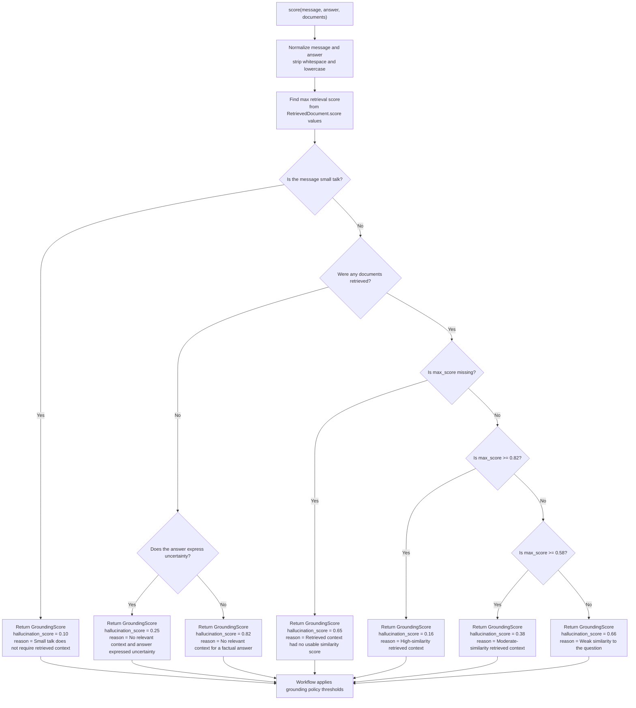

# Guardrails

This document is the permanent guardrail record for the project.

## Current Stage

Last reviewed: Phase 12 / current deployed MVP.

The application currently uses a local deterministic prompt guardrail and a Phase 12 grounding-risk policy. The prompt guardrail blocks known disallowed prompt terms before the request reaches retrieval, LangGraph workflow execution, memory, or the LLM provider. The grounding-risk policy runs after answer generation and can expose low-confidence metadata, escalate a simple-model answer to the configured Gemma 4 reasoning route, or replace a very high-risk answer with a safe fallback.

## Runtime Flow

```text
POST /chat
  -> Cognito authentication
  -> Guardrail validation
  -> LangGraph workflow
     -> Retrieval
     -> Model routing
     -> LLM provider generation
     -> Grounding-risk score
     -> Grounding policy action
  -> Response
```

The guardrail check runs in `apps/api/src/pra_api/routes/chat.py` after authentication succeeds and before the workflow is invoked. If the guardrail rejects the prompt, the API returns HTTP `400` and does not call retrieval or Bedrock.

## Implemented Guardrails

| Guardrail | Location | Purpose | Current Behavior |
| --- | --- | --- | --- |
| `Guardrail` interface | `platform/core/src/pra_core/guardrails/base.py` | Defines a common `validate(text)` contract. | Returns `GuardrailResult(allowed=True/False, reason=...)`. |
| `LocalPromptGuardrail` | `platform/core/src/pra_core/guardrails/local.py` | Performs deterministic local prompt checks. | Lowercases the prompt and blocks if any configured blocked term appears as a substring. |
| `GuardrailChain` | `platform/core/src/pra_core/guardrails/local.py` | Allows multiple guardrails to run in order. | Returns the first blocking result; allows the prompt only if every guardrail allows it. |
| `GroundingScorer` | `platform/core/src/pra_core/grounding/scorer.py` | Produces a hallucination-risk score from retrieval support and answer behavior. | Returns a score from `0.0` low risk to `1.0` high risk plus a reason. |
| Grounding policy node | `platform/core/src/pra_core/agent/workflow.py` | Applies threshold actions after generation. | Allows low-risk answers, marks moderate risk, escalates some simple-model answers to the configured Gemma 4 reasoning route, or returns a safe fallback for very high risk. |

## Grounding Scorer Flow

The grounding scorer flow is also available as a standalone Mermaid source file at `docs/grounding-scorer-flow.mmd`.



## Configuration

Blocked terms are configured through:

```text
PRA_GUARDRAIL_BLOCKED_TERMS
```

The current default value is:

```text
production-agentcore
```

Multiple terms can be supplied as a comma-separated list. Whitespace is trimmed during app startup.

Example:

```text
PRA_GUARDRAIL_BLOCKED_TERMS=term-one,term-two,term-three
```

## Current Response Behavior

When a blocked term is found, the guardrail returns:

```text
Prompt contains blocked term: <term>
```

The chat route returns that reason as a `400` response body detail.

When grounding risk is high, the workflow can return:

```text
I can't answer that confidently from what I have here yet. If you add material on that topic, I can take another pass.
```

The response also includes `hallucination_score`, `hallucination_reason`, and `hallucination_action` so the browser can show transparent metadata and logs can be audited.

## Tests

The guardrail chain is covered in:

```text
tests/test_phase5_abstractions.py
```

The chat route rejection path is covered in:

```text
tests/test_chat.py
tests/test_phase11_model_routing.py
```

## Limitations

The current guardrails are not a production safety system. They are deterministic local checks only.

Known limitations:

- No semantic safety classification.
- No jailbreak or prompt-injection model.
- No document-level policy scanning.
- No managed output moderation.
- No PII detection or redaction.
- No per-user or per-tenant policy rules.
- No audit persistence beyond normal structured request logging.
- Substring matching can create false positives and false negatives.

## Intended Evolution

Future stages should consider:

- Input classification guardrails.
- Output validation guardrails.
- Prompt-injection detection for retrieved document content.
- PII and secrets detection.
- Tenant-specific policy configuration.
- Structured guardrail audit events.
- Human-readable user messages separate from internal block reasons.
- Optional managed guardrail integration when the production provider is selected.
- Stronger claim extraction and source entailment checks for hallucination-risk scoring.
