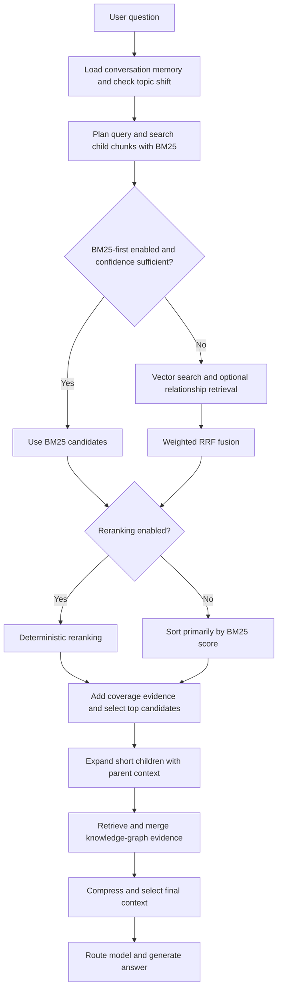
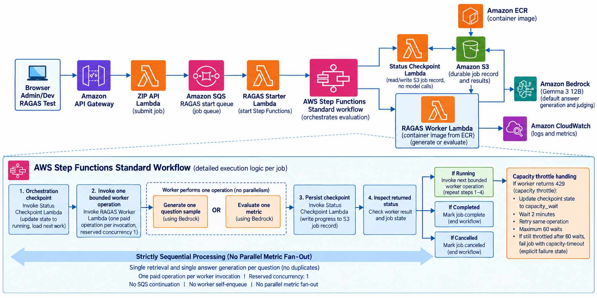

# RAG Master Guide

This master document combines the current MVP RAG pipeline, retrieval-only performance evaluation, RAGAS answer-quality evaluation, and diagnostic guidance into one reference. It is the primary RAG reference linked from the README.

The high-level architecture is maintained in [`mvp-architecture.mmd`](mvp-architecture.mmd) and rendered in [`mvp-architecture.png`](mvp-architecture.png). The compact rendered view uses service icons and numbered swimlanes for the deployed boundaries. The detailed relationship between normal chat, `Run RAG Performance Test`, and `Run RAGAS Test` is documented in the `Admin-Dev Check` section of [`architecture-overview.md`](architecture-overview.md). The former RAGAS recursive-loop failure and implemented Step Functions replacement are documented in [`ragas-step-functions-recovery.md`](ragas-step-functions-recovery.md).

For the controlled process for comparing BM25 and vector weights, see the
[Retrieval Weight Evaluation Guide](retrieval-weight-evaluation-guide.md).

After rebuilding the v2 evaluation dataset, weight changes must be evaluated
against the same isolated source corpus and question set. The comparison uses
a small number of explicitly recorded BM25/vector candidates and considers
Recall@5, Recall@10, Recall@25, context loss, final-context coverage, and
latency together. Answer-quality or RAGAS testing follows retrieval-only
testing, so LLM cost and answer variance do not hide retrieval regressions.

## Current Tuned Default

The current tuned retrieval default is:

- `PRA_BM25_TOP_K=50`
- `PRA_VECTOR_TOP_K=50`
- `PRA_RRF_K=30`
- `PRA_FUSION_STRATEGY=weighted_rrf`
- `PRA_BM25_FUSION_WEIGHT=0.8`
- `PRA_VECTOR_FUSION_WEIGHT=0.2`
- `PRA_PRESERVE_BM25_CANDIDATES=true`
- `PRA_ENABLE_RERANKING=false`
- `PRA_BM25_FIRST_ENABLED=true`
- `PRA_RETRIEVAL_BM25_WEIGHT=0.60`
- `PRA_RETRIEVAL_VECTOR_WEIGHT=0.40`
- `PRA_RETRIEVAL_RELATIONSHIP_WEIGHT=0.00`
- `PRA_RERANK_TOP_K=50`
- `PRA_LLM_CONTEXT_TOP_K=15`
- `PRA_ADAPTIVE_SIMPLE_CONTEXT_TOP_K=5`
- `PRA_ADAPTIVE_POLICY_CONTEXT_TOP_K=8`
- `PRA_ADAPTIVE_COMPLEX_CONTEXT_TOP_K=15`
- `PRA_ADAPTIVE_LOW_CONFIDENCE_CONTEXT_TOP_K=15`
- `PRA_ADAPTIVE_LOW_CONFIDENCE_SCORE_GAP=0.15`
- `PRA_ADAPTIVE_MIN_STRONG_MATCHES=2`
- `PRA_CHUNK_SIZE=600`
- `PRA_CHUNK_OVERLAP=100`

This keeps the hybrid code path alive, but uses BM25 as the first ranking attempt because the evaluation dataset shows lexical retrieval is currently the most reliable signal in this MVP. Hybrid retrieval remains an adaptive fallback when BM25 confidence is weak.

## Optimization Findings

The latest retrieval-only sweeps on `rag_eval_dataset_v2.json` produced four clear findings:

1. BM25 consistently outperformed the original equal-weight RRF hybrid on Recall, Precision, MRR, and NDCG.
2. Larger deterministic chunks were the single biggest gain. Moving from `300/50` to `600/100` improved both quality and latency in the isolated evaluation corpus.
3. Deterministic reranking added little to no measurable value on this dataset, so the default was simplified to `PRA_ENABLE_RERANKING=false`.
4. A BM25-heavy weighted RRF configuration with BM25 preservation matched the best BM25-only quality while keeping the existing hybrid contract intact for routing, score display, and future vector improvements.
5. The final-context bottleneck is addressed by deterministic context sizing: simple lookups use 5 chunks, policy/rule questions use 8, and incident, exception, approval, multi-condition, why/which, comparison, and regional-rule questions use 15. Low-confidence BM25 retrieval expands to 15 and invokes hybrid fallback.

The strongest comparison runs were:

| Run | Recall@10 | Precision@10 | MRR@10 | NDCG@10 | Avg latency |
| --- | --- | --- | --- | --- | --- |
| Base old default (`300/50`, equal RRF) | 0.4044 | 0.1200 | 0.4577 | 0.3510 | 391.01 ms |
| `600/100`, equal RRF | 0.6510 | 0.1760 | 0.6141 | 0.5258 | 14.40 ms |
| `600/100`, BM25-only | 0.7717 | 0.2040 | 0.7002 | 0.6304 | 6.56 ms |
| `600/100`, weighted RRF `0.8/0.2` + BM25 preservation | 0.7717 | 0.2040 | 0.7002 | 0.6304 | 15.25 ms |

Quality tied between BM25-only and BM25-preserving weighted RRF. The deployed default keeps the weighted hybrid because it preserves the current retrieval/routing contract while delivering the same measured quality on the evaluation set.

The latest full diagnostic sweep recommended `normalized_weighted_0.7_0.3` for pure offline retrieval quality, with `Recall@10=0.7772`, `Precision@10=0.2120`, `MRR@10=0.6791`, and `NDCG@10=0.6237`. The production default intentionally stays on the weighted RRF family for now. Both the model router and the grounding scorer use RRF-scale thresholds directly, so switching to a different score scale would require a coordinated retune of routing and hallucination-risk heuristics. Keeping the weighted RRF path gives the quality gain without changing the behavioral contract of the deployed app.

## RAGAS Job Persistence and Stop Behavior

RAGAS jobs are server-owned records in the configured S3 job store. The browser
also keeps a bounded cache under `pra_ragas_eval_jobs`, separate from the
retrieval-evaluation cache. On page load, the UI restores saved job IDs and
uses `GET /rag/evaluate/ragas/{job_id}` to recover server state; it never
submits a new job during refresh. One browser poller is allowed per job.
New Chat and sign-out do not clear this state.

The Stop RAGAS control calls `POST /rag/evaluate/ragas/{job_id}/cancel`.
Cancellation is idempotent and transitions an active job through
`cancel_requested` to `cancelled`. The worker checks this state before
retrieval, answer generation, metric evaluation, and continuation scheduling,
so queued or between-question cancellation prevents future model calls and
downstream batches. A provider request already in flight cannot be forcefully
interrupted by Lambda; its result is discarded when it returns and no later
paid work is started.

## Contents

- [RAG Pipeline](#rag-pipeline)
- [RAG Evaluation](#rag-evaluation)
- [RAG Pipeline Diagnostics](#rag-pipeline-diagnostics)

---

## RAG Pipeline

This document describes the current MVP retrieval-augmented generation path in plain language.

### Retrieval Depth

The MVP uses `top_k=25` by default when it searches the hybrid retrieval pipeline. That means each chat request can retrieve up to twenty-five merged candidates unless the caller overrides `top_k`.

### Retrieval Flow

The repository and CDK configuration implement a BM25-first adaptive path with
conditional vector search and weighted Reciprocal Rank Fusion (RRF). Parent expansion,
knowledge-graph evidence, and deterministic context compression run after candidate
ranking. Deterministic reranking is implemented but disabled in the AWS configuration.
This section describes the checked-in code and deployment configuration; it does not
by itself verify the settings of a currently running AWS stack.



The main retrieval implementation is `AdaptiveRetriever.search()` in
`platform/core/src/pra_core/adaptive_rag/service.py`. The workflow-level context
processing is in `ResearchAssistantWorkflow._retrieve()` in
`platform/core/src/pra_core/agent/workflow.py`.

| Order | Step | Current behavior |
| ---: | --- | --- |
| 1 | Memory and topic-shift check | Loads session history. A detected topic shift removes prior history from this request; retrieval uses the current question. |
| 2 | Artifact loading | Loads uploaded documents and adaptive child chunks. Missing child artifacts select the legacy retrieval path. |
| 3 | Query planning | Detects intent, domain, exact identifiers, acronym expansions, retrieval methods, weights, and context size. |
| 4 | BM25 child retrieval | Searches child-chunk text using the question and deterministic expanded terms. |
| 5 | Confidence check | Examines the top BM25 score, score gap, strong-match count, and exact-identifier coverage. |
| 6 | Conditional hybrid retrieval | Low confidence, or a plan that is not BM25-first, enables vector search and eligible relationship retrieval. Otherwise BM25 candidates continue directly. |
| 7 | Adaptive weighted RRF | On the hybrid branch, merges BM25, vector, and relationship ranks by child-chunk ID. |
| 8 | Rerank or BM25-first sort | Optional deterministic reranking applies local relevance bonuses. With reranking disabled, candidates sort by BM25 score first, then fusion, vector, and relationship scores. |
| 9 | Coverage protection | Inserts additional exact-identifier and selected rule/section evidence after the first three candidates. Some current coverage terms are tailored to the evaluation corpus. |
| 10 | Candidate selection | Applies the query-specific context limit. Low-confidence queries can receive the configured larger context allowance. |
| 11 | Parent expansion | A child shorter than 80 tokens can be replaced by a limited slice of its parent text, subject to the adaptive context-token budget. |
| 12 | Knowledge-graph merge | Retrieves matching graph evidence, merges by source chunk, keeps the higher score, sorts, and caps the result. This is not another RRF pass. |
| 13 | Context compression | Prioritizes exact entities, rule families, source-family matches, metadata affinity, and lexical relevance while removing same-document near-duplicates and weak evidence. |
| 14 | Final workflow cap | Takes compressed results up to `PRA_LLM_CONTEXT_TOP_K`, configured as 15, and records citations and retrieval diagnostics. |

BM25 provides the keyword-oriented signal. Vector search provides semantic similarity.
The adaptive path avoids vector work when BM25 confidence is sufficient, while keeping
hybrid retrieval available for lower-confidence questions.

#### Adaptive RRF and Ordering

The adaptive hybrid branch calculates each child chunk's fusion score as:

```text
S(d) = w_B / (60 + r_B(d))
     + w_V / (60 + r_V(d))
     + w_R / (60 + r_R(d))
```

An absent result contributes zero. The checked-in AWS configuration supplies
`w_B=0.60`, `w_V=0.40`, and `w_R=0.00`, making the configured adaptive score:

```text
S(d) = 0.60 / (60 + r_B(d)) + 0.40 / (60 + r_V(d))
```

Each rank is the chunk's one-based position after that retrieval method's scores are
sorted from highest to lowest. The adaptive fusion function currently uses the
constant `60` directly. `PRA_RRF_K=30` configures the separate legacy hybrid retriever;
it does not change the adaptive formula.

With reranking disabled, adaptive candidates are sorted descending by:

```text
(BM25 score, fusion score, vector score, relationship score)
```

The resulting order is therefore BM25-first rather than purely RRF-ordered. Coverage
insertion and the later graph merge can also change final membership and order.

#### Optional Deterministic Reranking

When enabled, adaptive reranking runs after RRF and before coverage protection,
candidate limiting, parent expansion, and graph merge. Its local score is:

```text
rerank(d) = fusion(d)
          + 0.02 * count(query terms intersecting chunk terms)
          + 0.15 * identifier_match(d)
```

`identifier_match(d)` is one when a recognized question identifier appears in the
chunk and zero otherwise. This is deterministic Python logic, not a cross-encoder or
LLM reranker. The CDK stack sets `PRA_ENABLE_RERANKING=false`.

#### Parent Expansion, Graph Retrieval, and Compression

Adaptive relationship retrieval and knowledge-graph retrieval are separate. Eligible
relationship candidates can enter adaptive RRF, although the deployed relationship
weight is zero. Knowledge-graph retrieval occurs later, after parent expansion, and
its scores are compared directly with candidate scores during merge. There is no
second RRF operation for graph evidence.

The query-time adaptive expansion stage uses parent context for short child chunks. It
does not perform a separate rolling-window neighbor expansion. Sliding overlap belongs
to legacy indexing and chunk construction, not this adaptive query-time stage.

Context compression then applies question-specific limits: 5 chunks for simple lookup
or definition, 8 for yes/no policy, eligibility, or timeline, 10 for amount/credit,
approval, procedure, or exception, 12 for incident/rule, and 15 for comparison. The
workflow's configured 15-item cap remains the final outer limit.

#### Legacy Retrieval Fallback

If adaptive retrieval is disabled, child artifacts are absent, or adaptive processing
raises an exception, the wrapper uses the legacy retriever:

1. Document-level BM25 search.
2. Vector chunk search.
3. Weighted RRF fusion using `PRA_BM25_FUSION_WEIGHT=0.8`,
   `PRA_VECTOR_FUSION_WEIGHT=0.2`, and `PRA_RRF_K=30`, with BM25 candidate preservation.
4. Knowledge-graph merge inside the legacy retriever.
5. Optional deterministic reranking, or default score sorting when disabled.
6. Result limiting and exact table-context repair.
7. Return through the adaptive wrapper, which performs its additive graph merge.
8. Workflow context compression and the final context cap.

These two paths explain why adaptive and legacy settings must be documented separately:
the adaptive path uses `0.60/0.40/0.00` and an internal RRF constant of 60, while the
legacy path uses `0.8/0.2` and the configured `PRA_RRF_K=30`.

### How Model Routing Uses RRF

After retrieval, the model router looks at three signals:

- top fused RRF score as the primary gate
- top semantic score as a secondary check when RRF is borderline
- number of retrieved documents above the minimum supporting RRF threshold as a tie-breaker

The current heuristic is:

- If the best RRF score is at least `0.03`, retrieval support is treated as strong and the workflow stays on the cheaper simple model unless the prompt itself clearly asks for high-value reasoning.
- If the best RRF score is at least `0.02` and the best semantic score is at least `0.88`, the workflow still stays on the simple model.
- If the best RRF score is at least `0.02` and at least two retrieved documents have RRF scores of at least `0.015`, the workflow also stays on the simple model.
- If those checks fail but documents were retrieved, the workflow routes to the reasoning model.
- If nothing useful was retrieved but the message still looks like an information-seeking question, the workflow routes to the reasoning model instead of falling back to the simple no-retrieval chat path.
- If the message itself contains conditional or exception-style language such as `always`, `except`, `unless`, `only if`, or `does this still apply`, the workflow routes to the reasoning model up front.
- Multi-record rule questions such as "Which incidents require approval, and why?" route to the reasoning model up front. This is based on general record/rule signals, not a document-specific keyword.
- Greetings still route directly to the simple model.
- Explicit compare, recommend, evaluate, strategy, risk, compliance, legal, and similar reasoning prompts still route directly to the reasoning model.

This is more robust than routing on raw vector similarity alone because RRF rewards cross-method agreement. A chunk that ranks well in both BM25 and vector retrieval is a better signal for low-cost routing than a strong score from only one retrieval path. The semantic check helps avoid escalating a query that has slightly weaker fused rank but an obviously strong chunk-level embedding match, and the support-count tie-breaker helps when multiple moderate results point in the same direction. The workflow also adds a post-retrieval refinement step before generation so strong raw retrieval does not hide the need for exception reconciliation across multiple chunks. The grounding scorer now uses that same fused RRF scale, so routing and hallucination-risk scoring interpret retrieval strength consistently.

### Prompt Assembly

The final context size is adaptive and compressed after retrieval. Retrieval candidate generation is unchanged. Simple lookups and definitions target up to 5 chunks, yes/no policy questions 8, amount or credit questions 10, approval questions 10, eligibility questions 8, procedure questions 10, timeline questions 8, exception questions 10, incident/rule questions 12, and comparison questions 15. `PRA_LLM_CONTEXT_TOP_K` remains the outer workflow cap. Entity and rule-family matches are selected first, followed by other relevance signals. A no-signal fallback can retain candidates in their original retrieval order.

Context selection uses generic deterministic rules rather than current-corpus filenames or entity names. It infers optional domain, document type, and source affinity from retrieved metadata, filenames, and text. Regex-based entity handling, generic rule-family detection, lexical overlap, and deduplication provide relevance signals. These are heuristics with incomplete entity and evidence coverage; no additional LLM call is used for filtering.

### Deterministic Answer Shape

Before the existing answer-generation call, the workflow creates a local answer-shape plan. It classifies the question as a yes/no policy, eligibility policy, amount or credit, definition, person lookup, deadline, procedure, approval, incident rule, comparison, multi-part question, or unknown. Classification prioritizes the answer form the user asked for: a `Can ... reimbursement ...?` question remains yes/no instead of becoming an amount question, and `How many days ...?` is treated as a duration or deadline question. The plan lists the answer slots that matter for that shape, preserves useful subject terms and identifiers, removes accidental leading question words from extracted entities, and adds a short instruction to the existing prompt. It does not make a second generation, rewrite, judge, rerank, or classifier call.

For example, amount questions ask the model to state both the amount and what it applies to; approval questions ask for the decision, authority, and triggering condition; multi-part questions ask for each requested part in order. The workflow emits deterministic diagnostics with the shape, required and filled slots, subject terms present or missing from the answer, entity-cleanup status, multi-part detection, opening type, unsupported answer-shape warning, and the prompt instruction. These diagnostics describe answer coverage only; they do not claim factual correctness.

Final-context selection also distinguishes strong evidence from a weak document-domain match. Exact entities, rule families, source or section affinity, and direct lexical overlap are selected first. A broad domain-only match is treated as fallback evidence only. For specific lookup, definition, yes/no, amount, approval, eligibility, timeline, and incident/rule questions, weak same-domain chunks are dropped when stronger evidence chunks are already available. This is post-retrieval selection only: BM25, vector retrieval, hybrid fallback, RRF, reranking, chunking, candidate order, and retrieval-only evaluation remain unchanged.

The cost constraint is deliberate: all answer-shape planning, entity cleanup, slot diagnostics, and context-selection signals are deterministic local logic. Normal chat still uses the existing single answer-generation request unless an already-existing grounding or completeness policy chooses its established fallback path.

#### Post-Generation Answer-Shape Guardrail

The answer-shape controller is also an enforcement layer. A mandatory final-answer validation gate runs after existing generation and grounding-policy handling, immediately before memory persistence and the API response. It cannot be bypassed by a generated answer. The gate rejects bare values such as an amount, duration, name, or standalone yes/no when the final context supports a more complete answer. It first filters noisy subject fragments, keeps only high-quality terms that are supported by the final context, and then checks missing terms, slots, conditions, inappropriate answer openings, internal mini-question formatting, and high-risk factual tokens such as amounts, dates, and record codes that are absent from the final context.

When repair is safe, the guardrail replaces the incomplete answer with one directly supported final-context sentence. Bare values such as `$600`, `90 days`, `4 weeks`, a standalone date, a name, or a standalone yes/no are expanded only when the final context supports the subject, program, policy, action, or trigger. For date and duration questions, the answer must include the duration and the supported subject, and it preserves a supported trigger such as `after 5 years`, `within 90 days`, a temperature excursion, a code, or an approval condition when that trigger explains the answer.

For a binary eligibility answer with separate item and policy evidence, the guardrail can combine those evidence sentences into a concise natural answer. A question such as whether a program covers an item should keep the yes/no decision, the item or action, the program or policy, and the supported reason or category. Definition or meaning questions are scoped more tightly: they answer the meaning first and do not list every trigger unless the user asks for conditions. Multi-part answers are converted to natural sentences instead of diagnostic field labels.

The guardrail rejects or repairs user-facing output that looks like an internal diagnostic template, including `Question Part`, `Primary Answer`, `Secondary Answer`, `Reason or Condition`, `What credit applies?`, `What credit should apply?`, `Why?`, or `Is approval required?` headings. Markdown field labels are not used unless the user explicitly requests structured output. When no unambiguous evidence supports a repair, the gate returns the safest supported answer available and records why a more specific repair was skipped rather than inventing a condition or policy rule.

The response diagnostics record `final_answer_validation_applied`, whether the original generated answer failed a gate check, its failure reasons, before/after answer text, repair strategy, and any safe-repair failure reason. They also retain duration, subject-term, condition, and mini-question-format diagnostics, including raw/high-quality/noisy terms and missing terms before versus present terms after repair. The gate uses no LLM call, rewrite pass, judge, reranker, classifier, compressor, or paid dependency; it only inspects the already selected final context.

The final validator also includes a low-cost semantic-completion gate for labeled,
multi-part conditional-credit answers. It runs after the existing answer-shape repair
and before locked-fact preservation. The gate activates only when the generated answer
contains visible mini-question labels, the primary credit clause lacks a reason, and
the existing final context provides an unambiguous amount, credit category, and
threshold. It composes concise prose from those supported slots, preserves an approval
clause only when approval was requested, and then passes the candidate through the
same locked-fact, scope, unsupported-token, and final-invariant checks. Unsafe or
ambiguous candidates are rejected without replacing the prior answer. The operation is
idempotent and adds no retrieval, embedding, generation, judge, reranking, external
service, or dependency call.

Its compact diagnostics are `semantic_completion_gate_applied`,
`semantic_completion_gate_reason`, `semantic_completion_candidate`,
`semantic_completion_passed`, `semantic_completion_rejected_reason`,
`question_labels_detected`, `question_labels_removed`, `semantic_reason_added`,
`semantic_reason_source`, `approval_part_detected`, `approval_part_preserved`,
`approval_part_removed`, and `final_selected_answer_source`.

Uploaded documents receive conservative metadata during repository ingestion when deterministic signals are clear. The metadata may include `source_file`, `source_family`, `document_type`, `domain`, `topic_tags`, `rule_families`, and headings/sections; ambiguous values are omitted rather than guessed. Existing records without metadata remain valid because final-context selection infers only what can be supported by the filename and text.

The selector runs after retrieval. Its selection decisions do not change BM25, vector search, hybrid fallback, RRF, reranking, chunking, candidate `top_k`, embedding behavior, retrieval ordering, or retrieval-only evaluation. It first selects matching chunks for detected entities and rule families, then fills the remaining question-type allowance using relevance signals. This is heuristic coverage, not a guarantee that every required supporting fact is retained. Generic question types include lookup, definition, yes/no policy, amount, approval, eligibility, procedure, timeline, exception, incident/rule, and comparison.

#### Metadata and Selection Limits

The current ingestion metadata has these fields:

| Field | Current derivation |
| --- | --- |
| `source_file`, `content_type` | Supplied document filename and MIME type. |
| `source_family` | Filename with extension removed and separators normalized; not a verified semantic taxonomy. |
| `document_type` | Keyword classification, stored only when exactly one type matches. |
| `domain` | Keyword classification requiring at least two distinct markers and exactly one matching domain. |
| `rule_families` | Generic keyword matches such as approval, eligibility, deadline, exception, threshold, and precedence. |
| `sections`, `topic_tags` | Markdown headings, limited to 32 sections and 16 normalized tags. |

Document repositories persist this optional metadata; older records load with an empty metadata dictionary. Retrieved chunks can carry metadata, but propagation is not complete across every retrieval/merge path. The selector therefore also infers values from the retrieved filename and text. Runtime inference uses its own first-match rules and is less conservative than ingestion inference. Effective dates, versions, jurisdictions, and arbitrary embedded file metadata are not currently extracted into dedicated fields.

Selection prioritizes entity matches, rule-family matches, domain/source affinity, and lexical overlap; retrieval score and original position break ties. A matching source family can exclude unrelated candidates unless they also match an entity or rule family. Duplicate detection is restricted to the same document and treats exact text or a text-similarity ratio of at least 0.94 as redundant. It does not prove semantic equivalence or explicitly follow citation/adjacency dependencies.

When no candidate has a usable signal, `metadata_and_signal_fallback` retains candidates in original retrieval order up to the question-type limit. This is an explicit exception to relevance-only selection. Entity/rule selections can exceed the selector's target, but the workflow still slices the result to `PRA_LLM_CONTEXT_TOP_K`; required evidence is therefore not guaranteed to survive that outer cap.

The existing diagnostics include `inferred_domain`, `inferred_source_family`, `metadata_known`, `fallback_path_used`, `strong_signal_kept_count`, `weak_domain_only_kept_count`, `weak_domain_dropped_count`, `final_context_selection_strategy`, `context_cap_reason`, `recall_protection_reason`, `required_evidence_chunk_ids`, `final_context_count_before_precision_filter`, `final_context_count_after_precision_filter`, and `dropped_extra_context_chunk_ids`, alongside question type, entities, rule families, counts, IDs, and reasons. `metadata_known` means at least one retrieved candidate carried a nonempty metadata dictionary. Kept/dropped diagnostics describe the selector output and may differ from the final workflow slice when the outer cap truncates it.

#### Validation and Cost

Metadata inference, context selection, and added answer-shape instructions use local Python logic. They add no classification, compression, or judging model call. The existing workflow's repair and grounding behavior is separate and can still invoke additional generation under its existing rules.

Focused validation recorded 29 passing context/config/retrieval tests and successful Python compilation. Examples include unseen technical, scientific, and contract text, missing metadata, generic identifiers, and spaced names. This is limited holdout coverage, not a full six-domain generalization benchmark. Broader routing tests were blocked in the tested interpreter by a missing `langgraph` dependency. No fresh paid RAGAS run established the requested quality targets; prior answer-quality and retrieval benchmarks remain historical baselines, not newly verified results.

The workflow exposes `context_compression` diagnostics with the original and final counts, kept and dropped chunk IDs, per-chunk keep/drop reasons, question type, detected entities, and detected rule families. These help investigate context-selection decisions; improved context precision must be established by evaluation rather than inferred from a smaller chunk count.

Before generation, the workflow now performs a general evidence-assembly pass for multi-record table/rule questions. If the retrieved context contains markdown tables and relevant rule language, the workflow prepends a synthetic `compiled-table-rule-evidence.md` context item ahead of the raw chunks. That packet includes:

- the user question
- the selected primary record table as normalized row facts
- relevant rule and condition lines
- small lookup/reference tables such as code meanings or user lists

This is not a Copper Door-specific answer patch. It is a general packaging step for questions that ask which records qualify, require approval, violate a rule, or need exception reasoning. Exact table lookups such as `BF-C` and direct field lookups such as the regional lead for `SW-7` still use deterministic lookup helpers and can answer without an LLM call.

Direct record-rule questions use the same evidence path. The observed failure was a question like `Does NM-1045 require Copper Door approval?` retrieving the approval-rule chunk as the top result while omitting the incident row that contains `NM-1045`. That made the model say the document did not mention `NM-1045`, even though the source document did. The fix is general: when a prompt contains an exact table-style record identifier plus rule, approval, exception, eligibility, qualification, or credit language, final-context coverage treats that identifier as an evidence anchor and also pulls the relevant record table plus rule/reference sections. This applies to other rows in the same table, not just `NM-1045`.

The prompt builder concatenates each retrieved document into a single context block that includes:

- the source filename
- the document ID
- the full retrieved text for that chunk or document

The Bedrock prompt then combines that context with the conversation history and the user question. The reranking stage happens before the prompt is built. The table/rule evidence compiler is a light deterministic packaging stage, not a summarizing compression stage and not a retrieval-evaluation LLM call.

### Embedding Size

The embedding size depends on the active provider:

- Local hash embeddings: `64` dimensions
- Bedrock Titan embeddings in deployed AWS: `1024` dimensions

### Score Scale

There is no single universal similarity scale in the hybrid MVP:

- vector similarity uses cosine similarity, which has a theoretical range of `-1.0` to `1.0`
- BM25 is a relative ranking score and is not bounded to a fixed range
- the merged hybrid score is the RRF score, which is also not a probability and is typically much smaller than raw cosine similarity values

In practice, the scores should be treated as ranking signals rather than probabilities or confidence percentages. The thresholds in the router and grounding scorer are heuristic and tuned to this repo, not to a universal industry scale.

One important detail for the chat UI:

- `semantic` in the assistant bubble is the best cosine similarity score for the top supporting chunk for that returned document
- `bm25` in the assistant bubble is the strongest lexical BM25 score associated with that returned document
- `rrf` in the assistant bubble is the fused Reciprocal Rank Fusion score used for hybrid ranking and routing

If multiple vector-hit chunks from the same document are retrieved, the retriever still sums their RRF rank contributions for document-level fusion, but the bubble shows the best single-chunk cosine similarity rather than adding cosine scores together.

### What This Means

The current MVP keeps retrieval simple and deterministic while making the ranking choice adaptive. It uses BM25-first scoring for keyword-heavy questions, retains vector search and weighted RRF as a low-confidence fallback, and keeps reranking behind `PRA_ENABLE_RERANKING=false`. The larger `600/100` chunk shape improved quality enough that it became the new default. Context size expands only for questions that need more evidence, and the router and grounding scorer continue to receive the existing retrieval score fields.

---

## RAG Evaluation

This MVP includes a retrieval-only RAG performance test that runs against the existing retriever without invoking the LLM generation path.

The current implementation is async:

1. `POST /rag/evaluate` creates a job record and returns immediately with `status: queued`.
2. The browser or caller polls `GET /rag/evaluate/{job_id}`.
3. A local thread worker handles jobs during local development, while the deployed AWS path uses SQS plus a worker Lambda.
4. When the job finishes, the status becomes `completed` and the summary metrics are attached to the job record.

### What It Does

The evaluation endpoint calls the current retriever directly for each dataset question:

```text
question -> Retriever.search(...) -> retrieved chunk IDs -> precision/recall scoring
```

It does not:

- send prompts through the normal chat UI
- invoke LangGraph generation
- call the Bedrock chat model

The same async evaluation path is available from both front ends:

- the API-served FastAPI browser UI
- the Firebase-hosted Tractlytics page in `data/research-assistant/`

Both use the same authenticated AWS endpoints, job polling model, and result summaries. The Firebase page calls those endpoints cross-origin through the configured Tractlytics/local CORS allowlist.

### Dataset Location

Set the dataset path with:

```text
PRA_RAG_EVAL_DATASET_PATH
```

Default:

```text
data/rag_eval_dataset_v2.json
```

The evaluator now supports both:

```text
local file path
s3://bucket/key
```

Place the dataset file at the configured path before running the test. The app will not create or overwrite it.

For the deployed AWS stack, the intended pattern is to store the dataset in an isolated S3 testing prefix such as:

```text
s3://<document-bucket>/pra-prod/testing/rag-eval/rag_eval_dataset_v2.json
```

This keeps the evaluation dataset separate from the uploaded document ingestion path. It is read directly for retrieval evaluation and is not uploaded through `/documents/upload`, not indexed into the live FAISS chat corpus, and not mixed into the user-facing chat data.

The dataset is stand-alone as a stored artifact, but it is not stand-alone in meaning. The checked-in `rag_eval_dataset_v2.json` contains 22 questions over `acmecorp-benefits-policy.md` and `scenario-northstar-meridian.md`; every item includes materialized `relevant_chunk_ids` for regression checks. It can live locally or in S3 as its own file, yet its `source_files`, `expected_sections`, and derived chunk labels are interpreted relative to the evaluation corpus in `docs/`. That means the dataset is operationally separate from user-uploaded documents and chat memory, while still semantically dependent on the repo docs that define the evaluation source material.

After the stack points `PRA_RAG_EVAL_DATASET_PATH` at `rag_eval_dataset_v2.json`, the S3 object must exist before the browser button can run. If it is missing, the UI surfaces a clear dataset-not-found message with the exact S3 path.

Upload and verify the dataset with:

```cmd
scripts\upload_rag_eval_dataset.cmd data\rag_eval_dataset_v2.json <document-bucket-name>
```

The helper uploads to:

```text
s3://<document-bucket-name>/pra-prod/testing/rag-eval/rag_eval_dataset_v2.json
```

If the AWS CLI reports a local certificate-chain error from a home machine, retry the same `aws s3 cp` command with `--no-verify-ssl` only for that one upload, then verify with `aws s3api head-object`.

During evaluation, the app now builds a temporary isolated retrieval corpus from the dataset's `source_files` entries using the bundled Markdown source documents in `docs/`. That means `rag_eval_dataset_v2` is evaluated against its own test corpus instead of the user's uploaded chat documents.

Within a single `/rag/evaluate` request, that isolated corpus is built once and then reused across all evaluation questions. The request-scoped retriever also reuses precomputed lexical corpus statistics and caches deterministic query results, which reduces timeout risk without changing the retrieval logic, precision, or recall definitions.

In deployed AWS, that temporary evaluation corpus now uses the deterministic local hash embedder instead of the live Bedrock embedding provider. This keeps the retrieval-only test path stable and prevents Bedrock embedding throttling from failing long evaluation runs, while leaving the normal uploaded-document chat retrieval path unchanged.

### Why Async RAG Evaluation Does Not Use Bedrock Embeddings

The async RAG evaluation path intentionally does not use Bedrock embeddings today. Instead, it uses the deterministic local hash embedder for the isolated evaluation corpus.

That choice was made for four practical reasons:

1. It reduces throttling risk. A full retrieval evaluation run touches many questions in sequence, and using Bedrock embeddings for every evaluation query would make the worker more likely to hit Bedrock rate limits.
2. It controls cloud cost. Retrieval-only evaluation is often run repeatedly while tuning chunking, fusion, ranking, and labeling behavior, so using Bedrock here would add recurring embedding cost to every diagnostic run.
3. It keeps evaluation deterministic. The local hash embedder produces a stable reproducible signal, which makes it easier to compare one retrieval configuration against another without introducing extra variability from a live managed service.
4. It improves runtime safety. Even with the async worker path, the evaluation job still has to finish within Lambda constraints. Local deterministic embeddings avoid extra remote calls and help the job complete more reliably.

The tradeoff is important: this makes the async RAG evaluation harness better for controlled retrieval diagnostics, but less faithful to the exact semantic behavior of the deployed user-facing retrieval stack. Normal user chat in AWS still uses Bedrock Titan embeddings, while the async evaluation job uses local deterministic embeddings so retrieval experiments stay cheaper, more repeatable, and less fragile operationally.

The evaluation route now performs a real existence check for the configured S3 object before loading it. If `rag_eval_dataset_v2.json` is missing from the configured S3 testing prefix, the API returns a clean `404` explaining that `PRA_RAG_EVAL_DATASET_PATH` is unresolved instead of pretending the dataset exists and failing later.

Because the job is now async, the browser does not wait on the original request. It submits the test, shows a queued/running status, and refreshes the result pane when the poll endpoint reports completion. That keeps the API request well under the Lambda timeout without changing the precision or recall math.

### Dataset Shape

Supported JSON structure:

```json
{
  "name": "personal_research_assistant_rag_eval_v1",
  "default_top_k": 25,
  "eval_k": [5, 10, 25],
  "items": [
    {
      "id": "rag-eval-001",
      "question": "What is Orchid Ledger?",
      "intent": "entity lookup",
      "source_files": ["scenario-northstar-meridian.md"],
      "expected_sections": ["Systems"],
      "relevant_chunk_ids": [],
      "expected_answer_summary": "Optional human reference summary.",
      "expected_answer_terms": [],
      "expected_behavior": "answer"
    }
  ]
}
```

`expected_answer_terms` is an optional list of explicit lexical anchors for answer-quality evaluation. When it is empty, the evaluator derives anchors from `expected_answer_summary`. `expected_behavior` is `answer` by default and can be set to `insufficient_evidence` for cases where a refusal or uncertainty statement is the correct response. These fields are additive and do not change retrieval-only scoring.

### Ground Truth Labels

The canonical ground truth is now `source_files` plus `expected_sections`, not stored chunk IDs. Chunk IDs are still returned in evaluation results, but they are derived from the isolated evaluation corpus at evaluation time.

This is why doc renames, merges, or deletions in `docs/` can require a dataset refresh even though the dataset file itself is stored separately. The JSON remains independent as a file, but its labels are only meaningful relative to the current evaluation corpus.

Before resolution, the app normalizes filenames by removing duplicate desktop suffixes such as `(1)`, `(2)`, or `(3)` while preserving the extension. For example, `architecture-overview(3).md` resolves as `architecture-overview.md`.

During evaluation, the app:

1. loads the isolated evaluation corpus built from bundled `docs/`
2. normalizes each `source_files` entry
3. finds chunks from the matching source file
4. resolves chunks whose headings or section text match `expected_sections`
5. computes precision and recall against those current chunk IDs

The aggregate evaluation summary and the detailed diagnostics now use the same isolated chunk-resolution step. That keeps the top-line precision and recall numbers aligned with the per-question diagnostic breakdown in deployed AWS runs.

If the source file or expected section cannot be found, the evaluation item is treated as unresolved for scoring and the result includes a ground-truth warning. That is the only case where a label warning should appear.

`relevant_chunk_ids` remains in the JSON schema for backward compatibility and for readable output, but it is no longer the source of truth. Do not rely on hardcoded chunk numbers when maintaining the dataset.

The repo still includes a helper script that can materialize the currently resolved IDs for inspection:

```powershell
python scripts/rebuild_rag_eval_dataset.py --input data/rag_eval_dataset_v2.json --output data/rag_eval_dataset_v2.json --docs-root docs --chunk-size 600 --chunk-overlap 100
```

That output is useful for debugging and reviewing chunk resolution, but evaluation itself resolves from `source_files` and `expected_sections` at runtime. The checked-in `v2` dataset is also covered by a repo test that now fails clearly if the materialized `relevant_chunk_ids` drift from the current deterministic chunker.

The same deterministic ID change also affects already-deployed FAISS indexes. Existing chunks indexed before this change may still carry older IDs until documents are reindexed. After deploying the normalization change, rebuild or refresh the deployed FAISS index before trusting live AWS label-integrity numbers.

### Local Retrieval Diagnostics

For deeper debugging, run the local diagnostic script:

```powershell
python scripts/rag_retrieval_diagnostics.py --dataset data/rag_eval_dataset_v2.json --docs-root docs --output .pra_diagnostics/rag_retrieval_diagnostics_v2.json
```

This produces a readable console summary and a full JSON report. It verifies that source files and expected sections resolve against the current chunk index, measures BM25-only, vector-only, hybrid pre-rerank, and hybrid post-rerank precision/recall, records where each resolved relevant chunk is lost, and captures stage latency.

The diagnostic runner uses an isolated corpus built from the dataset `source_files`, so it does not mix the evaluation corpus into user-uploaded chat documents. It does not invoke the LLM.

The default diagnostic config mirrors the current tuned retrieval settings:

| Setting | Value |
| --- | --- |
| embedding dimensions | 64 |
| BM25_TOP_K | 50 |
| VECTOR_TOP_K | 50 |
| RRF_K | 30 |
| FUSION_STRATEGY | weighted_rrf |
| BM25_FUSION_WEIGHT | 0.8 |
| VECTOR_FUSION_WEIGHT | 0.2 |
| PRESERVE_BM25_CANDIDATES | true |
| ENABLE_BM25_LEXICAL | true |
| ENABLE_VECTOR_SEARCH | true |
| ENABLE_RECIPROCAL_RANK_FUSION | true |
| ENABLE_RERANKING | false |
| RERANK_TOP_K | 50 |
| LLM_CONTEXT_TOP_K | 15 |
| CHUNK_SIZE | 600 |
| CHUNK_OVERLAP | 100 |

The script also runs configurable ablations for:

- `PRA_BM25_TOP_K`: `25, 50, 75, 100`
- `PRA_VECTOR_TOP_K`: `25, 50, 75, 100`
- `PRA_RRF_K`: `20, 30, 60, 90`
- `PRA_ENABLE_RERANKING`: `true, false`
- `PRA_RERANK_TOP_K`: `25, 50, 75`
- `PRA_LLM_CONTEXT_TOP_K`: `5, 8, 10, 15`
- chunk settings: `300/50`, `450/75`, `600/100`
- comparison modes: `bm25_only`, `vector_only`, equal-weight RRF, BM25-weighted RRF, normalized weighted fusion, and BM25-preserving fusion

Use the JSON report to identify whether the relevant chunk was never retrieved, retrieved but lost during fusion, dropped by reranking, or excluded from the final LLM context.

### Why Unlabeled Questions Do Not Affect Precision Or Recall

If an item has no resolvable `source_files` plus `expected_sections` match in the isolated evaluation corpus, the system treats it as unlabeled for precision and recall.

Unlabeled items are still executed and reported with ground-truth warnings, but they do not contribute to mean precision or mean recall. That keeps the aggregate retrieval metrics from pretending to be authoritative when the expected source or section is not present in the evaluation corpus.

The response still reports:

- `total_questions`
- `labeled_questions`
- `unlabeled_questions`
- `failed_question_count`

### Stress-Test Bounds

The MVP currently supports bounded repeat execution:

- `repeat`: `1` to `10`
- `concurrency`: accepted in the request and bounded to `1` to `5`

The current implementation keeps evaluation sequential for safety and predictability. That keeps retrieval evaluation easy to reason about and avoids accidental resource spikes. The async queue path protects the original HTTP request from timeout, but the per-job evaluation loop is still sequential.

### When To Use RAG Evaluation

The async RAG evaluation path is intended as an admin diagnostic tool, not a normal end-user feature. It should be used when major changes are made to the RAG pipeline, such as chunking strategy updates, fusion/ranking changes, retrieval-depth changes, embedding changes, label rebuilds, or other retrieval-quality tuning work.

It is not meant to run as part of ordinary chat usage. In the MVP, the safest operating model is:

- admins run it after meaningful RAG pipeline changes
- admins use it to compare retrieval quality before and after those changes
- ordinary users do not need it during normal document upload and chat workflows

### Async Job Flow

The deployed AWS path uses:

```text
Browser -> POST /rag/evaluate -> API Lambda -> SQS -> worker Lambda -> S3 job record -> GET /rag/evaluate/{job_id}
```

The job record stores:

- current status
- request payload
- principal
- summary metrics when complete
- error text when failed

The worker Lambda is intentionally separate from the API Lambda so a long evaluation cannot monopolize the request path. One worker is enough to start; if evaluation volume grows later, concurrency can be increased carefully after watching queue depth and job duration.

### Live AWS Diagnostics

The deployed `POST /rag/evaluate` path now returns both:

- the existing aggregate retrieval summary
- a live diagnostic report computed against the current AWS-backed repository and vector index

That diagnostic report does not invoke the LLM. It uses the existing indexed corpus and surfaces:

- expected relevant IDs present and missing from the current index
- BM25-only Precision/Recall@5, @10, and @25
- vector-only Precision/Recall@5, @10, and @25
- hybrid pre-rerank Precision/Recall@5, @10, and @25
- hybrid post-rerank Precision/Recall@5, @10, and @25
- per-relevant-chunk BM25, vector, RRF, and reranked ranks
- final-context inclusion
- latency by retrieval stage
- a loss summary showing where relevant chunks drop out of the pipeline

The browser RAG evaluation panel now renders this diagnostic payload directly from the authenticated job result, so the AWS UI can expose the live retrieval failure point instead of only the aggregate means.

---

## RAG Pipeline Diagnostics

This document gives a practical failure taxonomy for cases where the MVP retrieves seemingly relevant material but still answers poorly, incompletely, or too conservatively.

It is especially useful for questions that require conditional logic, exception handling, or reconciliation across multiple retrieved chunks.

### Core Judgment

For a question like:

```text
If a shipment is recovered before Monday at 10:00 AM, is the route delay credit always reduced to $25?
```

the first conclusion should usually not be "the system needs GraphRAG" and not immediately "the reasoning model is too weak."

If the right chunks are actually retrieved and passed into the prompt in a coherent way, the deployed reasoning model should usually be able to answer this class of question.

In the current MVP, this kind of miss is more likely to be a retrieval packaging problem than a raw model-capability problem.

### Current Retrieval Defaults

The v2 retrieval defaults are locked for the current MVP. The deployed stack enables adaptive retrieval, while the core settings keep the same explicit feature flags and opt-in hooks for local or alternate deployments:

```text
PRA_BM25_TOP_K        = 50
PRA_VECTOR_TOP_K      = 50
PRA_RRF_K             = 30
PRA_FUSION_STRATEGY   = weighted_rrf
PRA_BM25_FUSION_WEIGHT = 0.8
PRA_VECTOR_FUSION_WEIGHT = 0.2
PRA_PRESERVE_BM25_CANDIDATES = true
PRA_ENABLE_BM25_LEXICAL = true
PRA_ENABLE_VECTOR_SEARCH = true
PRA_ENABLE_RECIPROCAL_RANK_FUSION = true
PRA_BM25_FIRST_ENABLED = true
PRA_ENABLE_RERANKING  = false
PRA_RERANK_TOP_K      = 50
PRA_LLM_CONTEXT_TOP_K = 15
PRA_CHUNK_SIZE        = 600
PRA_CHUNK_OVERLAP     = 100
PRA_ADAPTIVE_RETRIEVAL_ENABLED = true in the deployed stack
```

BM25 is the primary ranking path for the deployed adaptive retriever because the current evaluation shows BM25 ranks keyword-heavy policy, code, configuration, and entity evidence better than hybrid at the top ranks. Hybrid retrieval remains available for low-confidence or non-BM25-first plans; vector search and the existing fusion hooks are retained. Reranking is off by default because it added latency without improving the current benchmark, but `PRA_ENABLE_RERANKING=true` still activates the existing deterministic reranking hook. If either BM25 or vector search is disabled, `PRA_ENABLE_RECIPROCAL_RANK_FUSION` is coerced to `false` because there are no two ranked lists to fuse. The local deterministic hash embedder uses `PRA_EMBEDDING_DIMENSIONS = 64` by default for local testing. Deployed Bedrock embedding uses `PRA_BEDROCK_EMBEDDING_DIMENSIONS = 1024`.

The latest controlled benchmark snapshot on the rebuilt 22-question v2 dataset is Recall@5 `0.8644`, Recall@10 `0.9508`, Recall@25 `0.9659`, average retrieval latency `6.69 ms`, and final-context loss `5`. The evaluation used `docs/acmecorp-benefits-policy.md` and `docs/test-corpus/scenario-northstar-meridian.md`, with 600-token chunks and 100-token overlap. Retrieval-only evaluation did not call the LLM. The latest report did not include a new final-context coverage value, so the prior coverage value is not repeated here.

The controlled weight comparison tested BM25/vector pairs `0.80/0.20`,
`0.70/0.30`, and `0.60/0.40` with the same corpus, questions, chunking,
`top_k`, local deterministic embeddings, BM25 preservation, and reranking
disabled. All three candidates produced the same quality and context metrics;
the `0.80/0.20` BM25-heavy candidate had the lowest measured latency and was
selected. The adaptive retrieval weights remain explicitly aligned to
`0.60/0.40/0.00` for BM25, vector, and relationship signals, respectively.
These results do not justify a broader parameter sweep.

Adaptive final-context sizing is deterministic and happens after candidate retrieval:

| Query shape | Final context target |
| --- | ---: |
| Simple lookup or definition | 5 |
| Policy or single-rule question | 8 |
| Incident, approval, exception, multi-condition, `why`, `which`, comparison, or regional-rule question | 15 |
| Low-confidence retrieval | Expand to 15 and use hybrid fallback when needed |

Low-confidence detection uses the top BM25 score, score gap, count of strong matches, exact lexical anchors, and unique source chunks. Exact identifiers such as `NM-1045`, `SW-7`, and `BF-C` anchor context coverage so the relevant record and its governing rule can survive into the final prompt. The adaptive context controls are `PRA_ADAPTIVE_SIMPLE_CONTEXT_TOP_K`, `PRA_ADAPTIVE_POLICY_CONTEXT_TOP_K`, `PRA_ADAPTIVE_COMPLEX_CONTEXT_TOP_K`, `PRA_ADAPTIVE_LOW_CONFIDENCE_CONTEXT_TOP_K`, `PRA_ADAPTIVE_LOW_CONFIDENCE_SCORE_GAP`, and `PRA_ADAPTIVE_MIN_STRONG_MATCHES`.

The adaptive defaults are `5`, `8`, `15`, `15`, `0.15`, and `2`, respectively. The deployed stack sets `PRA_ADAPTIVE_CHUNKING_ENABLED=true`, `PRA_ADAPTIVE_RETRIEVAL_ENABLED=true`, and `PRA_TABLE_PROCESSING_ENABLED=true`; the fixed chunk baseline remains `PRA_CHUNK_SIZE=600` with `PRA_CHUNK_OVERLAP=100`.

### Retrieval Diagnostic Test Runner

The repo now includes a retrieval-only diagnostic runner for poor retrieval results. It does not call the LLM, does not use the chatbot interface, and does not change upload or chat behavior.

The runner answers four practical questions:

- Do the dataset `source_files` and `expected_sections` resolve against the current chunk index?
- Does BM25, vector search, RRF, or reranking lose the relevant chunks?
- Do relevant chunks survive into the final LLM context window?
- Which retrieval settings improve or hurt recall before generation?

Run it locally with:

```powershell
python scripts/rag_retrieval_diagnostics.py --dataset data/rag_eval_dataset_v2.json --docs-root docs --output .pra_diagnostics/rag_retrieval_diagnostics_v2.json
```

The command uses these defaults unless overridden:

```text
embedding dimensions = 64
BM25_TOP_K           = 50
VECTOR_TOP_K         = 50
RRF_K                = 30
FUSION_STRATEGY      = weighted_rrf
BM25_FUSION_WEIGHT   = 0.8
VECTOR_FUSION_WEIGHT = 0.2
PRESERVE_BM25_CANDIDATES = true
ENABLE_BM25_LEXICAL  = true
ENABLE_VECTOR_SEARCH = true
ENABLE_RECIPROCAL_RANK_FUSION = true
ENABLE_RERANKING     = false
RERANK_TOP_K         = 50
LLM_CONTEXT_TOP_K    = 15
CHUNK_SIZE           = 600
CHUNK_OVERLAP        = 100
```

The JSON report includes:

- ground-truth resolution issues by question
- source files that are missing from the current index
- expected sections that cannot be found in the current source file
- BM25-only Recall/Precision@5, @10, and @25
- vector-only Recall/Precision@5, @10, and @25
- hybrid pre-rerank Recall/Precision@5, @10, and @25
- hybrid post-rerank Recall/Precision@5, @10, and @25
- BM25, vector, RRF, reranker, and total retrieval latency
- per-resolved-chunk survival ranks through BM25, vector, RRF, rerank, and final context selection
- ablations for RRF K, BM25 candidate count, vector candidate count, and chunk size/overlap

The built-in ablation set is:

```text
RRF_K:        20, 30, 60, 90
BM25_TOP_K:   25, 50, 75
VECTOR_TOP_K: 50, 100
chunks:       300/50, 450/75, 600/100
```

The evaluation dataset is stored in `data/rag_eval_dataset_v2.json`, but stored chunk IDs are no longer the authority. The diagnostic runner treats `source_files` plus `expected_sections` as canonical ground truth, normalizes filenames, resolves the current chunk IDs from the isolated evaluation corpus, and then scores retrieval against those resolved IDs. Duplicate suffixes such as `(1)` or `(3)` are stripped before indexing and diagnostics.

The deployed async evaluation job now uses that same isolated chunk resolution for both the summary metrics and the diagnostic report, so the two views should agree instead of one showing all-zero labels while the other has chunk-level detail.

Against the deployed AWS app, use the existing authenticated RAG evaluation endpoint for production-path retrieval scoring:

```powershell
curl -X POST "https://<api-id>.execute-api.us-east-1.amazonaws.com/prod/rag/evaluate" ^
  -H "Authorization: Bearer <cognito-id-token>" ^
  -H "Content-Type: application/json" ^
  -d "{\"dataset\":\"default\",\"top_k\":25,\"eval_k\":[5,10,25]}"
```

Then poll the returned job id:

```powershell
curl "https://<api-id>.execute-api.us-east-1.amazonaws.com/prod/rag/evaluate/<job_id>" ^
  -H "Authorization: Bearer <cognito-id-token>"
```

The deployed endpoint reports the MVP retrieval performance under AWS runtime configuration. The local diagnostic runner is more detailed because it decomposes retrieval into BM25, vector, RRF, reranking, survival, and ablation stages.

### Answer-Quality Evaluation

Answer-quality evaluation is a separate deterministic path. It consumes the existing RAG dataset plus captured answer records and does not call the LLM. It does not modify the async retrieval-performance job, its request model, its response schema, or its retrieval-only execution path.

The evaluator reports these per-question metrics:

- `answer_correctness`: lexical coverage of the expected answer summary or explicit `expected_answer_terms`
- `citation_correctness`: F1 alignment between cited source files and the dataset `source_files`; UUID citations can be mapped through the existing `retrieval_details` fields
- `groundedness`: coverage of answer terms in supplied evidence text or retrieval-detail text
- `multi_hop_reasoning`: clause-level coverage for multi-hop, comparison, exception, and global-scan cases
- `refusal_insufficient_evidence`: whether the answer refuses or expresses uncertainty when `expected_behavior` is `insufficient_evidence`, and avoids refusal for ordinary answer cases

The input answer file is a JSON object with an `answers` list. Each record needs the dataset item `id` and an `answer`. It can also include `citations`, `citation_sources`, `evidence` records with `source` and `text`, and the chat response's existing `retrieval_details` list. Example:

```json
{
  "answers": [
    {
      "id": "uploaded-rag-001",
      "answer": "Orchid Ledger is Northstar Meridian's main analytics system.",
      "citations": ["document-uuid"],
      "retrieval_details": [
        {
          "document_id": "document-uuid",
          "filename": "scenario-northstar-meridian.md",
          "text": "Orchid Ledger is Northstar Meridian's main analytics system."
        }
      ],
      "evidence": [
        {
          "source": "scenario-northstar-meridian.md#chunk-0",
          "text": "Orchid Ledger is Northstar Meridian's main analytics system."
        }
      ]
    }
  ]
}
```

Run the retrieval-only diagnostic, which never invokes the LLM:

```powershell
python scripts/rag_retrieval_diagnostics.py --dataset data/rag_eval_dataset_v2.json --docs-root docs --output .pra_diagnostics/rag_retrieval_diagnostics_v2.json
```

Run answer-quality evaluation against captured answers:

```powershell
python scripts/rag_answer_quality.py --dataset data/rag_eval_dataset_v2.json --answers path\to\captured_answers.json --output .pra_diagnostics\rag_answer_quality.json
```

The answer evaluator is intentionally a transparent baseline. It measures reference-term coverage and source/evidence alignment without introducing model variance; it is the starting point for correctness, citation, groundedness, multi-hop, and insufficient-evidence tracking while the locked retriever remains stable.

### RAGAS Evaluation

The browser also exposes `Run RAGAS Test` below `Run RAG Performance Test`. It
is a separate answer-quality workflow for the uploaded-document corpus. It
loads the same question and reference-answer dataset, sends each question
through a fresh instance of the existing RAG workflow, captures the generated
answer, retrieved contexts, and citations, then evaluates those records with
RAGAS. The workflow does not replace or modify the retrieval-only performance
test.

The RAGAS path is asynchronous. SQS accepts the initial job only; a starter
Lambda begins a Step Functions execution that owns all later bounded worker
steps. The recovery design is documented in
[`ragas-step-functions-recovery.md`](ragas-step-functions-recovery.md):

```text
browser -> POST /rag/evaluate/ragas -> API Lambda -> RAGAS start SQS
       -> starter Lambda -> Step Functions -> RAGAS worker step
       -> generated answers -> RAGAS metrics -> S3 job record
browser -> GET /rag/evaluate/ragas/{job_id}
```

The RAGAS worker does not publish a continuation to an SQS event source that
invokes it. Step Functions invokes one bounded worker step at a time, preventing
the Lambda recursive-loop pattern while keeping each paid operation small.

The focused AWS execution view below distinguishes the ZIP-packaged API Lambda
from the ECR-backed RAGAS Lambda container. The RAGAS container runs the shared
RAG workflow code directly; it does not invoke the API Lambda ZIP over the
network.



The browser revalidates authentication before each RAGAS status poll. If the
one-hour ID token is close to expiry, the stored Cognito refresh token is used
to obtain a replacement token silently. This prevents a normal long-running
RAGAS job from forcing a second sign-in. A sign-in prompt is expected only when
the refresh token is unavailable, expired, revoked, or the Cognito session is
otherwise invalid. The same behavior is implemented in both the Firebase page
and the API-served fallback page.

RAGAS judge evaluation is bounded by `PRA_RAGAS_METRIC_TIMEOUT_SECONDS`, which
defaults to 120 seconds. The worker writes a heartbeat before starting each
question and records a timeout as a failed question, rather than allowing a
slow metric call to leave the job silently `running` until Lambda termination.
This keeps progress visible and releases the worker for the next SQS message.

RAGAS jobs record milestone and periodic heartbeats in the S3 job record, including
`completed_questions`, `total_questions`, orchestration state, and capacity-wait
count. The worker receives Lambda's remaining time and checks the deadline before
each paid operation. If the deadline reserve is reached, it returns a durable
`running` checkpoint to Step Functions rather than scheduling another SQS message.
This preserves completed work and avoids repeating paid model calls.

The RAGAS SQS visibility timeout applies only to the initial starter message. Later
sample and metric steps are direct Step Functions Lambda invocations. Stale queued
and running messages therefore distinguish starter/capacity admission from a worker
that stopped checkpointing after it acquired capacity.

The browser continues polling for the full worker window and displays the
question progress. A job that ultimately fails is a worker failure; a stale
job is reported as a timeout rather than remaining indefinitely in `running`.

#### RAGAS Worker Lifecycle

The deployed RAGAS path publishes an initial job to `RagasEvaluationQueue`.
The starter Lambda consumes that one message and starts an idempotent Step
Functions execution. The state machine then invokes the Docker worker handler
`pra_api.ragas_worker.handler` once per bounded sample or metric step. The
worker has a 14-minute timeout and one reserved concurrent execution. The start
queue has a 30-minute visibility timeout and a dead-letter queue after five
receives, with an alarm whenever the DLQ contains a message. Step Functions,
rather than the worker, controls continuation and resume from the durable S3
checkpoint.

The one-worker concurrency limit is deliberate: it prevents overlapping RAGAS
model costs. If that worker is occupied, Step Functions catches
`Lambda.TooManyRequestsException`, checkpoints the capacity-wait state, waits two
minutes, and retries. After 60 waits it records an explicit capacity-timeout failure.
The browser can show the wait state and retry count; capacity contention does not fail
the job immediately or consume a model call.

Docker is used in two ways:

1. **Local development and CI**
   - `Dockerfile` builds a Python 3.12 image containing the FastAPI application.
   - It runs the API locally on port `8000`.
   - GitHub Actions builds this image to verify it packages correctly.

2. **RAGAS evaluation worker**
   - `Dockerfile.ragas-worker` builds a Lambda-compatible container.
   - It includes the heavier RAGAS and evaluation dependencies.
   - CDK publishes this image to ECR and runs it as the asynchronous RAGAS Lambda worker.
   - The worker is configured for a 14-minute timeout, 1,024 MB memory, and reserved concurrency of 1.

The API Lambda uses a ZIP deployment whose Python dependencies are bundled using Docker during the CDK build. The RAGAS worker uses an ECR container image at runtime and imports the shared RAG workflow directly. It does not invoke the ZIP-packaged API Lambda for answer generation. The API coordinates SQS submission and status polling; the worker reads and writes S3 job records and invokes configured model services.

The worker emits low-cost lifecycle logs in this order:
`ragas_worker_invocation_received`, `ragas_worker_record_received`,
`ragas_worker_message_parsed`, `ragas_worker_job_loaded`,
`ragas_worker_job_claimed`, and `ragas_worker_processing_started`, followed by
the existing corpus, retrieval, batch, and completion logs. Empty events,
malformed events, missing job IDs, missing jobs, terminal duplicate jobs, and invalid
states are explicitly logged as `ragas_worker_skipped` with a reason. Unexpected
internal failures are returned to Step Functions as failed task invocations;
completed or already-failed jobs are acknowledged idempotently.

Job liveness uses the existing `updated_at` field as a milestone heartbeat.
The coordinator writes it after claiming a job, before each question, after
each completed batch, and on terminal completion. A deadline guard reserves
60 seconds before Lambda termination; when reached it logs
`ragas_worker_deadline_approaching`, persists the current state, and stops
before starting another expensive batch. A stale `running` record is a
worker-stalled condition. A stale `queued` record means no worker checkpoint
was recorded after queue delivery, starter execution, and the bounded
worker-capacity retry window; it is separate from an actual Lambda execution
timeout.

The production worker is configured with
`PRA_RAGAS_STEP_FUNCTIONS_ORCHESTRATION=true`. The worker handler calls the
coordinator with `external_orchestrator=true`, so it persists the next durable state
and returns without enqueuing a continuation. The worker emits
`ragas_worker_invocation_complete` with the processed operation count so CloudWatch
can verify the bounded-step contract.

During long answer generation or RAGAS metric evaluation, a daemon heartbeat
updates `updated_at` every 45 seconds and stops in `finally`. It performs no
model, retrieval, or metric calls. Duplicate terminal invocations are acknowledged
without evaluation. The initial SQS message is complete once the starter successfully
begins the Step Functions execution.

#### RAGAS Deadline and Checkpoint Safety

The worker treats a batch checkpoint as the durable boundary for paid work. It
writes the latest summary and `completed_questions` before deciding whether to
continue. Deadline checks happen before new question retrieval/answer work and
before evaluator work, so the worker does not begin another paid operation when
the remaining Lambda window is too small. A deadline detected after the
checkpoint is a normal yield: the worker remains resumable and the next SQS
message starts at the durable next index.

Continuation scheduling is guarded by the latest S3 job record. The worker
reloads that record after processing and again before enqueueing, suppressing a
continuation for `cancel_requested`, `cancelled`, `completed`, or `failed`
jobs. This closes the cancellation race and makes duplicate SQS delivery
idempotent: a duplicate starts from the durable `completed_questions` value,
not from a stale in-memory snapshot. If an unexpected exception occurs, the
worker reloads the latest checkpoint before writing failure state so completed
progress is not overwritten by an older record. These controls reduce both
timeout risk and unnecessary Bedrock charges without changing the evaluator,
retriever, model, metric, or response contracts.

The dedicated worker keeps answer generation and evaluator-model calls out of
the existing retrieval-evaluation worker. The browser explicitly requests
`full` mode: up to 12 questions, `top_k=15`, and
`faithfulness`, `context_precision`, and `answer_correctness` plus citation
alignment. Sampling is spread across the complete dataset rather than taking
its first rows. Full mode remains an explicit administrative or release-
validation option and must not be run automatically. An ordinary answer question with no
retrieved context is recorded as a preflight failure without paying for a
meaningless judge call. An expected insufficient-evidence answer with no
context still runs `answer_correctness`, because refusal quality remains useful.

#### RAGAS Metric Definitions

The RAGAS result contains aggregate scores for the completed batch and a
per-question result containing the answer, citations, context count, metric
values, and any error. Scores are normalized by the evaluator and are reported
as values from 0 to 1, with higher values generally indicating better quality.

The evaluation reports:

- Faithfulness
- Context precision
- Context recall
- Answer relevancy
- Answer correctness
- Citation correctness, when citation data is available

| Metric | What it measures | Interpretation |
|---|---|---|
| `faithfulness` | Whether the claims in the generated answer are supported by the retrieved contexts. | A low score means the answer contains unsupported, invented, or poorly grounded claims even if the wording sounds plausible. |
| `context_precision` | Whether the retrieved chunks are relevant to the question and useful for producing the answer. | A low score means retrieval returned too much unrelated evidence or ranked useful evidence too low. |
| `context_recall` | Whether the retrieved contexts contain the information needed to support the reference answer. | A low score means important evidence was missed during retrieval or excluded from the final context. This metric is available in `full` mode. |
| `answer_relevancy` | Whether the generated answer directly addresses the user question instead of drifting into unrelated information. | A low score means the response may be factually related but does not answer the requested task clearly. This metric is available in `full` mode. |
| `answer_correctness` | Whether the generated answer agrees with the dataset reference answer or expected answer summary. | A low score means the answer missed required facts, applied a rule incorrectly, or failed to satisfy the expected conclusion. |
| `citation_correctness` | Whether the citation IDs returned by the application align with document IDs present in the retrieved evidence. | This is an application-specific deterministic check, not a native RAGAS judge metric. A low score indicates citation/source misalignment. |

Full mode runs `faithfulness`, `context_precision`, `context_recall`,
`answer_relevancy`, and `answer_correctness`, plus deterministic citation
alignment when citation data is available. Standard mode omits
`context_recall` and `answer_relevancy` to reduce judge calls and cost.

RAGAS does not return a separate `multi_hop_reasoning` score. Multi-hop,
comparison, exception, and approval questions are assessed indirectly through
answer correctness, faithfulness, context recall, and citation alignment.
The separate transparent answer-quality evaluator has additional diagnostic
labels for `groundedness`, `multi_hop_reasoning`, and
`refusal_insufficient_evidence`; those labels should not be confused with
native RAGAS metrics.

The RAGAS worker disables LangSmith reporting by design. It still generates
answers and evaluates them, but uses the no-op tracer and does not create or
update LangSmith runs. Normal chat requests continue to use the configured
LangSmith tracer.

RAGAS is enabled by default in the current deployment configuration, but it
uses explicit limits and model configuration so runs cannot silently expand
into unrelated or more expensive model routes:

```text
PRA_RAGAS_ENABLED=true
PRA_RAGAS_EVALUATION_QUEUE_URL=
PRA_RAGAS_EVAL_DATASET_PATH=data/rag_eval_dataset_v2.json
PRA_RAGAS_EVALUATOR_MODEL_ID=bedrock/google.gemma-3-12b-it
PRA_RAGAS_EMBEDDING_MODEL_ID=bedrock/amazon.titan-embed-text-v2:0
PRA_RAGAS_MAX_QUESTIONS=50
PRA_RAGAS_STANDARD_MAX_QUESTIONS=12
PRA_RAGAS_STANDARD_TOP_K=15
PRA_RAGAS_BATCH_SIZE=1
PRA_RAGAS_MODEL_ONLY_ID=google.gemma-3-12b-it
PRA_RAGAS_USE_NORMAL_MODEL_ROUTING=false
PRA_RAGAS_EVALUATOR_MAX_TOKENS=768
PRA_RATE_LIMIT_RAGAS_REQUESTS=2
PRA_RATE_LIMIT_RAGAS_WINDOW_SECONDS=3600
```

The current default development/deployment feature flags are:

```text
PRA_RAGAS_ENABLED=true
PRA_DOCUMENT_UPLOAD_ENABLED=true
PRA_RAG_EVALUATION_ENABLED=true
```

The retrieval-only performance test and RAGAS test are enabled by default. Set
`PRA_RAG_EVALUATION_ENABLED=false` or `PRA_RAGAS_ENABLED=false` to disable the
corresponding button and route. The browser hides the Recent evaluations section
only when both evaluation flags are `false`. Set either individual flag to `false` to disable its public
route. The API accepts at most
two RAGAS submissions per authenticated user per hour in one running API
process. The dedicated worker remains Gemma-only unless
`PRA_RAGAS_USE_NORMAL_MODEL_ROUTING=true` is explicitly set for answer
generation.

The dedicated RAGAS Lambda has a 14-minute timeout and processes one question
per invocation. This leaves a timeout buffer for job persistence and SQS
handoff, while the one-question batch keeps heartbeat updates frequent enough
to prevent a long-running question from making the whole job appear stale.
It may require more worker invocations than a multi-question batch, but it
limits lost work and avoids paying for a Lambda invocation that reaches its
hard timeout without saving progress.

The CDK stack deploys `data/rag_eval_dataset_v2.json` automatically to
`pra-prod/testing/rag-eval/rag_eval_dataset_v2.json` in the document bucket.
This prevents a newly created document bucket from passing the dataset path to
the worker before the dataset object exists. The manual upload helper remains
available for an already deployed bucket:

```cmd
scripts\upload_rag_eval_dataset.cmd data\rag_eval_dataset_v2.json BUCKET_NAME
```

RAGAS uses the existing SQS worker architecture in small asynchronous batches.
The default is one question per invocation. Each invocation generates and
scores one batch, writes progress and partial results to the durable job
record, and queues the next batch until the final result is ready. This keeps
answer-generation and judge-model work below the Lambda timeout without
changing the public RAGAS endpoints.

The worker has reserved concurrency `1`, 1024 MB of memory, and no provisioned
concurrency. Its answer-generation budget is 400 output tokens and its
structured evaluator response budget is 768 tokens. The start queue has a
dedicated dead-letter queue and permits five delivery attempts. An hourly
invocation alarm and a second alarm for any dead-lettered start message keep
cost and delivery failures visible without relying on the worker to enqueue
itself.

The RAGAS worker is Gemma-only by default. With
`PRA_RAGAS_USE_NORMAL_MODEL_ROUTING=false`, the current RAG workflow's simple
route, reasoning route, and answer fallback use `PRA_RAGAS_MODEL_ONLY_ID`,
which defaults to `google.gemma-3-12b-it`; Gemma 4, Nova Lite, and Ministral
are not constructed or selected for answer generation. The RAGAS evaluator
remains separately configured as `PRA_RAGAS_EVALUATOR_MODEL_ID`, which defaults
to `bedrock/google.gemma-3-12b-it`, and Titan remains the embedding model.

Set `PRA_RAGAS_USE_NORMAL_MODEL_ROUTING=true` only when an evaluation should
exercise production answer routing. In that opt-in mode, simple answers use
Gemma 3 with Nova Lite as the retryable fallback, while complex answers use
Gemma 4 through the Bedrock Mantle provider with Ministral 14B 3.0 as the
retryable fallback. This flag changes answer generation only; retrieval,
RAGAS metrics, evaluator model, embeddings, limits, and async orchestration
remain unchanged. The normal API Lambda retains its existing model routing.

#### RAGAS Cost Controls

The browser defaults to full metric coverage over a bounded 12-question request. The
API can accept an explicitly enlarged full run up to 50 questions and `top_k=25`.
The controls below bound both profiles and preserve a lower-cost standard mode:

| Control | What it does | Cost impact |
| --- | --- | --- |
| Full metrics by default | The browser requests 12 questions, `top_k=15`, and all five native metrics. Explicit API requests can increase full mode to 50 questions and `top_k=25`. | Preserves metric coverage while keeping the normal admin run bounded. |
| Bounded Step Functions operations | The worker processes one sample or metric operation per invocation and saves progress before the next state-machine step. | Limits work per Lambda invocation and reduces timeout-related duplicate work. |
| Default isolated evaluation | Answer generation uses `PRA_RAGAS_MODEL_ONLY_ID` (Gemma 3 by default), while the RAGAS evaluator remains `PRA_RAGAS_EVALUATOR_MODEL_ID`. | Prevents escalation into Nova Lite, Gemma 4, or Ministral and keeps the default evaluation cost predictable. |
| Explicit production-routing evaluation | `PRA_RAGAS_USE_NORMAL_MODEL_ROUTING=true` reuses normal simple/complex routing and its retryable fallbacks for answer generation only. | Enables production-routing coverage, but can add Gemma 4 Mantle or Ministral calls; leave false for low-cost default runs. |
| Retrieval and token limits | Browser full runs use `top_k=15`; explicitly enlarged full API runs can use up to 25. Answer output is capped at 400 tokens and evaluator output at 768 tokens. | Output caps bound each call; larger explicit contexts cost more. |
| Bounded job budget | Question count, batch size, token counts, Lambda remaining time, retries, and concurrency are bounded. Questions without useful context can be skipped before a judge call. | Prevents one job from expanding into unlimited model work. There is currently no live dollar-meter cutoff; the limits are workload-based budget controls. |
| Submission throttling | Each authenticated user can submit at most two RAGAS jobs per hour in one running API process. | Prevents repeated clicks or scripts from creating a large number of expensive jobs. |
| No LangSmith reporting | The RAGAS worker uses the no-op tracer and does not create or update LangSmith runs. | Removes unnecessary trace traffic and external observability work for evaluation jobs. |
| Bounded Lambda execution | The worker has a 14-minute timeout, reserved concurrency of `1`, and no provisioned concurrency. | Prevents a large concurrent evaluation burst and avoids paying for idle provisioned capacity. |
| S3 job records | Partial and final results are written to S3 while the worker exits between batches; the API/browser polls the job record. | Lambda is billed only while processing and does not remain running while a user waits for results. |
| Explicit standard mode | Clients can request the 12-question, `top_k=15`, three-native-metric profile. | Provides a deliberate lower-cost option when full coverage is unnecessary. |

In simple terms: the browser default favors complete metric coverage over the
smallest possible judge set while keeping the normal run to 12 questions. Gemma-only
routing, bounded Step Functions operations, token caps, submission limits, controlled
capacity waits, and no unnecessary tracing keep the evaluation bounded; standard mode
is the cheaper metric profile.

#### Model Cost and Usage

The model choices are part of the cost design. Gemma 3 handles simple chat and
all RAGAS work because it is substantially cheaper; Nova Lite is available only
as its request-scoped retryable fallback in normal chat. Gemma 4 Mantle is reserved
for normal-chat reasoning cases, with Ministral 14B 3.0 as its retryable
Bedrock Runtime fallback. The candidate models below are not deployed; they
must be compared with the same evaluation set before replacing an active
model.

Normal-chat routing remains deterministic first. Clear simple and complex
queries make no extra routing-model call. Only an ambiguous query may invoke
one small, query-only Gemma 3 12B fallback-classifier call; invalid classifier
output fails upward to the complex answer route without retrying the classifier.
The classifier is separate from the existing Gemma 3-to-Nova Lite and
Gemma 4-to-Ministral answer fallbacks. The NM-1047 multi-attribute incident
case is expected to route directly to Gemma 4 with zero classifier calls.

| Model | Input / 1M | Output / 1M | Currently used? | Pipeline role | Recommendation |
| --- | ---: | ---: | --- | --- | --- |
| `amazon.nova-lite-v1:0` | $0.06 | $0.24 | **Yes, fallback** | Request-scoped fallback after exhausted retryable Gemma 3 failures | Keep as resilience path; monitor invocation rate |
| `google.gemma-3-12b-it` | $0.09 | $0.29 | **Yes** | Simple-chat model and RAGAS base model | Best low-cost default |
| `google.gemma-4-31b` | Verify current Mantle pricing | Verify current Mantle pricing | **Yes** | Primary reasoning model for complex or exception questions | Mantle endpoint; requires short-lived bearer-token access |
| Gemma 3 27B | $0.23 | $0.38 | No | Candidate reasoning replacement | Test as a cheaper Mistral alternative |
| Ministral 14B 3.0 | $0.20 | $0.20 | **Yes, fallback** | Request-scoped fallback if Gemma 4 fails retryably | Lower-cost Bedrock Runtime fallback |
| Gemma 3 4B | $0.04 | $0.08 | No | Candidate lightweight model | Lowest cost, but likely weaker reasoning |
| Amazon Titan Text Embeddings V2 | $0.02 | N/A | **Yes** | Embeddings for vector search and RAGAS | Not an answer-generation model |

These are token prices, so the design also controls the number of questions,
retrieved chunks, context tokens, output tokens, retries, and concurrent
Lambda invocations. The result is a two-level cost policy: use a low-cost model
for routine work, and constrain expensive work to cases where it provides
measurable value. Embedding cost is input-only and is separate from answer
generation cost.

Simple definition questions now use a bounded answer policy: up to five final
context chunks, a 150-token output budget, Gemma when retrieval is confident,
and only unique citation IDs in the displayed response. Multi-hop incident and
rule-comparison questions retain the existing larger context and 400-token
reasoning budget. This reduces cost and verbosity for lookups without
weakening the evidence budget for difficult questions.

#### Answer Scope and Token Policy

The answer-generation path distinguishes high-confidence definition lookups
from multi-hop rule questions. Questions such as `What is Orchid Ledger?` or
`What does Copper Door mean?` are routed to the simple model when retrieval is
confident, limited to five final context chunks, and given a 150-token output
budget. The generation instruction requests only the definition and prevents
an unsolicited incident or rule inventory.

Incident comparisons, approvals, exceptions, and other multi-condition
questions keep the existing expanded context and reasoning route, with a
400-token output budget. This keeps the evidence needed for multi-hop answers
while avoiding the cost of using the larger budget for every lookup.

The API and browser clients also deduplicate citation IDs before displaying
them. This reduces repeated metadata without removing source coverage from the
retrieved context. The controls are configured with
`PRA_SIMPLE_ANSWER_MAX_TOKENS=150` and
`PRA_REASONING_ANSWER_MAX_TOKENS=400`.

The same table is available as a standalone download in
[`docs/model-cost-and-usage.md`](model-cost-and-usage.md). Prices should be
verified against the AWS pricing page before changing production defaults.

The dedicated worker pins RAGAS to the compatible `0.4.x` line, pins
`langchain-community` to `0.4.1` for the RAGAS 0.4.3 import compatibility, and
includes LiteLLM. Bedrock model IDs are passed through RAGAS's LiteLLM provider so the
configured `bedrock/<model-id>` values use the Lambda execution role and do not
fall back to an OpenAI client.

The worker passes evaluation rows to RAGAS as its native in-memory
`EvaluationDataset`, rather than first constructing a Hugging Face `Dataset`.
This keeps the worker out of the PyArrow serialization path that caused all
questions in one deployed run to fail with a `MonthDayNano` pickling error.
The native dataset adapter remains isolated from the retrieval-only performance
test.

The adapter uses RAGAS's legacy metric instances with `evaluate()`, because
that entry point validates the legacy `Metric` interface even in the RAGAS 0.4
line. The configured evaluator LLM and embeddings are still created before
evaluation so RAGAS can attach them to metrics that require them. A
Collections-API fallback remains available for releases without the legacy
exports.

The RAGAS worker also adapts modern LiteLLM embeddings to the legacy
`embed_query` and `embed_documents` interface required by the legacy answer
relevancy metric. Its evaluator model receives an explicit structured-output
instruction and a bounded 768-token response budget so metric responses remain
valid JSON without allowing unnecessarily long judge output.

The deployed CDK stack creates the dedicated queue and worker and enables API
submission by default. Pass `-c ragas_enabled=false` to CDK, or set
`PRA_RAGAS_ENABLED=false`, to disable RAGAS for a deployment. The existing
retrieval-only button has a matching operational flag,
`PRA_RAG_EVALUATION_ENABLED`, which defaults to `true`. Set it to `false` to
disable the retrieval-performance route. The browser hides the Recent evaluations
history section only when both `PRA_RAG_EVALUATION_ENABLED` and
`PRA_RAGAS_ENABLED` are `false`.

RAGAS evaluation invokes generation and judge-model work, so it has materially
higher latency and cost than the retrieval-only test. Run it as an explicit
diagnostic after uploading the evaluation corpus, not as part of ordinary chat.

To request the more expensive full evaluation explicitly:

```powershell
curl.exe -X POST "$env:PRA_API_URL/rag/evaluate/ragas" `
  -H "Authorization: Bearer $env:PRA_ID_TOKEN" `
  -H "Content-Type: application/json" `
  -d '{"dataset":"default","mode":"full","top_k":25,"max_questions":50}'
```

The local command remains useful for deterministic baseline scoring of captured
answers:

```powershell
python scripts/rag_answer_quality.py --dataset data/rag_eval_dataset_v2.json --answers path\to\captured_answers.json --output .pra_diagnostics\rag_answer_quality.json
```

### Implemented Hardening For Topic Drift And Context Contamination

The MVP now includes a set of practical controls to reduce wrong-topic answers and stale-session behavior.

#### Topic-Shift Check Before Retrieval And Generation

Before retrieval runs, the workflow now checks whether the current prompt appears to be about a different named entity than the recent conversation history.

If the current prompt and recent history do not share the same extracted entity, the workflow:

- clears the in-memory history for that turn
- marks the run with `topic_reset_applied = true`
- retrieves against the current prompt rather than carrying prior topical momentum forward

This is especially useful for abrupt topic changes such as:

- prior turn: `What does Blue Finch code BF-C mean?`
- current turn: `What is Orchid Ledger?`

In that case, the system now treats the current turn as a retrieval reset instead of letting the earlier thread keep steering context assembly.

#### New Chat Now Uses A Fresh Session ID

The browser `New chat` action now generates a brand-new `session_id` every time.

That matters because simply clearing the visible chat window is not enough. If the same `session_id` were reused, the workflow could still load prior stored messages after refresh or after a partial UI reset.

#### New Chat Clears Local And Server-Side State

When the user starts a new chat, the UI now:

- clears visible browser messages
- resets the text input
- rotates to a fresh `session_id`
- calls `POST /chat/reset` for the prior session when the user is signed in

That means both the browser state and the stored memory for the old conversation are cleared rather than only one side.

#### Active Session ID Is Visible In The UI

The front end now shows the active `session_id`.

This helps during debugging because it makes it obvious when:

- a refresh is still using an older conversation identity
- a true new chat has started
- a response might have come from the wrong server-side thread

#### Request/Response Correlation Logging

The chat route now logs correlation fields without storing full prompt content in logs:

- `trace_id`
- `session_id`
- `message_hash`

This makes it easier to verify that:

- the intended request reached the backend
- the backend answered the expected session
- a suspicious response can be tied to a specific request without logging the full user message

The API response now also echoes:

- `trace_id`
- `message_hash`
- `retrieved_chunk_labels`
- `top_chunk_label`

and the browser UI renders these as lightweight debug metadata inside the assistant bubble. That makes it much easier to answer the concrete debugging questions:

- was `/chat` called once or twice for this turn?
- what exact chunk labels were returned for this question?
- what was the top returned chunk?

#### Retrieval Is Now More Strongly Anchored To The Current Turn

The current MVP retriever already searches from the active user question rather than directly searching over prior-turn chat history. The recent hardening adds a stronger exact-entity bias for simple lookup-style prompts.

For prompts such as:

- `What is Orchid Ledger?`
- `Describe Northstar Meridian`
- `Explain Blue Finch`

the BM25 candidate score now receives an additional boost when the exact named entity appears in the candidate chunk or filename.

This helps the system prefer chunks that actually contain the named entity rather than chunks that merely share surrounding vocabulary.

#### Retrieved Chunk Labels Are Surfaced For Debugging

Chat metadata now includes retrieved chunk labels, using filename or filename plus chunk index.

That makes it easier to inspect whether the assistant is actually grounding on the expected material or staying stuck on older, irrelevant chunks.

The browser also now blocks duplicate in-flight submissions for the same `session_id` plus message text. It keeps one stable `trace_id` across automatic retry attempts for the same turn, which makes CloudWatch and UI correlation much cleaner when debugging duplicate bubbles or duplicate requests.

### Failure Taxonomy

#### 1. Retrieval Failure

The system did not actually fetch the chunks that contain the needed rule.

What that looks like:

- BM25 locks onto overlapping words such as `shipment`, `recovered`, `Monday`, or `10:00 AM`
- but the retriever misses the chunk that actually mentions `route delay credit`
- or it misses the chunk containing the exception or override

In plain language, the system found nearby text, not decisive text.

#### 2. Rerank Failure

The right chunks may have been retrieved, but weaker or more generic chunks ranked above them.

What that looks like:

- the chunk containing the real credit rule was in the candidate set
- but other chunks with stronger lexical overlap were ranked higher
- the final prompt received close evidence instead of answering evidence

This becomes more common with exception-heavy questions because the override chunk may be short and look less generally relevant unless reranking is sharp.

#### 3. Chunk-Boundary Failure

This is one of the most likely causes for conditional policy questions.

What that looks like:

- the base rule is in one chunk
- the timing condition is in another
- the exception or override is in a third
- no single chunk expresses the full logic cleanly

The model then has to reconstruct policy logic from partial slices. Sometimes it succeeds. Sometimes it responds conservatively.

#### 4. Context-Selection Failure

The system may retrieve more material than it ultimately sends to the LLM.

What that looks like:

- the useful chunks exist in the larger candidate pool
- but only a smaller final subset is passed into the prompt
- one decisive chunk gets dropped before generation

This is different from retrieval failure. The system found the evidence somewhere, but did not actually hand it to the model.

#### 5. Prompt-Assembly Failure

The right chunks may be present, but not presented in a way that makes reasoning easy.

What that looks like:

- chunks are concatenated in a noisy order
- exception text appears after less relevant material
- the model sees the evidence but not the logical relationship clearly

For policy-style questions, ordering and framing matter more than they first appear to.

#### 6. Model-Synthesis Failure

This is the final bucket: the model received enough evidence but still reasoned badly.

What that looks like:

- the prompt clearly contains the base rule
- the prompt clearly contains the exception
- the prompt clearly contains the timing condition
- the model still denies or misstates the answer

This can happen, but it should not be treated as the leading explanation until the earlier retrieval and context buckets are ruled out.

#### 7. Guardrail Or Grounding Over-Caution

The model may infer the answer but choose a conservative response because it judges the support as incomplete.

What that looks like:

- enough evidence to suspect an answer
- not enough evidence to answer confidently
- the model responds with a denial, refusal, or non-answer instead of a partial answer

In the MVP, this can look like the model being safer than expected rather than more insightful.

### Most Likely Ranking For Conditional-Logic Misses

For questions like:

```text
If X happens before Y, is Z always true?
```

the most likely failure order is usually:

1. Chunk-boundary failure
2. Context-selection failure
3. Rerank failure
4. Prompt-assembly failure
5. Model-synthesis failure

That ordering reflects the current MVP architecture. Conditional and exception-heavy questions often depend on combining multiple policy fragments, so retrieval packaging is usually the first suspect.

### GraphRAG Versus The Current MVP

GraphRAG can help when the underlying knowledge is naturally:

- rule-based
- entity-linked
- exception-heavy
- dependent on relationships across sections

For example, a graph could make it easier to explicitly connect:

- `route delay credit`
- `shipment recovery`
- `before Monday at 10:00 AM`
- an exception node
- an override amount such as `$25`

That said, GraphRAG is not the first explanation for this class of miss in the MVP.

If the right evidence were already retrieved and assembled coherently, the deployed reasoning model should generally be able to answer the question without a graph layer.

### Practical Interpretation Of Strong Retrieval Scores

If a run shows a high BM25 score, a solid semantic score, a strong fused RRF score, and the reasoning model was used, but the answer still denies the needed fact, that usually points to one of these:

- retrieved support was incomplete
- support was split across chunks
- the decisive chunk did not make the final prompt
- the prompt structure did not make the exception relationship clear

That pattern more strongly suggests a retrieval packaging problem than a pure reasoning-model weakness.

### Wrong-Topic Answer Diagnostic

Another important failure mode is when the assistant answers a different question than the one the user believes was asked.

Example:

```text
Expected test question:
What is Orchid Ledger?

Observed assistant answer:
I do not have information about Blue Finch codes.
```

This pattern usually points to prompt or session misalignment rather than a pure retrieval miss.

#### Most Likely Causes

##### 1. Session-History Mismatch

The workflow may have loaded earlier messages from the same `session_id`, so the effective conversational context was still centered on a previous topic such as Blue Finch.

What that looks like:

- the visible prompt asks about one topic
- the returned answer addresses a prior topic
- the response reads coherent, but coherent for the wrong turn

##### 2. UI Or Request Mismatch

The browser may have displayed one prompt while the API request that actually went out still contained a previous prompt.

What that looks like:

- the answer is specific and internally consistent
- but it is specific to a different question than the one the user intended

This usually indicates request-shaping or front-end state drift rather than a reasoning limitation.

##### 3. Retrieval Contamination From Prior Turn

Even if the current prompt was correct, the retrieved context may have been dominated by chunks that were more relevant to the earlier topic in the same conversation.

What that looks like:

- retrieval scores are still strong
- the answer aligns with some retrieved material
- but that material is about the wrong topic for the current test question

##### 4. Less Likely: Pure Model Failure

A pure model failure is less likely when the answer is tightly aligned to the wrong topic.

If the model were simply weak on the requested question, the answer would more likely look like:

- a vague incorrect definition of the right topic
- an unsupported refusal about the right topic
- a partial answer about the right topic

When the answer cleanly switches topics, input or context confusion is the stronger explanation.

#### How To Interpret Strong Scores In This Case

If the run shows values such as:

- solid semantic similarity
- solid BM25
- strong RRF
- low hallucination risk

but the answer addresses the wrong topic, that usually means the system found support for something, just not for the intended question.

In that situation, the failure is more likely to be:

- wrong prompt sent
- wrong session reused
- wrong topic dominating retrieved context

rather than:

- weak reasoning model
- insufficient hybrid retrieval depth
- need for GraphRAG

#### Bottom Line For Wrong-Topic Answers

When the assistant answers a different topic entirely, diagnose it first as:

- session-history mismatch
- prompt-to-request mismatch
- context contamination

before diagnosing it as a retrieval-depth or reasoning-model problem.

#### Suggested Fixes

If this pattern keeps showing up, the first hardening steps should focus on keeping the active conversation and the submitted prompt aligned.

For session-history or prompt-to-request mismatch:

- apply a topic-shift check before retrieval and generation so that when the current prompt clearly targets a different entity than the recent conversation, the system treats the turn as a retrieval reset rather than continuing the earlier topic
- issue a brand-new `session_id` for every true new chat so a refresh or partial UI reset does not accidentally reuse stored conversation memory
- clear both the visible browser conversation and the server-side stored conversation state when the user starts over
- avoid relying on UI clearing alone, because a reused `session_id` can still cause the next turn to inherit old context from storage
- log request and response correlation with `trace_id`, `session_id`, and a privacy-safe message hash so the backend path can be verified without storing full user prompts
- show the active `session_id` in the UI during debugging so it is obvious whether the browser is still attached to an older conversation thread

For retrieval/context contamination:

- constrain retrieval more aggressively to the active turn so the model answers primarily from chunks relevant to the current prompt rather than conversational drift
- downweight prior-turn topical momentum so a recently discussed topic such as Blue Finch does not keep dominating a new question about something else
- tighten retrieval anchoring when the topic changes sharply so the current prompt, not prior context, drives ranking
- surface retrieved filenames or chunk labels during debugging so it is easy to see whether the system actually pulled the intended source material
- give exact entity matches much more weight for basic lookup questions such as `What is Orchid Ledger?` so the retriever strongly privileges chunks containing the named concept directly

These are smaller, more targeted fixes than jumping straight to GraphRAG. They help determine whether the app is carrying forward the wrong conversation state, the wrong prompt, or the wrong context pool.

### Bottom Line

For this class of miss:

- it is usually not primarily a reasoning-model intelligence problem
- it is not automatically a GraphRAG-required problem
- it is most often a retrieval packaging problem for conditional logic

GraphRAG may still become valuable later for rule-heavy corpora, but it should be viewed as an advanced structural enhancement rather than the first required fix for every exception-style retrieval miss.

## Rule-Heavy Answer Synthesis And RAGAS Recovery

The current retrieval baseline is unchanged. BM25-first retrieval, hybrid fallback,
chunking, context sizing, graph retrieval, reranking defaults, embeddings, and
retrieval-only evaluation are intentionally outside this change.

### First-Pass Answer Synthesis

Before generation, a small deterministic classifier identifies the answer shape from
the question. It recognizes yes/no decisions, amount or credit questions, approval
and authority questions, comparisons, and rule-heavy incident questions. This uses
no LLM call and does not encode document-specific entities or amounts.

The detected requirements are added to the original generation prompt. For rule-heavy
questions the model is told to reason internally from material facts to rule to
exception or override to approval and final decision, without exposing chain of
thought. Simple lookups remain concise.

After generation, a local completeness check tests only objective structure: a binary
answer begins with Yes, No, or Conditional; a comparison names a selected candidate;
an explicitly requested supported amount is present; and an approval question states
an approval decision or authority. The check does not attempt to judge factual truth.

### Cost-Gated Repair And Grounding

The normal path is one generation. If the first answer is structurally complete, it
returns immediately. If a required structural element is missing, at most one repair
generation uses the exact same retrieved context, selected model, and citations. It
does not retrieve, reroute, or invoke a judge again.

Grounding escalation has precedence over completeness repair. Both share a hard maximum
of two answer-generation calls per request: the initial call plus either one grounding
escalation or one completeness repair. A complete answer normally costs one call;
complexity alone never causes a second call. Deterministic table and rule answers
retain their existing zero-LLM behavior.

The existing selective routing remains unchanged: normal simple questions use Gemma 3,
complex questions may use the configured Gemma 4 Mantle path when enabled, and the
RAGAS answer-generation path remains on its configured model-only route. This feature
does not add a judge, self-reflection, speculative model calls, or visible reasoning.

### RAGAS Metric Recovery

#### Full-Mode Metric Steps

Full-mode RAGAS uses a durable, sequential state machine. The worker retrieves
once and generates one answer for a question, then stores the generated response,
the exact compressed context supplied to answer generation, citations, and routing
metadata in the existing S3-backed job record. Each later Step Functions worker invocation runs
one metric only: faithfulness, context precision, context recall, answer relevancy,
then answer correctness. A checkpoint is written after every metric and the next
state-machine invocation contains only the job ID; the S3 job record identifies the
next question, phase, and metric.

This avoids duplicate retrieval, answer generation, embeddings, and successful
metric runs when a bounded step is retried. A 12-question successful full run has
12 retrievals, 12 answer-generation workflows, and 60 metric evaluations before
bounded retries. Metrics remain sequential: there is no parallel fan-out.

#### Worker-Capacity Admission And Status

The production RAGAS worker retains reserved concurrency of `1`. This is an
intentional spend guard: it prevents two full RAGAS evaluations from performing
Bedrock answer-generation and judging work at the same time. The SQS starter can
still create more than one Step Functions execution, so the state machine treats a
`Lambda.TooManyRequestsException` as an admission wait rather than a worker error.

Before the first worker invoke, and after each capacity throttle, a lightweight
checkpoint Lambda updates the S3-backed RAGAS job record. It performs only an S3
read/write: no retrieval, embedding, answer generation, or RAGAS metric call. The
browser can therefore report that a job is waiting for the single cost-capped worker
and show its capacity retry count. Step Functions waits two minutes before trying the
bounded worker step again. After 60 capacity waits, the same lightweight handler
persists an explicit capacity-timeout failure instead of allowing the stale-job
watchdog to present a misleading failure.

The RAGAS worker also defers full FastAPI application construction from module
initialization until its first invocation. This avoids placing the RAGAS dependency
graph and isolated workflow setup inside the short Lambda initialization phase. It
does not add a model call or change worker memory, reserved concurrency, or the
14-minute bounded invocation timeout.

The deadline safety window is a scheduling boundary. When too little Lambda time
remains before sample generation or a metric, the worker checkpoints the current
state, schedules a continuation, and returns with the job still running. A failed
metric gets one later, metric-only recovery attempt; a valid low score is never
retried. Cancellation is checked before every paid boundary and before scheduling
continuations. Standard mode retains its existing lower-cost batch behavior.

RAGAS evaluates `ragas_contexts`, the final compressed context that reached answer
generation, not the former preflight retrieval copy. This makes context precision
describe the actual answer-generation evidence. No extra LLM call, evaluator
provider, or retrieval operation is introduced by this wiring.

A RAGAS question is complete only when every requested judge metric has a finite score.
For standard mode this means faithfulness, context precision, and answer correctness;
full mode uses its complete requested metric set. A low but valid score is retained as
an evaluation result and is never retried.

When a requested score is missing or invalid, only the affected question is retried
once, subject to the existing `RagasRunConfig.max_retries` bound. The implementation
does not rerun successful questions, regenerate answers, retrieve again, or rerun the
whole evaluation batch. If the RAGAS version supports narrower metric selection it can
be used; otherwise the affected question is rerun with its requested metric set. No
retry is started after cancellation or when the worker deadline guard prevents safe
paid work.

If a metric remains missing, the question is marked failed with
`error_category=missing_metric_scores` and the error lists the missing names. Valid
partial scores remain in the result, as does deterministic `citation_correctness`.
The summary now includes backward-compatible `failed_metric_counts`, for example:

```json
{"context_precision": 1, "faithfulness": 0, "answer_correctness": 0}
```

Aggregate metrics average only finite values; missing values are never silently treated
as zero. This means a question can fail the completion requirement while its valid
metrics remain useful for diagnosis.

### Verification And Cost Rationale

The focused tests cover generic answer shapes, first-pass one-call behavior, one-call
repair, no third generation, no second retrieval, selective model routing, strict
all-metrics completion, affected-question-only recovery, partial-score preservation,
citation preservation, and no-retry behavior for valid low scores. All verification is
mocked or local; no Bedrock model, Mantle model, Titan embedding call, or live RAGAS
evaluation is used.

The cost boundary is deliberate: spend a second answer call only for a measurable
structural omission or existing grounding escalation, and spend a RAGAS recovery call
only for the affected question with a missing/invalid metric. This improves rule-heavy
answer usability and evaluator diagnostics without broad retrieval tuning or routine
extra model spend.
### RAG Retrieval Diagnostics Visibility

The admin/developer retrieval diagnostics footer is controlled by
`PRA_RETRIEVAL_DIAGNOSTICS_ENABLED`, which defaults to `true`. The API exposes
the flag through `/auth/config`, and the browser shows the citations/chunks,
retrieval scores, model, trace, session, and related diagnostic metadata unless
the flag is explicitly set to `false`. This does not change retrieval, grounding,
tracing, or server-side logs; it only controls display in the chat UI.
The chat API continues to use its existing response schema and may still return
diagnostic fields to an authenticated client when the flag is `false`; the flag
is not a network-payload redaction or security boundary. Use authorization and
API response changes separately if those fields must be removed from transport.
