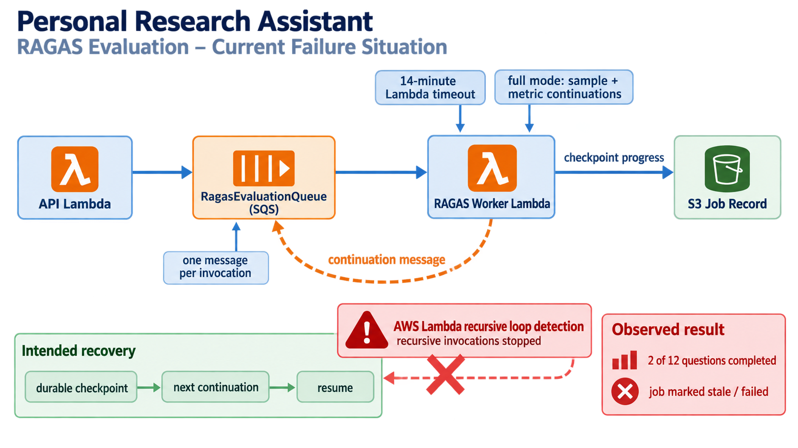
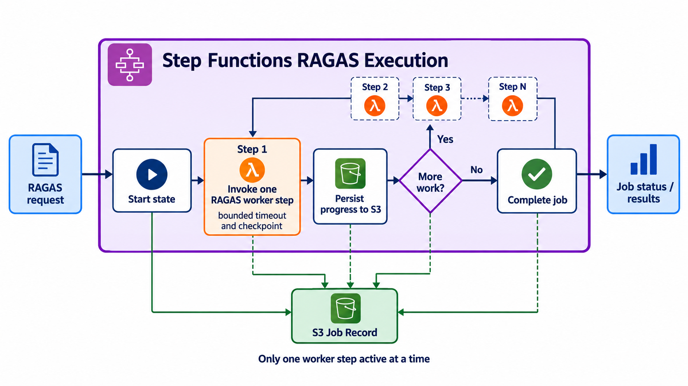

# RAGAS Step Functions Recovery

## Purpose

This document records the former recursive SQS failure and the Step Functions
replacement now implemented in the repository. Deployment and live-stack validation
remain separate operational steps.

## Historical Failure

The retired design used the RAGAS worker as both the SQS consumer and continuation
publisher. After each bounded operation, the worker sent another message to the same
queue that invoked it:

```text
API Lambda -> RAGAS queue -> RAGAS worker Lambda
                              -> S3 checkpoint
                              -> same RAGAS queue
```

That Lambda -> SQS -> Lambda chain could trigger AWS Lambda recursive-loop detection.
A job could retain valid partial results in S3 while later questions never started.
Disabling recursive-loop protection was rejected because it would increase the risk
of runaway invocations and unexpected cost.



## Implemented Architecture

SQS remains the asynchronous entry point, but it carries only the initial job. A
dedicated starter Lambda begins an idempotently named Standard Step Functions
execution. The state machine owns every continuation:

```text
API Lambda -> RAGAS start queue -> starter Lambda -> Step Functions
                                                   -> status checkpoint
                                                   -> bounded RAGAS worker step
                                                   -> inspect status
                                                        running   -> next step
                                                        completed -> success
                                                        cancelled -> success
                                                        failed    -> failure
```

The worker is not connected to the start queue and does not receive that queue URL.
When `external_orchestrator=true`, it returns its compact status to Step Functions and
never publishes a continuation. The S3 job record remains authoritative for question
state, generated samples, final compressed contexts, metric results, cancellation,
progress, and errors.



## Bounded Worker Contract

Each worker invocation performs one paid boundary:

1. Retrieve once, generate one answer, and persist the sample for one question; or
2. Evaluate one requested RAGAS metric for an already persisted sample; and
3. Checkpoint the updated state before returning.

Full mode runs metrics sequentially: faithfulness, context precision, context recall,
answer relevancy, and answer correctness. Citation correctness is calculated when
citation data is available. There is no parallel metric fan-out, no repeated answer
generation between metrics, and no extra normal-chat model call.

The current worker controls are:

- 14-minute Lambda timeout with a 60-second scheduling reserve;
- 120-second timeout per metric evaluation;
- reserved concurrency of one;
- Gemma 3 12B-only answer routing by default;
- durable S3 checkpoint after each successful paid boundary;
- cancellation checks before paid work and between steps;
- no LangSmith reporting from evaluation workers.

## Capacity Admission

Reserved concurrency of one is an intentional spend limit. If another RAGAS execution
already owns the worker, Lambda returns `Lambda.TooManyRequestsException`. Step
Functions catches that service error and invokes the lightweight status-checkpoint
Lambda. That helper performs only an S3 read/write, records `capacity_wait`, and
increments the wait count without retrieval, embeddings, generation, or judge calls.

The state machine then waits two minutes and retries the bounded worker step. After 60
capacity waits, the checkpoint helper stores an explicit capacity-timeout failure and
the execution ends as failed. This turns ordinary concurrency contention into a visible
queued wait instead of a misleading stale-worker message.

## Failure, Retry, and Cancellation

Detailed phase and metric state stays in S3; the Step Functions payload remains small.
If a worker invocation times out or fails after a prior checkpoint, a later bounded
step resumes from the last durable state rather than repeating completed paid work.
Invalid or missing metric scores are recorded at the affected metric/question level.

The browser requests cancellation by changing the job record to `cancel_requested`.
Before the next paid operation, the worker changes that state to `cancelled`; Step
Functions then exits through its cancelled terminal state. A completed, failed, or
cancelled duplicate invocation is acknowledged idempotently.

## Preserved Contracts

The migration changed orchestration only. It preserves:

- `POST /rag/evaluate/ragas`, status polling, cancellation, and response schemas;
- the isolated evaluation corpus and checked-in dataset contract;
- retrieval, final-context compression, answer generation, and model routing;
- the separate retrieval-only performance evaluation path;
- S3 job-record schemas and question/metric checkpoints;
- the one-worker cost ceiling and one-paid-operation step size.

## Validation Checklist

- A full 12-question browser run completes without a recursive-loop alert.
- SQS invokes only the starter Lambda for the initial job.
- Step Functions invokes one bounded RAGAS worker step at a time.
- Progress is visible in S3 after every successful paid operation.
- Capacity contention is reported as a two-minute retry wait with a visible count.
- A forced timeout resumes from the latest durable checkpoint.
- Cancellation stops before the next paid operation.
- No worker invocation publishes to its own event source.
- Retrieval-only evaluation and normal chat behavior remain unchanged.
